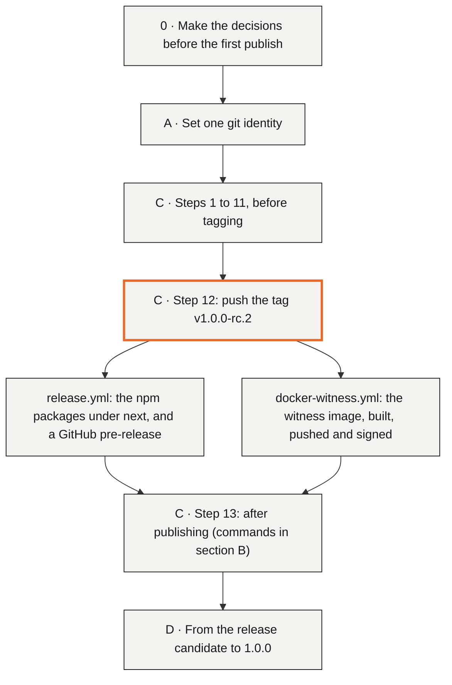
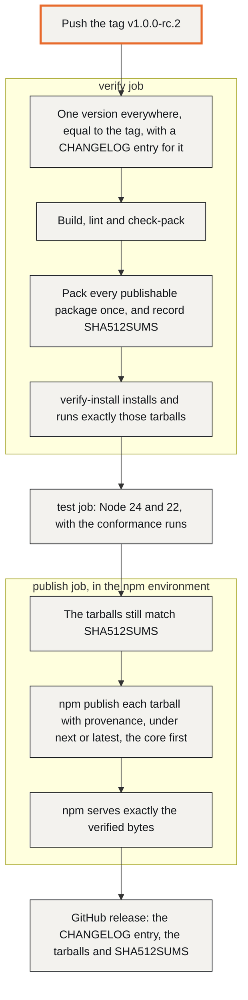

# Release checklist

This is the list a maintainer works through, in order, to publish IronTrellis (formerly Continuity): first the release candidate 1.0.0-rc.2, then 1.0.0. Everything goes out at one version: eleven npm packages, the Python package, the witness container image and the two MCP Registry entries. (The Python package is the one exception to the shared version; see section C, step 1.)

Pushing a version tag starts two GitHub workflows. `release.yml` publishes the npm packages and a GitHub release; `docker-witness.yml` publishes the witness image. A person does the rest: the decisions in section 0, the identity and accounts the workflows rely on (sections A and B), the checks before tagging, the Python and MCP Registry uploads, and the clean-up afterwards (section C).

## Why the order matters

Two things can't be taken back once they are published:

- **Names.** A published npm name cannot be taken back. If the name has to change, it changes before the first publish (section 0, item 1).
- **The history format.** Publishing 1.0.0-rc.2 releases format 2. Histories written by 1.0.0-rc.2 keep their verdicts: later versions read them exactly as 1.0.0-rc.2 does, or refuse them, and rule fixes after 1.0.0-rc.2 come as a new format.

Two of the items fix problems the September 2026 evaluation found in the Continuity repository and its npm packages: commits under nine author identities (section A), and a `latest` tag that pointed at an old preview, so the quickstart failed when followed literally (section B). They come first because they are cheap, and because first impressions happen once.



## 0. Decisions before the first publish

1. **Name clearance.** `IronTrellis` has not been cleared against trademark registers (`brand/README.md` says so). Search USPTO, EUIPO and WIPO for `IronTrellis` and `Iron Trellis` in classes 9 and 42, and check the npm scope and unscoped names, the PyPI name, the GitHub name and the domains. If the name fails, the rename is mechanical (package names, commands, `server.json`, the brand kit), but it must happen before the first publish: a published npm name cannot be taken back.

2. **npm scope and token.** Confirm that RAmEx Labs owns `@ramex-labs`, that the unscoped `irontrellis` (the CLI) is free, and who holds `NPM_TOKEN` (an automation token in the `npm` environment). The token must be able to publish **new** packages in the scope, because every package is new under its IronTrellis name, `@ramex-labs/irontrellis-witness` included; a granular token can be limited to existing ones. Provenance requires publishing from the public repository through `release.yml`.

3. **Repository.** Create `zerohourzulu/irontrellis`, or transfer and rename `zerohourzulu/continuity` and make this tree its new default branch (the redirect from the old name is then automatic). Either way, archive the Continuity history:
   - a final tag;
   - a one-paragraph notice at the top of its README, pointing at IronTrellis and docs/MIGRATION.md;
   - the archived flag on GitHub.

   Do not delete it: it is the provenance of the reference engine and the legacy vectors.

4. **Older deployments.** New histories are format 2. Existing `continuity-event/0.2` and format-1 files open read only: every question and `verify` works, and every write is refused with `FORMAT_READ_ONLY`. Migrate each one (`irontrellis migrate <source> <target>`, with `--accept-unpinned-source` for a Continuity file, after checking the source against a copy you trust), and point hooks, gateways and scripts at the target. Write the plan for each deployment into its runbook.

5. **Rekor.** The Rekor anchor is experimental and has never run against a live log. Exercise it against the public instance (or a private one), and keep or drop the experimental label for 1.0.0 (section D). Chain anchoring has its own limit: 1.0.0-rc.2 doesn't verify chain anchors itself (its anchor check produces no report), and the separate tools used for the demonstration anchoring records report `TRUSTED_NODE` only ([known issues 54 and 71](docs/records/KNOWN-ISSUES-r2.5.md)).

6. **Codex ask semantics.** Codex CLI does not honor `permissionDecision: "ask"`, so the hook turns an ask into `askFallback` (deny by default). Decide whether that default stays, and whether to report the gap upstream.

7. **The hook's boundary.** On one OS user the hook is a tripwire, not a boundary ([docs/SECURITY.md](docs/SECURITY.md) §2). Decide whether to automate and test the separate-OS-user or signer set-up ([docs/CUSTODY.md](docs/CUSTODY.md) §8), or to keep documenting it as the operator's job. Two more limits of the 1.0.0-rc.2 hook bear on this:
   - it needs the single owner key beside the history (`<history>.owner-key.json`), so it can't yet be used with multi-signature or offline owner keys;
   - its protective rules, which guard IronTrellis's own files and commands, deny a call before the history is opened, so 1.0.0-rc.2 doesn't record those refusals.

8. **Witness defaults per deployment.** At least one remote witness must run in a trust domain the agent hosts cannot write (docs/WITNESS.md §4: DNS and TLS, backups, the checkpoint key offline, monitoring), with its verifier key and registration tokens distributed out of band. Choose each binding's policy: `quorum`, `maxUnwitnessedEvents` and `requireOnOpen` are signed into the binding, and `mode` is kept beside it. `init --witness` takes only `--mode` and `--no-require-on-open` (quorum 1 and at most 1,000 unwitnessed events by default); `witness add` also takes `--quorum` and `--max-unwitnessed`.

   When you set `maxUnwitnessedEvents`, know that hook and gateway writes (refusals and effects) neither count toward it nor are refused by it. They are appended without an owner attestation or a witness statement, and stay unattested and unwitnessed until the owner's next write or checkpoint.

9. **The playground and website.** They are not in this repository. Decide where they live, and point them at `@ramex-labs/irontrellis`.

## A. One git identity

**The problem.** The Continuity repository's 31 commits were made under nine author identities:

- four placeholder addresses: `Continuity contributors <staging@continuity.invalid>`, `RAmEx Labs <development@continuity.invalid>`, `Continuity Root Developer <continuity@local.invalid>` and `Continuity staging <staging@continuity.invalid>`;
- a personal name with a local machine hostname (`USER@MACHINE.lan`);
- two `users.noreply.github.com` addresses;
- and two others.

Placeholder `.invalid` addresses cannot be signed or verified, a hostname leaks the machine, and a personal name contradicts the intent to publish as RAmEx Labs. Open-source maintainers read this as a repository that is not looked after.

**The solution.** If the public repository starts from a fresh history, its first commit can already be right. Use one identity for every commit: `RAmEx Labs <EMAIL>`, where the owner fills in the address. The history already contains `opensource@ramex.com` as one candidate. Whichever address is chosen must be one the organization controls and can add to a GitHub account, so that commits are attributed and signatures verify.

Set it for this repository, not globally, so personal work elsewhere is unaffected:

```sh
cd irontrellis
git config user.name  "RAmEx Labs"
git config user.email "EMAIL"
```

Sign every commit. SSH signing is the least setup if the key already exists; GPG works the same way, with `gpg.format` unset and `user.signingkey` set to the key id.

```sh
git config gpg.format ssh
git config user.signingkey ~/.ssh/irontrellis-release.pub     # add the same public key to GitHub as a *signing* key
git config commit.gpgsign true
git config tag.gpgsign true
```

If Continuity's history is ever imported (for example, to keep the reference engine's provenance in one place), unify the old identities with a `.mailmap` at the repository root. It rewrites how `git log` and `git shortlog` display them, without rewriting the commits:

```
RAmEx Labs <EMAIL> Continuity contributors <staging@continuity.invalid>
RAmEx Labs <EMAIL> Continuity staging <staging@continuity.invalid>
RAmEx Labs <EMAIL> RAmEx Labs <development@continuity.invalid>
RAmEx Labs <EMAIL> Continuity Root Developer <continuity@local.invalid>
RAmEx Labs <EMAIL> Continuity Release Preparation <continuity@users.noreply.github.com>
RAmEx Labs <EMAIL> Continuity <continuity@users.noreply.github.com>
RAmEx Labs <EMAIL> RAmEx Labs <zerohourzulu@users.noreply.github.com>
RAmEx Labs <EMAIL> RAmEx Labs <opensource@ramex.com>
RAmEx Labs <EMAIL> <USER@MACHINE.lan>
```

**Make CI refuse anything else.** The `commit-identity` job in `.github/workflows/ci.yml` already does this; it only needs the identity. Put it in `.github/allowed-identities.txt`, one per line, as part of the first commit:

```
RAmEx Labs <EMAIL>
```

On every push and pull request, the job lists the commits in a range and fails if any author **or** committer email is not in the file:

| Event | Commits checked |
|---|---|
| A pull request | `base..head` |
| A push to an existing branch | `before..after` |
| A new branch, or a force push | Everything reachable |

Only the address inside `<…>` is compared, case-insensitively. The job reads the raw `%ae` and `%ce`, so a `.mailmap` cannot launder an identity. While the file lists no identities (comments only, as it is now), the job passes with a notice that the check was skipped, so fill it in before the first push.

The job checks identities, not signatures. Signing is still recommended: turn on the branch protection rules "Require signed commits" and "Require linear history" on the default branch, which GitHub enforces on push. If you want CI to check signatures as well, add a step like this to the `commit-identity` job. It needs the signers' public keys to be known to git on the runner for `G`; `U` means a good signature whose key git has no trust information for.

```yaml
      - name: every commit is signed
        run: |
          set -euo pipefail
          range="${{ github.event.pull_request.base.sha || github.event.before }}..${{ github.event.pull_request.head.sha || github.event.after }}"
          if git log --format='%H %G?' "$range" | grep -v ' [GU]$'; then echo "unsigned commits above"; exit 1; fi
```

Squash-merging through the GitHub UI produces commits authored by the PR author and committed by GitHub. So either merge with fast-forward from a signed local branch, or list `GitHub <noreply@github.com>` in `.github/allowed-identities.txt` and accept that merge commits carry the GitHub-verified identity of the merger.

## B. npm dist-tags, deprecation and provenance

**The problem.** At the time of the evaluation, `latest` for `@ramex-labs/continuity`, `@ramex-labs/continuity-mcp` and `@ramex-labs/continuity-mcp-gateway` pointed at `0.3.0-preview.6`, and for `@ramex-labs/continuity-remote` at `0.3.0-preview.1`. The documentation described preview.8 and preview.9, and only the `preview` tag was current. A plain `npm install @ramex-labs/continuity` therefore gave a package without the `/attempts` entry point the examples used, and the quickstart failed when followed literally. The packages carried registry signatures but no provenance attestations.

**The solution.** Pre-releases go under `next`, never `latest`; `latest` moves only when a stable version is published. The workflows do both automatically, and pick the tags from the version:

| Version | npm dist-tag | Witness image tags | GitHub release |
|---|---|---|---|
| With a hyphen, such as `1.0.0-rc.2` | `next` | `1.0.0-rc.2` and `next` | Pre-release |
| Stable, such as `1.0.0` | `latest` | `1.0.0`, `1.0` and `latest` | Release |

`release.yml` packs every publishable package once, checks exactly those tarballs, and publishes those same files. It never rebuilds or repacks:



The install check in the verify job is `scripts/verify-install.mjs --tarballs`. The publish step runs `npm publish <file>.tgz --provenance --access public --tag …`, after checking each tarball's sha512 against the verified list. Provenance needs `id-token: write` (already in the workflow), a public repository, and the `NPM_TOKEN` secret. The attestation links the tarball to the exact commit and workflow run, and `npm audit signatures` verifies it on the consumer's side. Publishing from a laptop would produce no attestation; do not.

To publish the release candidate:

```sh
node scripts/check-versions.mjs            # 1.0.0-rc.2 everywhere
git tag -s v1.0.0-rc.2 -m "IronTrellis 1.0.0-rc.2"
git push origin v1.0.0-rc.2                # release.yml: verify → test → publish under next → GitHub pre-release
```

Then verify what the registry serves, for every package:

```sh
for p in @ramex-labs/irontrellis irontrellis @ramex-labs/irontrellis-hooks @ramex-labs/irontrellis-mcp-gateway @ramex-labs/irontrellis-mcp @ramex-labs/irontrellis-witness @ramex-labs/irontrellis-agent-shims @ramex-labs/irontrellis-anchor-outbox @ramex-labs/irontrellis-managed-agents @ramex-labs/irontrellis-remote @ramex-labs/irontrellis-remote-tools; do
  npm view "$p" dist-tags
done
```

`npm audit signatures` checks the packages installed in the current project, not one named on its command line, so check the signatures and provenance from a scratch project:

```sh
mkdir irontrellis-sigcheck && cd irontrellis-sigcheck && npm init -y
npm install @ramex-labs/irontrellis@1.0.0-rc.2 irontrellis@1.0.0-rc.2 @ramex-labs/irontrellis-hooks@1.0.0-rc.2 @ramex-labs/irontrellis-mcp-gateway@1.0.0-rc.2 @ramex-labs/irontrellis-mcp@1.0.0-rc.2 @ramex-labs/irontrellis-witness@1.0.0-rc.2 @ramex-labs/irontrellis-agent-shims@1.0.0-rc.2 @ramex-labs/irontrellis-anchor-outbox@1.0.0-rc.2 @ramex-labs/irontrellis-managed-agents@1.0.0-rc.2 @ramex-labs/irontrellis-remote@1.0.0-rc.2 @ramex-labs/irontrellis-remote-tools@1.0.0-rc.2
npm audit signatures
```

Expected: `next: 1.0.0-rc.2` and no `latest` (or, later, `latest` at a stable version). If a tag is ever wrong, fix it with `npm dist-tag`; never republish to move a tag.

When 1.0.0 is published, the workflow sets `latest` itself. For that moment, or whenever `latest` has to be promoted by hand for any reason, these are the exact commands:

```sh
npm dist-tag add @ramex-labs/irontrellis@1.0.0 latest
npm dist-tag add irontrellis@1.0.0 latest
npm dist-tag add @ramex-labs/irontrellis-hooks@1.0.0 latest
npm dist-tag add @ramex-labs/irontrellis-mcp-gateway@1.0.0 latest
npm dist-tag add @ramex-labs/irontrellis-mcp@1.0.0 latest
npm dist-tag add @ramex-labs/irontrellis-witness@1.0.0 latest
npm dist-tag add @ramex-labs/irontrellis-agent-shims@1.0.0 latest
npm dist-tag add @ramex-labs/irontrellis-anchor-outbox@1.0.0 latest
npm dist-tag add @ramex-labs/irontrellis-managed-agents@1.0.0 latest
npm dist-tag add @ramex-labs/irontrellis-remote@1.0.0 latest
npm dist-tag add @ramex-labs/irontrellis-remote-tools@1.0.0 latest
```

**Deprecate the old packages,** so that every install and every `npm view` says where to go. Deprecating a whole package (no version range) marks every version, and the message is shown on install:

```sh
npm deprecate @ramex-labs/continuity             "Continuity is now IronTrellis: npm install @ramex-labs/irontrellis — see https://github.com/zerohourzulu/irontrellis/blob/main/docs/MIGRATION.md"
npm deprecate @ramex-labs/continuity-mcp         "Continuity is now IronTrellis: npm install @ramex-labs/irontrellis-mcp — see https://github.com/zerohourzulu/irontrellis/blob/main/docs/MIGRATION.md"
npm deprecate @ramex-labs/continuity-mcp-gateway "Continuity is now IronTrellis: npm install @ramex-labs/irontrellis-mcp-gateway — see https://github.com/zerohourzulu/irontrellis/blob/main/docs/MIGRATION.md"
npm deprecate @ramex-labs/continuity-remote      "Continuity is now IronTrellis: npm install @ramex-labs/irontrellis-remote — see https://github.com/zerohourzulu/irontrellis/blob/main/docs/MIGRATION.md"
```

Do not unpublish them: existing installs and the evaluation's reproduction script depend on the exact versions. Leave the old `preview` tags where they are; after deprecation they are documentation, not a path anyone should take.

**Reserve the unscoped names the docs mention.** The commands `irontrellis-hook`, `irontrellis-witness`, `irontrellis-mcp-gateway` and `irontrellis-evidence` are bins of scoped packages. A plain `npx irontrellis-hook` outside a project therefore resolves to an unscoped npm package of that name, which anyone could register. The docs recommend `npx --no-install …` or `npx -p @ramex-labs/irontrellis-hooks …`, but reserve the four names before or with the release: a placeholder package under each, owned by the same account, whose README and `npm deprecate` message point at the scoped package. (`irontrellis` itself is the CLI's real package.)

**The witness container image.** On the same `v*` tag, `.github/workflows/docker-witness.yml`:

1. builds `ghcr.io/zerohourzulu/irontrellis-witness` for linux/amd64 and linux/arm64, and smoke-tests it;
2. in its publish job (in the `ghcr` environment, with `packages: write` and `id-token: write`), pushes it with SLSA provenance and an SBOM;
3. signs it with cosign (keyless, GitHub OIDC);
4. smoke-tests the pushed image by digest.

Its tags mirror the npm dist-tags (the table above). Before the tag, create the `ghcr` environment (add protection rules if a release needs an approval), and pin the base image by digest (`NODE_IMAGE` in the workflow; the header of `packages/witness/deploy/Dockerfile` gives the procedure). After the first push, make the package public in the organization's GitHub Packages settings and link it to the repository. Then verify what was pushed:

```sh
cosign verify ghcr.io/zerohourzulu/irontrellis-witness:1.0.0-rc.2 \
  --certificate-identity https://github.com/zerohourzulu/irontrellis/.github/workflows/docker-witness.yml@refs/tags/v1.0.0-rc.2 \
  --certificate-oidc-issuer https://token.actions.githubusercontent.com
docker buildx imagetools inspect ghcr.io/zerohourzulu/irontrellis-witness:1.0.0-rc.2
```

## C. Before tagging

In this order. Each step is a command or a yes/no; a "no" stops the release.

1. **Version.** Every publishable `package.json`, both `server.json` files, `python/pyproject.toml` and `python/src/irontrellis/__init__.py` carry the release version (`1.0.0-rc.2`; for a stable release, `1.0.0`). The Python package is the exception: it is frozen at format 1 and keeps `1.0.0rc1` until it is ported to format 2, and `check-versions` expects that. `node scripts/check-versions.mjs` passes: one version (the Python one in its PEP 440 spelling, the `server.json` files and their npm package versions included), one `engines`, one licence, the shipped files listed, and the newest CHANGELOG entry for this version.

2. **CHANGELOG.** `CHANGELOG.md` has a `## [<version>] - <date>` entry at the top. `release.yml` refuses to publish without it (`grep "^## \[<version>\]"`) and uses that entry as the GitHub release body. Set its date to the day of the tag. For 1.0.0-rc.2, the entry also records the sha256 of each format-2 conformance manifest at the tag (`MANIFEST.json` in `conformance/v2/`, `v2-g3/`, `v2-regenerated/`, `v2-owner-policy/` and `v2-human-attestation/`); every later build must give identical results on that corpus. Make the launch-time text edits of known issue 67 (README.md, CHANGELOG.md) in the same commit.

3. **Packing.** `node scripts/check-pack.mjs` passes. Each `npm pack --dry-run` lists only `dist/`, `README.md`, `LICENSE`, `NOTICE` and `package.json`, plus `bin/` for the CLI, the hooks and the witness, `server.json` for the two MCP packages, and `docs/` for the gateway. `remote` and `remote-tools` ship their root `*.mjs` and `*.d.mts` modules, `LICENSING.md` and `THIRD-PARTY-NOTICES.md` instead of `dist/`. Nothing under `test/`, no `.tsbuildinfo`, no history scratch files.

4. **Fresh-clone CI green.** On a clean clone, these pass:

   ```sh
   pnpm install --frozen-lockfile && pnpm -r build && pnpm -r lint && pnpm -r test
   pnpm test:async-signers
   pnpm verify:install
   node scripts/check-coherence.mjs
   ```

   On a stock Ubuntu 24.04 machine, `pnpm verify:install` first needs the `python3.12-venv` package: run `apt install python3.12-venv` as root, or with `sudo` ([docs/PLATFORMS.md](docs/PLATFORMS.md), section 1).

   CI must be green on Linux and macOS with Node 24 and 22, on Windows, and in the Python-only job, the Vault job and `verify install`. (The `engines` field is `>=22.18.0`; do not claim Node 26 until it is in the matrix.) Watch the jobs that have never run on GitHub before through their first run: Windows, `verify install` on macOS and on Node 22.18.0, the Docker arm64 build and the GHCR push, the Vault service container, the asynchronous-signer and two-OS-user steps, and `release.yml` itself.

5. **Conformance matrix.** `pnpm test:conformance:all`: the node and Python adapters match every vector of both suites, and the reference adapter every legacy vector (the counts are in conformance/README.md). `node conformance/transparency/generate.mjs --check` reports the committed vectors up to date. `pnpm conformance:check` (the format-1 generator) still fails at one vector, `replay/v1/rejects-shortened-migrated-prefix`, for a known reason ([known issue 19](docs/records/KNOWN-ISSUES-r2.5.md)); `node scripts/check-frozen-vectors.mjs` must pass, and any other `conformance:check` failure stops the release.

6. **Python.** Run the tests:

   ```sh
   cd python && pip install -e ".[test]" && pytest
   ```

   From the repository root, build with the pinned tooling, which is what `scripts/verify-install.mjs` builds, installs and checks:

   ```sh
   python3 -m venv .rel && .rel/bin/pip install --require-hashes -r scripts/requirements-release.txt && .rel/bin/python -m build --no-isolation python
   ```

   `twine check --strict` passes. Upload exactly those files (check their sha256 before `twine upload`), with `twine upload python/dist/*` (from the repository root) or `uv publish`, using a PyPI trusted publisher or a project-scoped API token, and to TestPyPI first for the release candidate (`--repository testpypi`). PyPI has no dist-tags: `pip install irontrellis` skips a pre-release, and `pip install --pre irontrellis` gets it.

7. **MCP Registry.** `packages/mcp-gateway/server.json` and `packages/mcp-evidence/server.json` carry the release version and the names `io.github.zerohourzulu/irontrellis-gateway` and `io.github.zerohourzulu/irontrellis-evidence`, with the npm identifiers `@ramex-labs/irontrellis-mcp-gateway` and `@ramex-labs/irontrellis-mcp` (`check-versions` checks all of it). After the npm publish, publish both with the registry's `mcp-publisher` (GitHub authentication for the `io.github.zerohourzulu` namespace). The old `continuity-gateway` and `continuity-evidence` entries stay listed; update their descriptions to point at the new entries if the registry allows it.

8. **Domains and DNS.** Register `irontrellis.dev`, `irontrellis.io` and `irontrellis.ai`, whichever are available; `.dev` first, since it forces HTTPS and is the developer convention. Point them at the site once it exists; until then, a redirect to the GitHub repository is enough. Add the chosen primary domain to the npm package `homepage` fields and to `brand/`.

9. **GitHub.** Set up the repository (section 0, item 3) with the description "Authority, duties and succession for AI agents. Agents change. The structure holds." Then:
   - enable Discussions, if RFCs are to live there;
   - enable private vulnerability reporting (SECURITY.md relies on it);
   - turn on signed-commit and linear-history protection on the default branch;
   - create the `npm` environment with the `NPM_TOKEN` secret, and the `ghcr` environment (section B);
   - confirm that `id-token: write` is allowed for provenance.

10. **Social preview.** Upload `brand/social/irontrellis-social-card.png` (1280 × 640) as the repository's social preview in Settings. The README already shows `brand/social/irontrellis-readme-banner.png` (and `@2x`) at the top; check that it renders on the public repository.

11. **Name clearance.** Section 0, item 1, is done and recorded. The npm scope, the unscoped `irontrellis` and the four reserved names (section B), and PyPI `irontrellis`, are confirmed available or owned. This is the last gate before the first publish: a rename after publishing cannot be undone on npm.

12. **Tag and publish.** Follow section B. The tag starts `release.yml` (the eleven npm packages under `next`, and the GitHub pre-release with SHA512SUMS) and `docker-witness.yml` (the image). Watch both, then run the `npm view` loop and the `cosign verify` yourself.

13. **After publishing.** Deprecate the old packages and reserve the unscoped names (section B). Update the MCP Registry (step 7). Archive the Continuity repository with a pointer (section 0, item 3). Announce nothing until `npx irontrellis demo` works from a clean machine against the published package. Then add to the release notes the core tarball's sha256 (known only once the verify job has packed it), the hash of the Lean proof edition and the identity of the independent checker, so the launch pin is complete.

## D. From the release candidate to 1.0.0

The release candidate exists to find out what the published packages do on machines that are not ours. Promote to 1.0.0 when all of these hold:

- [ ] The eleven `next` packages, the PyPI pre-release and the witness image have been installed and run from a clean machine, by someone other than the person who published them.
- [ ] The Rekor anchor has been exercised against a live log, or stays explicitly experimental (section 0, item 5).
- [ ] At least one remote witness has run in another trust domain, for real histories.
- [ ] The untested signer backends (1Password, gpg-agent with a YubiKey, the cloud KMS examples) have been tried, or stay documented as untested.
- [ ] The hook has been used through a real Claude Code, Codex and Cursor session, on the published wire formats.
- [ ] No issue affecting revocation, rollback detection or a conformance vector is open.

Then:

1. bump every version to `1.0.0` (Python `1.0.0`);
2. write the CHANGELOG entry;
3. tag `v1.0.0`;
4. let `release.yml` publish under `latest`, and `docker-witness.yml` tag the image `latest`.

*Last reviewed: 24 October 2026. This page is revisited at each release.*
