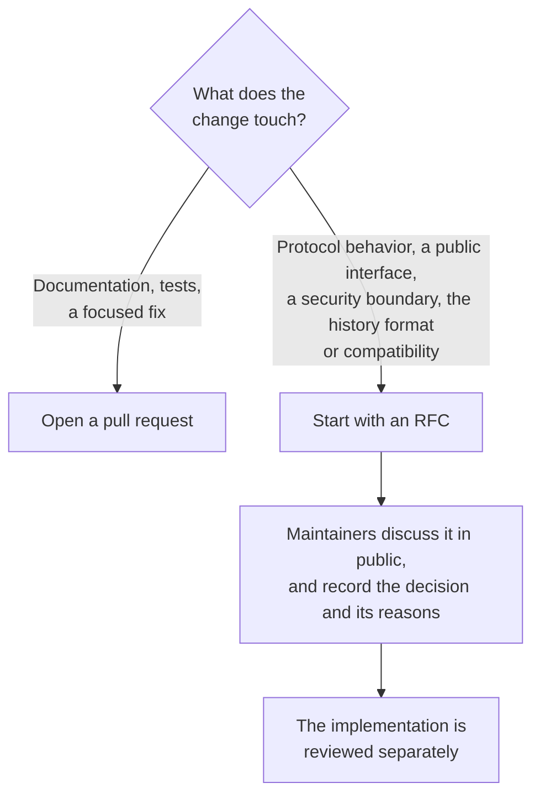

# Contributing to IronTrellis

IronTrellis (formerly Continuity) is a signed, replayable record of authority, duties and succession for AI agents. People rely on it to give the same answer to the same question about the same history, every time, so one rule comes before all others.

**Authorization must stay deterministic:** a change that silently broadens a power, or that makes a decision depend on anything outside the history, is a bug even when every test is green.

Report vulnerabilities privately, as [SECURITY.md](SECURITY.md) describes; do not open a public issue for anything exploitable. The [code of conduct](CODE_OF_CONDUCT.md) applies in every project space.

## Build and test

| Requirement | Version |
| --- | --- |
| Node.js | 22.18 or later. CI tests 24, the primary version, and 22. |
| pnpm | 11.19.0, the root `packageManager` pin; `corepack enable` picks it up. |
| Python | 3.11 or later, for the conformance runner and the Python package. |

The everyday loop:

```sh
pnpm install --frozen-lockfile     # workspace install; engineStrict is on (pnpm-workspace.yaml)
pnpm -r build                      # tsc → dist/ for each package that builds
pnpm -r test                       # node --test per package (core is the longest: differential tests)
```

Tests run against the TypeScript sources with `--experimental-strip-types`, so a `pnpm build` is not needed before `pnpm test` inside a package; packages that depend on `@ramex-labs/irontrellis` do need core's `dist/` and get it from `pnpm -r build`.

Before a pull request, run the other checks too:

| Command | What it checks |
| --- | --- |
| `pnpm -r lint` | `tsc --noEmit` |
| `pnpm test:conformance` | The IronTrellis node adapter against the legacy and format-1 vectors (CI also runs it against each format-2 suite by name) |
| `node scripts/check-frozen-vectors.mjs` | The frozen vectors are unchanged |
| `pnpm test:conformance:legacy` | The frozen legacy vectors (`conformance/README.md` has the counts) |
| `pnpm test:python` | The Python verifier |
| `node scripts/check-versions.mjs` | One version and one `engines` field across every publishable package and both `server.json` files; the Python package stays at its frozen `1.0.0rc1` |
| `node scripts/check-coherence.mjs` | Public docs, help text and comments describe the release as it is |

### Frozen material

Frozen material is what the new engine is checked against, so it is never edited to make a test pass. Two cases matter most when you change the engine:

| What | The rule |
| --- | --- |
| The frozen Continuity reference, `packages/reference-0.2` | The differential tests in `packages/core/test` compare the new engine with it. Never edit the reference; if it is wrong, add the deliberate divergence to the test and to the list of deliberate departures in [docs/MIGRATION.md](docs/MIGRATION.md). |
| The legacy conformance vectors, `conformance/legacy/` | They are byte-frozen; a mismatch is a finding, not something to regenerate. |

### Tests that need a particular environment

| Tests | What they need | Without it |
| --- | --- | --- |
| The custody tests | A real `ssh-agent` and Unix sockets they can `bind`. A socket path is limited to 103 bytes on macOS (107 on Linux), so they need a short `TMPDIR` or a writable `/tmp`, which the helpers fall back to when `TMPDIR` is too deep (`packages/core/test/helpers/ssh-agent.mjs`). | A sandbox that refuses Unix-socket `bind` fails them as `listen EPERM` or "ssh-agent exited at start" ([docs/PLATFORMS.md](docs/PLATFORMS.md)). |
| Two core differential tests, `format2-budgets` and `format2-state` | They compare the engine with the format-2 generator's oracle, which loads the core of the previous release candidate, built: set `IRONTRELLIS_RC1_DIST` to that tree's `packages/core/dist` to run them. | They skip and say so ([conformance/v2/README.md](conformance/v2/README.md)). |

## Proposing a change



The RFC process and template are in [docs/RFC.md](docs/RFC.md).

A pull request explains the problem, the changed behavior and how it was verified. It is not merged just because CI passes.

## One git identity

Commits and tags are made with **one** git identity per contributor: the same `user.name` and `user.email` across every machine, matching the GitHub account that opens the pull request, with commit signing on. Release tags are signed by a maintainer. Mixed identities muddle the provenance and `Co-Authored-By` trail. Once `.github/allowed-identities.txt` lists the project's identities, CI refuses any commit whose author or committer is not on it ([CHECKLIST.md](CHECKLIST.md), section A).

## Commit messages

Conventional commit prefixes, imperative mood, subject <= 72 characters:

| prefix | use |
| --- | --- |
| `feat:` | a new capability visible to users of a package |
| `fix:` | a behavior correction |
| `docs:` | documentation only |
| `test:` | tests only (including differential and conformance vectors) |
| `refactor:` | no behavior change |
| `perf:` | performance with no behavior change (attach the benchmark) |
| `build:` / `ci:` | tooling, workspace, workflows |
| `chore:` | everything else (dependency bumps, release housekeeping) |

Scope in parentheses when it helps: `feat(cli): add irontrellis migrate`. A breaking change carries `!` after the prefix and a `BREAKING CHANGE:` footer, and needs an RFC.

## Writing style

For documentation and anything else written for readers:

- American spelling: "behavior", "organization", "color".
- Dates: day, month, year, with a leading zero: 01 January 2026. Never month first.
- Times: 24-hour, with a time zone: 01:23 PDT, or 08:23 UTC.
- Specifications and machine-readable output use ISO 8601: 2026-01-01, and 2026-01-01T08:23:00Z in UTC.
- Dated records in docs/records/ and docs/history/ are kept as they were written.

## License

IronTrellis is Apache-2.0. Contributions intentionally submitted for inclusion are covered by Apache-2.0 section 5 unless explicitly stated otherwise. Preserve third-party notices ([NOTICE](NOTICE), [THIRD-PARTY-NOTICES.md](THIRD-PARTY-NOTICES.md)).

*Last reviewed: 24 October 2026. This page is revisited at each release.*
