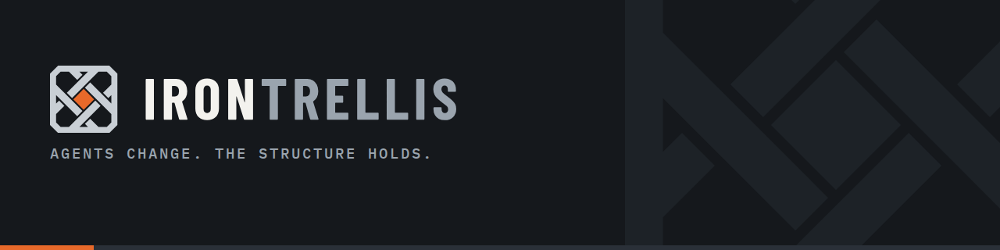
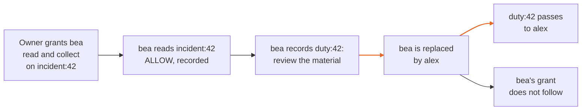

<picture>
  <source srcset="brand/social/irontrellis-readme-banner.png 1x, brand/social/irontrellis-readme-banner@2x.png 2x">
  
</picture>

# IronTrellis™

**Agents change. The structure holds.**

Authority, duties and succession for AI agents.

IronTrellis (formerly Continuity) is open-source software that keeps a checkable, append-only record of authority for AI agents. It records grants, revocations and duties; answers whether an action is allowed, denied or cannot be decided, and why; and shows which duties survive when an agent is replaced. It works alongside policy engines such as Cedar and OpenFGA rather than replacing them.

This is **1.0.0-rc.2, history format 2**, a release candidate. Its first worked example is anchored on Etherlink mainnet: [chapter 1](docs/examples/chapter-1-record.md), an agent-authority scenario that plays out as a storyboard, ten working days of an AI assistant at an invented company, including a refused attempt to copy files out. Finality for that record is reported by nodes we chose. A stronger mode, consensus-verified anchoring, is defined and partly vectored but is not part of this release, because the code that confirms finality against independently run Tezos nodes is not finished yet. Installation checks and passing tests do not establish production readiness, public deployment or certification.

## Start here

| If you want to | Go to |
|---|---|
| Try it with your own coding agent | [The agent hook](packages/hooks/README.md) runs Claude Code, OpenAI Codex CLI or Cursor under IronTrellis. To see it first, run the demo in [See it work](#see-it-work). |
| Read the model and the format | [The specification](docs/spec/SPEC-IRONTRELLIS-CORE-v2-EFFECTIVE-r5.2.md) and the [conformance suites](docs/CONFORMANCE.md) |
| Check the claims | [How IronTrellis was tested](docs/TESTING.md), the [published Lean proofs](verification/SelectLeanProofs/) and [why we check IronTrellis with Lean](docs/FORMAL-VERIFICATION.md) |
| Understand how it was built | [How this is built](docs/HOW-THIS-IS-BUILT.md) and the [historical reviews](docs/history/README.md) |
| Set it up for an organization | The [Commissioning Disclosure](docs/COMMISSIONING-DISCLOSURE.md), read and signed before commissioning, and the [Install Checklist](docs/INSTALL-CHECKLIST.md) |
| Know why it exists | [Why IronTrellis, why now](docs/WHY-IRONTRELLIS.md) and [the origin of IronTrellis](docs/ORIGIN.md) |

## Why record authority

An AI agent acts on authority that changes while it runs. Later, someone asks about one of its actions: was it allowed, at that moment, and on whose authority? Logs record what a system says it did, but rarely the authority the answer depends on. IronTrellis records the authority itself, in a signed, replayable history:

| The difficulty | What the history records |
|---|---|
| Authority changes while agents run | Each grant and revocation, owner-signed, in order |
| A session, an agent and its role can each be replaced | Sessions, agents and roles as separate records |
| Refusals and unfinished work matter too | Refusals, and duties that survive a replacement |

## See it work

Use Node.js 22.18 or later and the repository's pinned pnpm version.

```sh
pnpm install
pnpm -r build
node packages/cli/bin/irontrellis.mjs demo
```

The demo plays this story:



It then asks three questions, and prints commands to ask them yourself:

| Question | Command: what it answers |
|---|---|
| **WHY** was bea allowed to read `incident:42`? | `why`: the recorded grants behind a decision |
| Who is **RESPONSIBLE** for that action now? | `responsible`: who is attributed for an action, then and now |
| What **SURVIVES** bea? | `survives`: what outlives an agent (tenures, duties, intents) |

Asked again now, WHY answers DENY: bea's termination ended her authority; the record of what was allowed then is unchanged. An answer describes a captured history. An ALLOW answer is not a credential for a later dispatch.

## Before a real deployment

The demo creates synthetic state. For a real integration, read [the operator guide](docs/OPERATOR.md), [API](docs/API.md) and [security boundaries](docs/SECURITY.md) before choosing identities, signers and dispatch handlers. In every deployment:

- Keep owner handles, keys, history paths, trusted clocks and signer callbacks outside agent control.
- The execution path requires an admitted runtime session, current authority and a fixed adapter. Bind business identity and idempotency at the trusted host.
- When an effect's outcome is unknown, investigate the original operation; creating a new operation identifier is not recovery.

## What is in 1.0.0-rc.2

**History format 2** includes signed runtime sessions, authority and budgets, checkpoints and export views, refusals, counterparty records, reconciliation observations, and duties with handover and disposition.

**Owner approval policies** set how many owner signatures a change needs: M-of-N thresholds per type of change, power reduction by effect (`PR_eff`), separation of credentials and recovery using committed next keys. Replay honours a recovery rotation, but this release ships no tool that writes one: a deployment that sets `recovery` and loses its quorum needs an external producer of the event, which this release neither ships nor documents ([known issue 24](docs/records/KNOWN-ISSUES-r2.5.md); [owner policies](docs/reference/owner-policy.md)). The writer is planned after this release.

**The attestation policy for PHL, Proof of Human Lineage, ships in 1.0.0-rc.2.** The `ATTESTED` profile includes lapse, restoration and T1/T2 time bounds. It establishes the specified relationship to accepted attestation evidence; a key's declared class alone does not prove a physical human or a person's legal identity. See [the format guide](docs/HISTORY-FORMAT.md) and [owner-policy reference](docs/reference/owner-policy.md).

**Publishing 1.0.0-rc.2 releases format 2.** A history it writes keeps its verdicts: later versions read it exactly as 1.0.0-rc.2 does, or refuse it; rule fixes after 1.0.0-rc.2 come as a new format. Format 2 as released means challenge profile `g3`; the `frozen-r2.3` profile only verifies the frozen conformance vectors. Existing histories retain their own profile; [migration](docs/MIGRATION.md) is explicit.

| Surface | Purpose |
|---|---|
| Core and CLI | Signed history, replay, authority, queries, storage and explicit control operations |
| Hooks | Host integration; the same OS account is not an isolation boundary |
| MCP gateway | Fixed upstream tools, retained attempts, cooperative execution, HTTP and Tasks subpaths |
| Witness | Separately operated retention and comparison of authenticated heads |
| [Remote SDK](packages/remote/README.md) / [remote tools](packages/remote-tools/README.md) | Format-2 cooperative destination, transfer, recovery and tools |
| [Managed agents](packages/managed-agents/README.md) / [agent shims](packages/agent-shims/README.md) | Trusted execution adapters and framework approval/resume bindings |
| [Policy composition](integrations/policy-composition/README.md) | Cedar/OpenFGA examples alongside native authority |
| [Evidence integrations](integrations/protected-evidence-mcp/README.md) | Protected evidence MCP and [LangChain tools](integrations/langchain-evidence/README.md) |

The packaged Python verifier/evaluator is frozen at 1.0.0rc1 and the legacy/format-1 boundary; it refuses format 2 with `UNSUPPORTED_VERSION` and is not a writer. The separate spec-only format-2 checker is advisory. Do not infer whole-format parity from either name or a finite set of passing examples.

## Evidence

- **Tests.** At this commit, on Linux, every package and integration test suite passes, and `scripts/verify-install.mjs` reports 70 passed, 0 failed, 0 skipped. These are build checks, not production qualification. [Conformance](docs/CONFORMANCE.md) identifies the suites and their limits; [benchmarks](docs/BENCHMARKS.md) separates historical format-1 measurements from current format-2 claims.
- **Lean.** Selected Lean model properties have been checked; they do not prove the entire implementation, cryptography, host or external effects. [Why we check IronTrellis with Lean](docs/FORMAL-VERIFICATION.md) says what was checked and what was not; the proof sources are not in this repository yet.
- **Review.** [How this is built](docs/HOW-THIS-IS-BUILT.md) explains the evidence and human review process. [Historical reviews](docs/history/README.md) are preserved as dated evidence.

## Limits

- **The host.** IronTrellis does not confine a hostile host, undo a dispatched effect, or turn a service report into proof of business success.
- **Anchoring on a public chain** isn't verified by 1.0.0-rc.2 itself: its anchor check produces no report, and the MCP gateway takes a supplied report's mode on its producer's word ([known issues 54 and 71](docs/records/KNOWN-ISSUES-r2.5.md)).
- **Session-signed records** from the hook and the gateway stay unattested and unwitnessed until the owner's next write. The coding-agent hook needs the single owner key beside the history (no multi-signature or offline owner keys yet) and does not record protective-rule refusals ([SECURITY.md](SECURITY.md)).

Read the threat model for the chosen deployment and keep its trust assumptions explicit.

## See for yourself

Run the demo, then check its history with the `verify` command it prints. To report a vulnerability, see [SECURITY.md](SECURITY.md); to contribute, [CONTRIBUTING.md](CONTRIBUTING.md).

*Last reviewed: 24 October 2026. This page is revisited at each release.*
