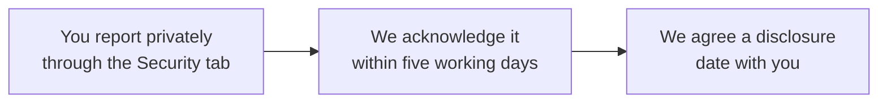

# Security policy

IronTrellis (formerly Continuity) keeps a signed history of the authority given to AI agents, and answers from it whether an action was allowed. A vulnerability is anything that makes those answers wrong, or that lets a history be altered in a way its checks should catch and don't. This page says how to report one, what is in scope, and the limits we already know about.

## Reporting a vulnerability

Report vulnerabilities privately through the repository's **Security** tab ("Report a vulnerability"), which opens a private advisory with the maintainers. Do not open a public issue for anything exploitable, and do not include secrets, real histories or customer incident data in a report.

A good report includes:

- the package and version (`npm ls @ramex-labs/irontrellis`, or the PyPI version);
- a minimal synthetic history or vector that shows the problem;
- the decision you expected, and the decision you got.

No bounty is offered.

## Supported versions

| Package | Receives fixes |
| --- | --- |
| The latest `1.x` release of every package | Yes |
| Legacy Continuity packages (`@ramex-labs/continuity`) | No: migrate with `irontrellis migrate` (see [docs/MIGRATION.md](docs/MIGRATION.md)) |

## What is in scope

| Area | What we want to hear about |
| --- | --- |
| **The engine** (`@ramex-labs/irontrellis`) | Any input for which replay, `authorize`, `why`, `responsible`, `survives`, admission or receipt verification gives a different answer from the specification, or an answer that depends on anything other than the captured history and the request. In particular: a way to make a revoked, expired, terminated or unappointed authority decide ALLOW; a way to widen a delegation past its parent; a way to make two conforming implementations disagree on a vector. |
| **History integrity** | A modified, truncated, reordered or rolled-back history that replays as `ACCEPTED`, passes pinned-head checks, or verifies an anchor it should not; a forged or replayed control-event signature. |
| **Signatures and hashing** | The vendored keccak-256 and secp256k1 recovery, the Ed25519 suite, canonical encoding collisions. |
| **The CLI, hooks and MCP servers** | Path traversal, key-file exposure, argument injection, a hook that lets an agent run a denied command. |
| **Supply chain** | Anything that would let a published package differ from the tagged source (provenance, lockfile, release workflow). |

## What is out of scope

- **A host administrator who can edit the history file, the pinned head, the anchor log and the owner key together.** Local hashes and pinning detect tampering by others; they do not prevent it. Against the administrator, only evidence the administrator cannot rewrite detects a rollback: a remote witness bound to the history ([docs/WITNESS.md](docs/WITNESS.md)), or an anchor log kept on other storage and checked with `irontrellis verify --anchors-file`.
- **The limits stated in [docs/SECURITY.md](docs/SECURITY.md) §2 and §3.** For example: a history with no remote witness can be rolled back to a head the owner once attested (an old history restored with its old pin, or the file cut back to a head whose attestation is copied from an old pin or the anchor log) when no anchor log holds a later head. Another is an agent that runs as the same OS user as `irontrellis-hook` and its owner key, or that can reach the signer holding it (an ssh-agent socket, a Vault token, a KMS credential). [docs/CUSTODY.md](docs/CUSTODY.md) says how to keep the key out of the agent's reach, and `irontrellis doctor --as-agent`, run as the agent's OS user, checks it; it supplements an operational review rather than proving isolation. Reports that go beyond those limits are welcome.
- **Denial of service** by feeding a very large history to a process with no memory limit; the file caps are documented limits, not a sandbox.
- **Behavior of an agent, tool or model *after* it received an ALLOW.** A decision reads a captured history; it does not execute anything and cannot stop what a cooperating process refuses to stop.
- **Vulnerabilities in the frozen references** (`packages/reference-0.2` and `packages/reference-0.3`) that do not affect the new engine; the references are test oracles, not shipped.

## Known limits of 1.0.0-rc.2

These limits are already known. A report that shows one of them reaching further than stated here is welcome.

| Limit | What it means |
| --- | --- |
| **Protective-rule refusals are not recorded** | The coding-agent hook's protective rules refuse any tool call that names IronTrellis's own state (the history and the files beside it, the keys, the hook configuration) or runs one of its writing commands. They decide before the history is opened, so the host gets the refusal, but the history holds no record of it. |
| **Session-signed hook and gateway records stay unattested and unwitnessed until the owner's next write** | Refusals and the other records that the hook and the MCP gateway sign with session keys carry no owner signature. Until the owner next writes to the history, they lie past the last head the owner attested, and no remote witness holds a head that covers them. `irontrellis verify` reports both in its notes (`PIN_ATTESTED_EARLIER`, and `UNWITNESSED_TAIL` where remote witnesses are configured). |
| **The coding-agent hook needs the single owner key beside the history** | The hook creates the agent and admits each session itself, signing with the one owner key kept beside the history: the key file, or a reference to the signer that holds it. It cannot gather more signatures, so it cannot yet be used with an owner approval policy that requires two or more signatures, or with an owner key kept offline. |
| **This release doesn't verify chain anchors** | The anchor check in 1.0.0-rc.2 produces no report: it lists chain inclusion and finality as missing evidence. The MCP gateway's pre-dispatch barrier opens only on a report from an outside producer, and takes the mode that report declares, `CONSENSUS_VERIFIED` included, on its producer's word. The separate tools used for the demonstration anchoring records report `TRUSTED_NODE` only, never consensus-verified ([known issues 54 and 71](docs/records/KNOWN-ISSUES-r2.5.md)). |

## Threat model

The full threat model, what a decision establishes and what it does not, the trust placed in the owner key, the runtime credential and the remote witness, and the known limits of rollback detection are in **[docs/SECURITY.md](docs/SECURITY.md)**. Read it before relying on any decision in an operational setting.

*Last reviewed: 24 October 2026. This page is revisited at each release.*
