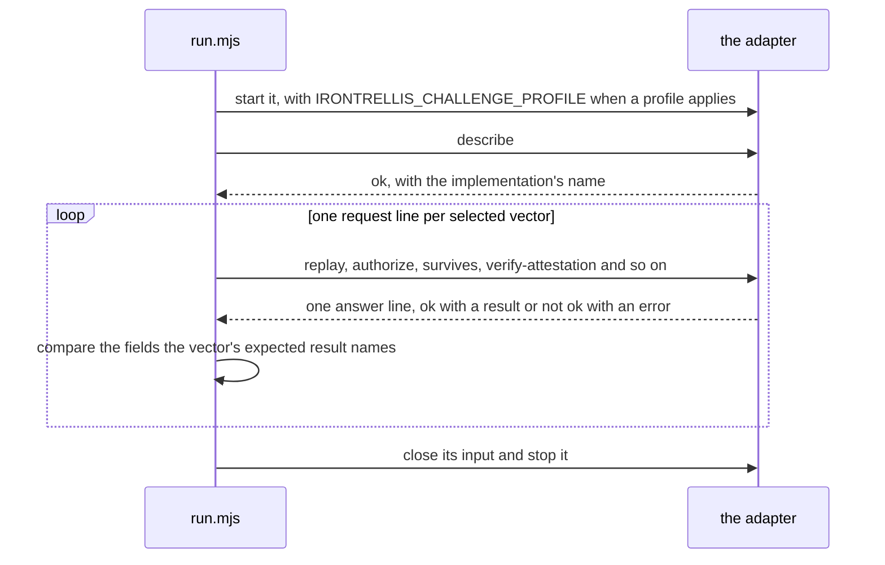

# IronTrellis conformance vectors

IronTrellis (formerly Continuity) keeps a checkable record of who may act for whom, and which duties survive when an AI agent is replaced. It claims that anyone holding a history can replay it and get the answers its writer got. This folder holds the test cases that check that claim for an implementation. Each case, a *vector*, names an input, such as a history and a question about it, and the exact result an implementation must give.

[docs/CONFORMANCE.md](../docs/CONFORMANCE.md) explains what passing shows and what it doesn't. This page is the reference for the folder itself: the suites, the runner, the adapter protocol, and how each file is kept current.

## Try it

Install and build the workspace, then run one suite against this repository's engine:

```sh
pnpm install --frozen-lockfile
pnpm build
node conformance/run.mjs --suite v2-g3 --adapter conformance/adapters/node.mjs
```

The runner prints one line per suite, then a reminder of what the result is worth:

```text
[v2-g3 profile g3] MATCH: 86 matched, 0 mismatched, 0 execution errors, 0 not run (irontrellis-core)
Finite selected-vector evidence, not full protocol certification.
```

To test your own implementation, wrap it in an *adapter* (see [Adapters](#adapters)) and pass it to the runner with `--adapter`, or give any command after `--`.

## The suites

The runner, `run.mjs`, knows seven suites. They differ in what they cover and in where their expected results come from:

| Suite | What it covers | Where the expected results come from | Challenge profile |
| --- | --- | --- | --- |
| `legacy/` | Continuity Core 0.2.2: replay, authorization and SURVIVES | Continuity's own vectors, kept byte for byte | none |
| `v1/` | Format 1 (`irontrellis-event/1`), by topic (below) | This repository's TypeScript engine, recorded by `v1/generate.mjs` | none |
| `v2/` | Format 2 (`irontrellis-event/2`), over one 40-event history | The specification's own generator, under the earlier challenges | `frozen-r2.3` |
| `v2-g3/` | The same vectors as `v2/`, re-signed | The same generator, changed only in its challenges and re-run under `g3` ([its README](v2-g3/README.md)) | `g3` |
| `v2-regenerated/` | Format 2 across the whole engine | This engine's own answers ([its README](v2-regenerated/README.md)) | `g3` |
| `v2-owner-policy/` | Owner approval policies and co-signatures | This engine's own answers ([its README](v2-owner-policy/README.md)) | `g3` |
| `v2-human-attestation/` | The attestation policy for PHL, Proof of Human Lineage | This engine's own answers ([its README](v2-human-attestation/README.md)) | `g3` |

A suite made from this engine's own answers is *engine-derived*. It catches any change in the engine's behaviour, and it lets another implementation compare itself with this one, but it is not an oracle derived from the specification. Each format-2 suite's README says how it was made and what checks it independently. The format-2 specification names `v2-g3` and `v2-regenerated` as part of format 2's definition ([SPEC §19](../docs/spec/SPEC-IRONTRELLIS-CORE-v2-EFFECTIVE-r5.2.md#19-versioning)).

The counts of the legacy and format-1 suites are generated into the table below by `v1/generate.mjs`. Each format-2 suite's `MANIFEST.json` lists its vectors with their topics and purposes, and the runner prints how many it ran.

<!-- vector-counts:begin (generated by conformance/v1/generate.mjs; do not edit) -->
| Suite | Topic | replay | authorization | survives | attestation | total |
| --- | --- | ---: | ---: | ---: | ---: | ---: |
| `legacy/` | Continuity 0.2.2 (byte-identical) | 11 | 19 | 4 | 0 | 34 |
| `v1/` | genesis-and-control-signatures | 7 | 0 | 0 | 0 | 7 |
| `v1/` | owner-keys | 18 | 0 | 0 | 0 | 18 |
| `v1/` | anchors-and-witness-bindings | 23 | 0 | 0 | 0 | 23 |
| `v1/` | migration | 6 | 0 | 0 | 0 | 6 |
| `v1/` | authorization | 0 | 25 | 0 | 0 | 25 |
| `v1/` | survives | 0 | 0 | 5 | 0 | 5 |
| `v1/` | attestation | 0 | 0 | 0 | 6 | 6 |
| `v1/` | **all** | **54** | **25** | **5** | **6** | **90** |
<!-- vector-counts:end -->

### The format-1 topics

`v1/MANIFEST.json` lists every format-1 vector with its topic and purpose:

* **genesis-and-control-signatures**: owner-signed control events accepted; unsigned, moved, tampered-signature, altered-effect and undeclared-key events refused.
* **owner-keys**:
  * the genesis next-key commitment: accepted; naming an owner key, a duplicate digest and an empty list refused;
  * rotation out of an uncommitted epoch (the opt-out history `rotation-v1`): accepted, starting a commitment, the commitment-only rotation; a retired key signing, an unknown key rotating, a retired key id reused, a key id re-bound, a carry-over rotation without a commitment and a rotation in a legacy history refused;
  * rotation out of a committed epoch: the pre-rotated rotation accepted; a rotation to an uncommitted key, a revealed key without proof, a rotation without the next commitment and a commitment-only rotation refused.
* **anchors-and-witness-bindings**: anchors (genuine, bad, an unknown anchor kind, and receipts shaped like bindings that bind nothing); `WITNESSES_BOUND` / `WITNESSES_UNBOUND` (bind, re-bind in place, unbind, accepted loss; every schema and replay refusal).
* **migration**: a history migrated from the legacy handover fixture with a genesis commitment (accepted; truncated, incomplete and shortened prefixes, an ed25519 session and a witness binding inside the prefix refused).
* **authorization**: ALLOW through a delegation with an intersection partner, ROOT and GLOBAL prohibitions, REVOKED, EXPIRED, NOT_YET_VALID, MISSING_INTERSECTION, AMOUNT_REQUIRED/EXCEEDED, CUMULATIVE_AMOUNT_EXCEEDED and TRANSACTION_COUNT_EXCEEDED with usage taken from admissions, AGENT_INACTIVE, NO_AUTHORITY, HISTORY_RELATION_UNVERIFIED, CAUSAL_TIME_INVALID, DOMAIN_MISMATCH, and decisions on the migrated history identical to the legacy vectors.
* **survives**: SURVIVES before and after a handover with an obligation and an assignment, on the native and the migrated history.
* **attestation**: owner head attestations before, at and after a rotation.

Every history but `rotation-v1` commits its owner key to a next key in the genesis (the default creation path); `rotation-v1` is the one explicit opt-out.

## Format 2 as released means profile g3

A *challenge profile* fixes exactly what a session key signs. Publishing 1.0.0-rc.2 releases format 2, and format 2 as released means profile `g3`, the engine's default: the challenges for an intent declaration, a refusal, an effect and a counterparty receipt also bind the event's id, type and timestamp. The other profile, `frozen-r2.3`, reproduces the earlier challenges, without that binding. It exists only to verify the frozen `v2` vectors: under it, every format-2 write (a new history, an owner write, a session write) is refused with `CHALLENGE_PROFILE_READ_ONLY` before anything is written.

A history verifies under one profile only, and the engine never retries the other. The runner passes each format-2 suite's profile to the adapter as `IRONTRELLIS_CHALLENGE_PROFILE`; `--profile` overrides it, for example to show that `v2` does not verify under `g3`.

## Running the suites

```sh
pnpm build                                   # the node adapter imports packages/core/dist
node conformance/run.mjs --adapter conformance/adapters/node.mjs                 # legacy suite (the default)
node conformance/run.mjs --suite all --adapter conformance/adapters/node.mjs     # legacy and v1 (pnpm test:conformance)
node conformance/run.mjs --suite all --adapter conformance/adapters/python.py    # legacy and v1, Python engine
node conformance/run.mjs --suite v1 -- node my-adapter.mjs                       # any command after --
node conformance/run.mjs --suite v2-owner-policy --adapter conformance/adapters/node.mjs   # a format-2 suite, by name
pnpm test:conformance:all                    # node + python on legacy and v1, reference on legacy
pnpm test:conformance:format2                # all five format-2 suites
```

`--suite all` runs legacy and v1 only. Run a format-2 suite by name, or all five with `pnpm test:conformance:format2`, as CI does.

| Option | What it does |
| --- | --- |
| `--suite <name>` | `legacy` (the default), `v1`, `all` (legacy and v1), or a format-2 suite: `v2`, `v2-g3`, `v2-regenerated`, `v2-owner-policy`, `v2-human-attestation` |
| `--profile <profile>` | `frozen-r2.3` or `g3`, in place of the suite's own challenge profile. `frozen-r2.3` is verify-only: the frozen `v2` suite has no write case, and under it an adapter's format-2 writes are refused with `CHALLENGE_PROFILE_READ_ONLY` |
| `--level <level>` | `verifier`: replay, SURVIVES, attestation, export and export-verify vectors. `evaluator`, the default, adds authorization, headroom, duty-view, writer-open and authority-evaluation |
| `--filter <text>` | Only the vectors whose id contains the text |
| `--json` | The full reports, as JSON |
| `--timeout <seconds>` | The time an adapter has for each answer (10 seconds by default) |
| `--adapter <file>` | Runs a `.py` file with Python 3 and any other file with Node |
| `-- <command…>` | Runs any command as the adapter, from the repository root |

| Exit status | Meaning |
| --- | --- |
| 0 | Every selected vector matched |
| 1 | A completed response disagreed |
| 2 | Setup or transport failed, no vector was selected, or the adapter answered a vector with `{"ok":false,…}` (for example `UNIMPLEMENTED` for an op its engine does not have yet): that vector gets an ERROR row and the run continues |

The comparison is the legacy runner's. On objects, only the fields a vector's expected result names are compared. Arrays must match in order and length, scalars must match exactly, with their JSON types, and tagged BigInt records compare exactly. `legacy/run.py`, the original Python runner, still runs the legacy suite against any adapter.

## Adapters

An adapter puts an engine behind the runner's line protocol. Three come with the repository:

| Adapter | Engine | Suites |
| --- | --- | --- |
| `adapters/node.mjs` | `@ramex-labs/irontrellis`, this repository's engine | All seven; CI runs each |
| `adapters/python.py` | The `irontrellis` Python package (`python/`) | Passes legacy and v1. The package doesn't read format 2 |
| `adapters/reference-node.mjs` | The frozen Continuity Core 0.2 engine (`packages/reference-0.2`) | Passes legacy. It does not understand format 1 and is expected to fail `v1` |

On 24 October 2026, `adapters/node.mjs` matched every vector of all seven suites, with no mismatch, no error and no vector left unrun.

One run, as the runner sees it:



The adapter contract is `legacy/ADAPTER.md`: one JSON request per line on stdin, one `{"ok":true,"result":…}` or `{"ok":false,"error":…}` line on stdout, amounts as `{"$continuity.bigint":"…"}`. A `replay` request carries `events` inline; `authorize` and `survives` requests carry the vector's `input` fields plus the referenced history prefix. A line ends at `\n` only, and one trailing `\r` is dropped. U+2028 and U+2029 are ordinary characters inside JSON strings, not line ends, so a runner or an adapter must not split on them. `adapters/node.mjs`, `adapters/reference-node.mjs` and `adapters/python.py` end a line at `\n` only. The frozen `legacy/adapters/node.mjs` alone still reads with `readline`, which also splits there ([known issue 73](../docs/records/KNOWN-ISSUES-r2.5.md)); the legacy vectors contain neither character.

Format 1 extends the protocol in three ways:

| Addition | What the adapter answers |
| --- | --- |
| `code` on every `replay` result | The rejection code, `null` when accepted. Every v1 replay vector pins it |
| Format-1 facts on a `replay` result, compared where a vector's `expect` declares them | `boundWitnesses` (the verifier keys of the remote witnesses the history binds, in binding order), `boundPolicy` (the owner-signed witness policy minimum, or `null`) and `nextKeyDigests` (the next-key commitment of the owner keys in force, or `null`); all three are `null` when the replay is rejected |
| The `attestation` kind | The request is `{"op":"verify-attestation","events":[…],"attestation":{…}}`, with a head attestation as the store and the anchor logs hold it. The answer is `{ valid, signatureValid, prefix }` |

In that answer, `signatureValid` means the attestation is signed by an owner key in force at the attested head's position (`docs/HISTORY-FORMAT.md` §7.1); `prefix` means the attested position is at most the head and the history hash there equals the attested hash; `valid` means both. Both levels, `verifier` and `evaluator`, include the kind.

Format 2 adds more ([SPEC §17](../docs/spec/SPEC-IRONTRELLIS-CORE-v2-EFFECTIVE-r5.2.md#17-adapter-line-protocol-conformance)): `replay` results also carry `stateRoot` and `projectionHead`, `authorize` results `budgetId`, and `verify-attestation` results `stateRootValid` and `projectionValid`; three new kinds are `headroom`, `export` and `duty-view`. The loader rules and compared fields are in [v2/README.md](v2/README.md), and `v2-regenerated` adds kinds of its own ([its README](v2-regenerated/README.md)).

## Keeping the vectors current

Most vector sets here are either frozen or reproduced by a generator, and each of those has a check. CI runs them all except the generator of `v2-g3`, which needs a build of the previous release candidate's core and is run by hand:

| What | Check | Notes |
| --- | --- | --- |
| `legacy/`, `v1/`, `inputs-ref/` and `v2/` | `node scripts/check-frozen-vectors.mjs` | Byte for byte against `FROZEN.sha256` here and in `v2/`; part of `pnpm lint` and CI. These files are frozen: restore them, never edit them |
| `v1/` and the count table above | `node conformance/v1/generate.mjs --check` (`pnpm conformance:check`) | Fails at one vector, `replay/v1/rejects-shortened-migrated-prefix`, an expected failure for a known reason ([known issue 19](../docs/records/KNOWN-ISSUES-r2.5.md)) |
| `v2-g3/` | Its generator, run with a build of the previous release candidate's core | See [v2-g3/README.md](v2-g3/README.md) |
| `v2-regenerated/`, `v2-owner-policy/`, `v2-human-attestation/` | `node conformance/<suite>/generate.mjs --check` | |
| `transparency/` | `node conformance/transparency/generate.mjs --check` (`pnpm conformance:transparency`) | |
| The anchoring vectors | `pnpm conformance:check:anchors` | The `--check` of the five anchoring generators: statement, namespace, descriptor, attempt and connector |

`node conformance/v1/generate.mjs` rebuilds `v1/vectors.json`, `v1/MANIFEST.json`, `v1/histories/` and the count table above deterministically (fixed Ed25519 seeds, counter ids, scripted clock); `--check` compares a fresh generation with the files instead. Regeneration must reproduce the committed files byte for byte; a difference means the engine changed and needs a decision, not a silent refresh.

## Other files here

| Path | What it holds | How it's used |
| --- | --- | --- |
| `crypto-vectors.json` | Keccak-256, EIP-191 recovery, and challenge and receipt hashes, from part 4 of the legacy semantics ([04-crypto-signatures.md](../docs/legacy-semantics/04-crypto-signatures.md)) | Loaded by the TypeScript and Python unit tests, not by `run.mjs` |
| `transparency/` | The witness wire formats: RFC 6962 Merkle proofs, C2SP signed notes and checkpoints, head statements, witness log entries and receipts; published vectors copied verbatim plus deterministic generated ones | Loaded by the TypeScript and Python unit tests, not by `run.mjs` ([its README](transparency/README.md)) |
| `inputs-ref/` | Two reference vectors from the frozen legacy and format-1 suites | Read by the `v2` and `v2-g3` generators; frozen |
| `anchor-statement/`, `anchor-namespace/`, `anchor-descriptor/`, `anchor-attempt/` | Synthetic vectors for anchoring a history on a public chain: the statement, the profile and its namespace, body and artifact descriptors, a publication attempt and its operator clearances | Each is reproduced by its own generator; nothing contacts a chain |
| `connector/` | The MCP gateway's pre-dispatch anchoring barrier | Its generator runs the gateway's own code |
| `adapters/` | The three adapters above | `run.mjs` |

## What a pass shows

A pass is finite evidence, and the runner says so on every run. It shows that an implementation gave the expected answers to these cases, compared on the fields each case names. It is not protocol certification. [docs/CONFORMANCE.md](../docs/CONFORMANCE.md) says what conformance does and doesn't establish.

*Last reviewed: 24 October 2026. This page is revisited at each release.*
