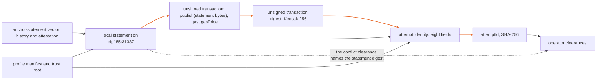

# Anchor attempt and clearance vectors (proposed)

IronTrellis (formerly Continuity) can commit a history to a public chain by publishing an *anchor statement* there. The anchor outbox (`packages/anchor-outbox`) does the publishing: one transaction per statement, through a signer and a node the installer supplies. When something goes wrong that it can't resolve on its own, the outbox halts; for three kinds of halt, an operator then clears it with a signed record.

This folder holds one synthetic vector, `vector.json`, that fixes both halves offline: the identity of one publication attempt, and three operator clearances. It is an additive proposal. Every existing conformance suite, and the anchor-statement vector it builds on, stays unchanged.

## What the vector fixes

| Part | What it fixes |
| --- | --- |
| The attempt identity | A closed record of eight typed fields: the statement digest, the profile manifest hash, the adapter identity, the chain id as `eip155:<decimal>` text, the destination, the publisher address, the nonce as a number (a U53) and the unsigned transaction digest. `attemptId` is the Core canonical SHA-256 of that record |
| The unsigned transaction digest | Keccak-256 of the canonical unsigned legacy EIP-155 RLP encoding of the transaction |
| The signed transaction | The transaction as the publisher signed it, and its hash, plus `signedSubstitutions`: the same transaction signed with one field changed at a time |
| Three accepted clearances | `SIGNING_UNCERTAIN` cleared by `RECLAIM_SAME_NONCE_SAME_BYTES`; `CONSUMED_BY_OTHER` cleared by `NONCE_FOREIGN_CONSUMED`, which states `keyExposure: "KNOWN_OWN_USE"`; and `OUTBOX_CONFLICT` cleared by `CONFLICT_RESOLVED`. The operator key signs each one |
| Seven refused clearances | A foreign-nonce clearance that states no key exposure; a reclaim or a conflict clearance that states one; a reclaim that observed bytes other than ours; a conflict resolution naming a statement other than the one observed on chain; an unknown field; and a clearance signed by the publisher instead of the operator |

How the pieces derive from each other:



The unsigned encoding includes `gas` and `gasPrice`, so the fee is inside the unsigned transaction digest and the attempt identity, and outside the anchor statement. This reading was confirmed on 14 October 2026, so the vector is final on this point. The vector claims no equivalence with the older tuple ABI.

The vector reads the anchor-statement vector's history and head attestation unchanged, and records the SHA-256 of each file's actual bytes. Its own local statement replaces that vector's illustrative profile with a profile manifest and trust root in the form the anchoring specification defines (§19), shared with the namespace vectors, on the local test chain 31337. The transaction calls a proposed `publish(bytes)` with the exact canonical statement bytes. The derived JSON never takes the identity of the original vector file.

## Synthetic, offline and test only

Every output is `SYNTHETIC_TEST_ONLY`, non-production, `UNVERIFIED` and `dispatchAllowed: false`. The generator runs offline and uses only fixed, published test inputs: the elementary secp256k1 private key 1 for the publisher, and the RFC 8032 section 7.1 test 1 seed for the operator, a key distinct from the publisher's and the history's. It signs with no real credential and establishes no fact about a chain, finality or a deployment.

The pair (`eip155:31337`, `synthetic-local-anchor`) is outside the table of admitted anchoring profiles, so the public `openAnchorOutbox` refuses it. The outbox's own tests open it through a test-only entry point.

## Check it

Install and build the workspace first (`pnpm install --frozen-lockfile`, then `pnpm -r build`, as in [CONTRIBUTING.md](../../CONTRIBUTING.md)). The generator itself installs nothing and makes no live call.

```sh
node conformance/anchor-attempt/generate.mjs           # write vector.json
node conformance/anchor-attempt/generate.mjs --check   # reproduce it and compare, byte for byte
```

Either command replays the actual history, recomputes the payload and the namespace, derives the canonical attempt bytes and their SHA-256 a second, independent way, accepts the three clearances through the outbox's own decoder, which checks each signature with Core's Ed25519 suite, and refuses the seven bad ones. `--check` then reproduces every byte of `vector.json`.

The anchor-outbox package's tests use the vector as well: they check the real signed bytes, rejecting each one-field substitution, and the transport and reconciliation paths.

*Last reviewed: 24 October 2026. This page is revisited at each release.*
