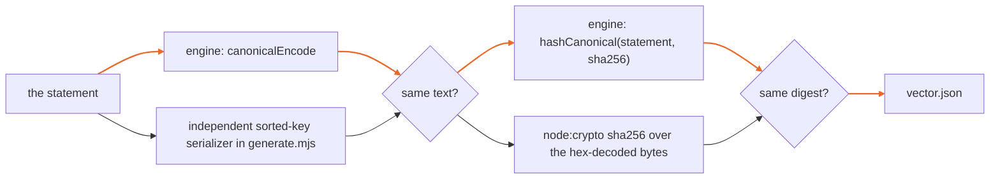

# Anchor statement vector

To anchor a history on a public chain, IronTrellis (formerly Continuity) publishes an *anchor statement*: a small canonical JSON object, `irontrellis-anchor-statement/1`, that names the history and commits to one head, its state root and the owner's attestation of it (anchoring specification §6). Every implementation must turn the same statement into the same bytes and the same digest, or anchors made by one can't be checked by another.

`vector.json` fixes that for one statement, so that an independent checker can reproduce it. It is an **external** vector, not a Core vector: no replay rule, refusal code or frozen suite depends on it.

## What it fixes

- **The canonical rule.** The canonical text follows Core specification §3.1: keys sorted by UTF-8 byte order, `JSON.stringify` string escaping and safe integers. Every optional field is written as an explicit `null`.
- **The digest.** `digest = hashCanonical(statement)`, per §3.2: `"0x" + hex(sha256(utf8(canonical)))`.
- **The recorded output.** `canonical.utf8`, `canonical.hex` (1,076 bytes) and `digest.value`.

## Where the values come from

The bindings are real. `generate.mjs` re-derives each one from the engine (`packages/core/dist`):

| Field | Source |
| --- | --- |
| `domain` | The genesis `data.domain` as written, from `conformance/v2-regenerated/histories/rotation-v2.json` |
| `historyId` | `recordHash(0)`, through `historyIdOfGenesis(e0)` |
| `genesisEventHash` | `eventHash(e0)` |
| `head`, `stateRoot`, `projectionHead` | A replay of the history to its head, at position 6. They equal the regenerated suite's pin for `rotation-v2` at position 6 (`conformance/v2-regenerated/MANIFEST.json`; `node scripts/pin-roots.mjs --out <dir>` writes the same pin, into a directory outside the repository) |
| `attestationDigest` | `hashCanonical` of the `/2` attestation as written, including `keyId`, `scheme` and `signature`. The attestation is the positive vector `attestation/v2r/post-rotation-head-by-new-key-verifies`, and the generator verifies it again (`verifyHeadAttestationFacts`, all five facts true) |
| `sequence` | `0`, so `predecessor` and `previousHead` are `null` |

Some values are illustrative, chosen before the anchoring specification fixed the profile manifest (§19) and the `availability` values (§12.5):

- `profile.id`, and the manifest behind `profile.manifestHash`, which is `hashCanonical` of the placeholder manifest recorded under `source.illustrative`;
- `chain.destination`, a placeholder address: no contract bytes exist;
- `availability: "ANCHOR_ONLY"`;
- the `evidence` slots, which are all `null`.

`chain.id` is `eip155:42793`, Etherlink mainnet. These values change the bytes but not the rule. A later vector that uses the profile manifest's final schema will have a separate id; the anchor-namespace fixtures already carry a sequence-0 statement in that form (`conformance/anchor-namespace/fixtures/statement.json`). The vector only fixes bytes: generating it publishes nothing and contacts no chain.

## Two derivations

Both derivations must agree, or the generator exits 1:



A third check runs outside Node: `python3 -c` with `json.dumps(sort_keys=True, separators=(",",":"), ensure_ascii=False)` and `hashlib.sha256` reproduces both the bytes and the digest.

## Running

```
pnpm --filter @ramex-labs/irontrellis build
node conformance/anchor-statement/generate.mjs           # write vector.json
node conformance/anchor-statement/generate.mjs --check   # exit 1 if a fresh generation differs, or the file's bytes/digest/statement disagree
```

`--check` also hashes the committed `canonical.hex` with `node:crypto` alone. It then re-encodes the committed `statement` and compares the result with `canonical.utf8`. A checker can therefore reproduce the digest from `vector.json` without the engine.

*Last reviewed: 24 October 2026. This page is revisited at each release.*
