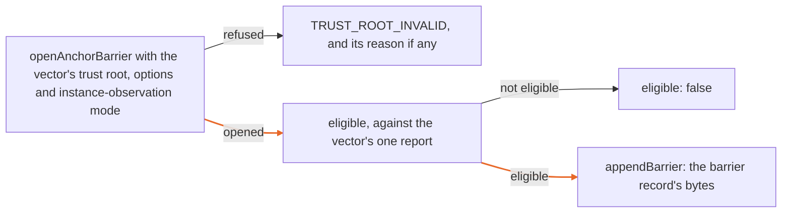

# Anchoring barrier vectors (connector profile)

IronTrellis (formerly Continuity) can anchor a history on a public chain, and the IronTrellis MCP Gateway can hold an admitted operation back until a report says that anchor is final enough on its chain. This *pre-dispatch barrier* reads anchor reports written by a separate producer, and decides whether one is eligible. `vectors.json` fixes the barrier's decisions for the connector profile, so that an independent checker can reproduce them.

These are **external** vectors, not Core vectors: no replay rule, refusal code or frozen suite depends on them. Every input is synthetic. No node, chain, contract or key is contacted or used, and a TEST-class result supports no production or live-anchoring claim.

## What they don't show

1.0.0-rc.2 doesn't verify chain anchors itself: its anchor check produces no report, and the barrier takes the mode a supplied report declares on its producer's word ([known issues 54, 56 and 71](../../docs/records/KNOWN-ISSUES-r2.5.md)). The separate anchoring tools used for the demonstration records report `TRUSTED_NODE` only, never consensus-verified.

The production-class positive vector, `l1-final-consensus-verified`, is synthetic output of this repository's generator, not live evidence from real nodes. That live evidence and this positive vector belong to the live public anchoring milestone, which comes after 1.0.0-rc.2: the point at which histories are first anchored on a live public chain in consensus-verified mode (anchoring specification §7.1 and §8.3). The vector supports no claim of production anchoring, nor any claim that an anchor is final in consensus-verified mode under a production profile. 1.0.0-rc.2 makes no production-anchoring claim.

## How each vector is made

`generate.mjs` runs the gateway's own built code (`packages/mcp-gateway/dist`) for each vector, over the pinned format-2 history `conformance/v2-regenerated/histories/rotation-v2.json`:



The outcome must equal the expectation written by hand in the generator, or the generator exits 1 before writing anything. The class of a profile comes from the pair (chain id, profile id) in Core's class table, which `vectors.json` also records:

| Class | Chain | Profile id |
| --- | --- | --- |
| PRODUCTION | `eip155:42793` | `irontrellis-anchoring-profile/etherlink-mainnet/1` |
| TEST | `eip155:127823` | `irontrellis-anchoring-profile/etherlink-shadownet-test/1` |

## The vectors

Each id is under `connector/etherlink/`. The last column gives the sections of the anchoring specification each one follows.

| Id | What it fixes | Anchoring spec |
| --- | --- | --- |
| `l1-final-consensus-verified` | The positive: a production `L1_FINAL` report in `CONSENSUS_VERIFIED` is eligible; the barrier record's bytes | §8.2, §14 |
| `trusted-node-not-final` | A `TRUSTED_NODE` report never satisfies a production barrier | §8.2, §14 |
| `same-administration-nodes` | EVM and L1 nodes run by one operator: `TRUST_ROOT_INVALID` at load | §8.3, §14 |
| `shadownet-chain-refused` | The production profile id on Shadownet is not a pair of the table: `TRUST_ROOT_INVALID` (check T6), even with the TEST opt-in set | §10.1, §14 |
| `test-profile-refused-without-opt-in` | The TEST pair without `allowTestProfile`: `TRUST_ROOT_INVALID`, `TEST_PROFILE_NOT_ALLOWED` | §10.2 |
| `test-profile-accepted-with-opt-in` | The TEST pair with the opt-in opens, carries the TEST label, and its consensus-verified report is eligible | §10.2 |
| `test-profile-trusted-node-barrier-eligible` | TEST with `testBarrierMode: "TRUSTED_NODE"` and no independent L1 node (the manifest's `nodes.l1` pin equals `nodes.evm`): a trusted-node `L1_FINAL` report is eligible, and the barrier record says `TRUSTED_NODE` | §8.2, §10.2 |
| `test-profile-trusted-node-barrier-refuses-consensus-claim` | Under the trusted-node barrier, a report claiming `CONSENSUS_VERIFIED` is not eligible: no independent L1 node qualified it | §8.2, §10.2 |
| `production-profile-trusted-node-barrier-refused` | The trusted-node barrier on the production pair: `TRUST_ROOT_INVALID`, `TRUSTED_NODE_BARRIER_NOT_ALLOWED` | §8.2, §10.2 |

Each vector records its inputs (`trustRoot`, `options`, `instanceObservationMode`, `report`) and the bytes derived from them: the report's canonical hex, its `reportDigest` (checked to equal SHA-256 over those bytes) and, where the report is eligible, the barrier record's canonical hex and digest.

## Not produced

Two cases are listed under `notProduced` ([known issue 57](../../docs/records/KNOWN-ISSUES-r2.5.md)):

- **`substring-not-inclusion`** needs a connector that decides inclusion from chain data: that the statement is the decoded argument of the publish call at the destination, not bytes found somewhere in its calldata. The gateway reads reports, never transactions. The outbox's observed-transaction binding (`bindObservedTransaction`, used by `createObservedConnector`) can't host the check either: it compares an observed transaction field by field with the outbox's own signed transaction, so it only ever recognizes the one transaction the outbox sent. No such connector is built in this release.
- **`cemented-by-elapsed-time-refused`** is a check on a report producer, which must not infer `CEMENTED` from elapsed time; no producer is built in this release. The reader checks what it can see. The gateway's report codec lists a `CEMENTED` report whose `refutationResidual` is `OPEN`, or whose `cementedAt` is null, as `CEMENTED_REQUIRES_CLOSED_AND_LEVEL`, and the barrier never treats a report with a listed contradiction as eligible (a test in `packages/mcp-gateway/test/anchor-barrier.test.mjs` checks both). A report that carries a closed residual and a level its producer derived from elapsed time looks like a real one to the reader, so that case can only be tested at the producer.

## Running

Build first (`pnpm -r build`): the generator reads the built gateway and Core.

```
node conformance/connector/generate.mjs           # write vectors.json
node conformance/connector/generate.mjs --check   # exit 1 when a fresh generation differs
```

*Last reviewed: 24 October 2026. This page is revisited at each release.*
