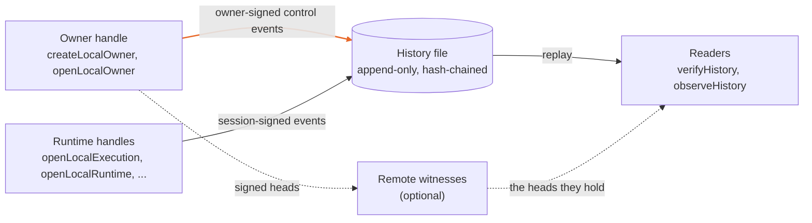
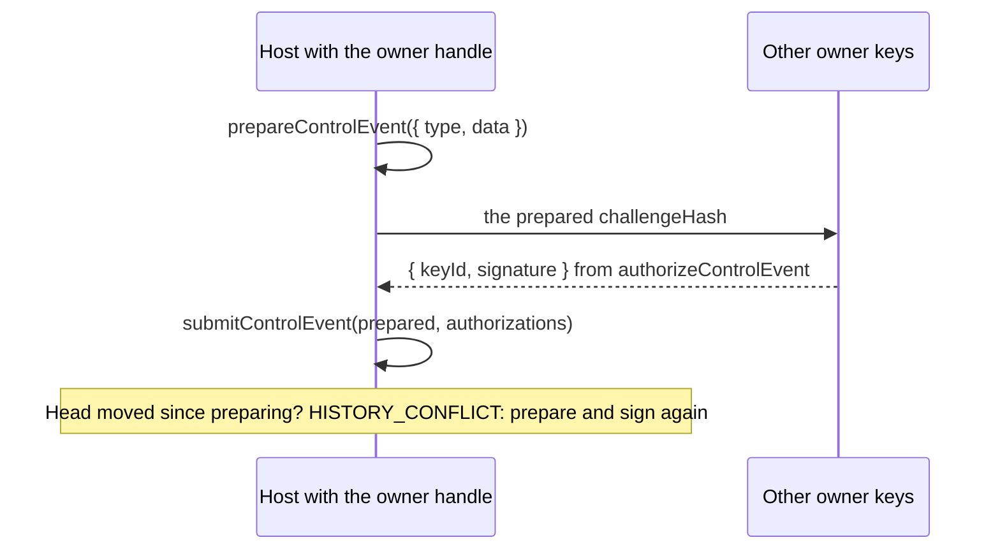
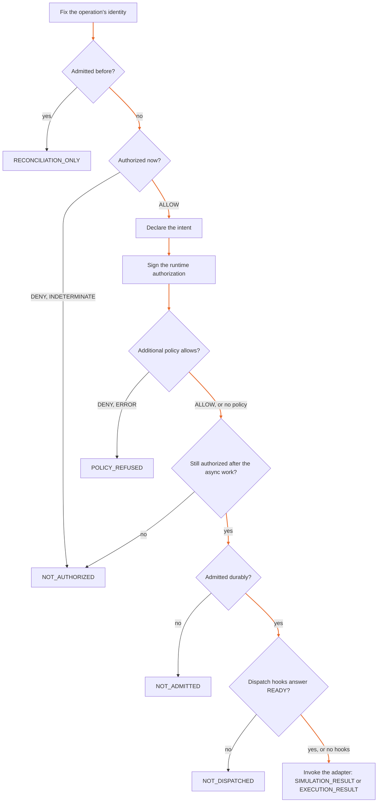

# API guide: `@ramex-labs/irontrellis`

IronTrellis (formerly Continuity) keeps a signed, replayable history of who may act for whom. Owners grant authority to agents, agents act through runtime sessions, and anyone holding the file can replay it and check every decision. This guide is for a developer who drives that history from JavaScript or TypeScript with the core package, `@ramex-labs/irontrellis`. It walks through the handles in the order you usually meet them, says what each one promises and what it does not, and links to the reference pages for exact shapes.

> **A decision describes the supplied history.** It is not an execution capability, and it is not proof of an external effect.

## One history, start to finish

An owner, `ops`, lets an agent, `bea`, collect evidence for an incident. Here is the life of that history, with the call behind each step.

| Step | What happens | The call | What the history gains |
|---|---|---|---|
| 1 | `ops` creates the history | `createLocalOwner(options)` | The genesis, naming the owner keys, and the owner's record |
| 2 | `ops` creates `bea` and a role, appoints `bea`, and grants it evidence collection on `incident:42` until Friday | `owner.createAgent`, `owner.createRole`, `owner.appoint`, `owner.grant` | Owner-signed control events |
| 3 | `ops` admits a runtime session for `bea`; the session's private key stays with the host process acting for `bea` | `owner.admitRuntime` | The session and its public key |
| 4 | The host runs `bea`'s request through an adapter the host chose | `openLocalExecution(...).run(operation)` | The intent and its admission: ALLOW |
| 5 | `bea` asks for `incident:43`, which no grant covers | `run(operation)` | A refusal: DENY, `RESOURCE_NOT_ALLOWED` |
| 6 | `ops` replaces `bea` with `alex` | `owner.succeed(...)` | Retirement, role transfer and a checkpoint; `bea`'s grants do not pass to `alex` |
| 7 | An auditor checks the file without the host | `verifyHistory(historyFile)` | Nothing: verification only reads |

The rest of this guide takes these calls one at a time. The shape stays the same at any size: two kinds of writers, one file, and readers who replay it.



Use the local API to own a history or run a session, the store API for durable history access, and the engine API for decisions over captured events or replayed states. This guide covers the exported interfaces and their operational boundaries; full shapes, codes, challenges and failure details are in the linked references. It does not claim new performance measurements or complete formal verification of the package.

## The rules every call follows

| Rule | What it means |
|---|---|
| Inputs are plain data | Accessors, proxies, symbol keys, cycles and sparse arrays are refused as `INVALID_INPUT` |
| Results are frozen | Except the engine's `ReplayState`, which is a live object: never mutate it |
| Amounts: `bigint` in, strings in events | Format-2 event Amount values are decimal strings. The JS host API still takes Amounts as `bigint`; the owner handle writes them into format-2 event data as strings |
| Times are milliseconds | `now` must return milliseconds, as `Date.now()` does: format 2 reads every timestamp, expiry, window and duration in milliseconds (the 5-minute clock-skew bound, for one). The CLI and hooks do the same |
| Writes are asynchronous | Local writes return promises; witness-aware verification and checks also need `await` |

The [complete entry-point and option reference](reference/api-owner.md) keeps the detailed contracts.

## Which history format the API writes

The API writes format 2, `irontrellis-event/2`, and nothing else. Older files stay readable:

| The file is | Writes |
|---|---|
| Format 2 | Accepted |
| Format 1, or legacy (`continuity-event/0.2`, Continuity's format) | Refused: `FORMAT_READ_ONLY`, `detail.reason` `FORMAT_1` or `LEGACY` |
| A source fenced by a migration | Refused: `FORMAT_READ_ONLY`, `detail.reason` `MIGRATED`, with `detail.target` |

Naming another `format` for a new owner, or passing `readOnlyFormats: false` to the public store, is `INVALID_INPUT`. The legacy and format-1 writers are test tooling in the non-public `@ramex-labs/irontrellis/internal-format1`.

Publishing 1.0.0-rc.2 releases format 2; [HISTORY-FORMAT §1](HISTORY-FORMAT.md#releasing-format-2) says what that promises for later versions.

The reference pages still describe the older writers. Their format-1 and legacy write and migration clauses are historical: do not use them as instructions to write those formats.

## Where things live

| Import | Use |
|---|---|
| `@ramex-labs/irontrellis/local` | Owner, runtime, execution, simulation, evidence, attempt, observation, capacity and migration handles; `IronTrellisError` |
| `@ramex-labs/irontrellis/store` | `openHistoryStore`, `createHistoryStore` and store types |
| `@ramex-labs/irontrellis/attempts` | Attempt recorder and replay-only attempt inspection |
| `@ramex-labs/irontrellis/transparency` | Witness notes, checkpoints, Merkle proofs, statements, receipts and key-event bundles |
| `@ramex-labs/irontrellis/custody` | Key references and signer backends |
| `@ramex-labs/irontrellis/adapter` | Trusted integration-host interface: canonical encoding, hashing, configured event store, export view and transfer |
| `/duties`, `/evidence`, `/runtime`, `/simulation` | One handle family each, also re-exported by `/local` |
| `/policy` | The additional-policy helpers `capturePolicy` and `evaluatePolicy` (§9), also re-exported by `/local` |
| `@ramex-labs/irontrellis/platform` | `replaceFileSync`, `syncDirectorySync`, `ownerOnlyModeEnforced`, `isFullyQualifiedPath`, `isWindowsTransientError`, `WINDOWS_TRANSIENT_ERROR_CODES`; optional `{ platform }`. Replacement retries use `REPLACE_RETRY_BUDGET_MS`; directory sync is skipped and owner-only mode enforcement is false on Windows |
| `@ramex-labs/irontrellis` | Engine, store, signing and local re-exports |

## 1. Owner: `createLocalOwner`, `openLocalOwner`

An owner handle records control changes: agents, roles, grants, prohibitions, revocations, appointments, succession, session admission, epoch changes, and key or policy rotation. The whole handle is privileged host configuration: never give it to an agent.

| Call | Returns | What it does |
|---|---|---|
| `createLocalOwner(options)` | `Promise<LocalOwner>` | Creates a format-2 history; `format` defaults to `irontrellis-event/2`. An existing file is `HISTORY_EXISTS` |
| `openLocalOwner(options)` | `LocalOwner` | Opens a history with its recorded domain and owner (`PROFILE_MISMATCH` otherwise) |
| `createLocalAttemptOwner(options)`, `createLocalReviewOwner(options)` | `Promise<LocalOwner>` | Creates a history for the attempt recorder (§2): adapter edition E5, or E6, which adds review closure |
| `createLocalDomain()` | `AuthorizationDomain` | A fresh local namespace, format 2 by default |

A missing or unusable owner signer leaves reads available but makes control writes fail with `KEY_UNAVAILABLE`.

Format-2 options include `maxEvents`, `maxStateRecords`, `checkpointPolicy`, `sessionTimeHorizonMs` (the session time horizon, [OPERATOR §5.3](OPERATOR.md#53-session-time-horizon)), `coOwnerKeys` (1–63 public keys), `ownerPolicy`, the next-key options and `witness`; `now` returns milliseconds.

Once a history exists, this read-only verification example uses its recorded format:

```js
import { verifyHistoryWithWitnesses } from "@ramex-labs/irontrellis/local";
const report = await verifyHistoryWithWitnesses("./history.jsonl");
console.log(report.ok, report.failures, report.notes);
```

It was not run when this page was written. Use a history and witness policy you are authorized to inspect; verification does not create a history or restore missing events.

The [owner reference](reference/api-owner.md) contains every option, method input and event mapping. Important constraints:

| Constraint | Detail |
|---|---|
| Identifiers are permanent | An agent, role or authority id is never reused, even after a revocation |
| Roles are exclusive | `createRole({ exclusive: false })` is `INVALID_INPUT` |
| Delegation attenuates | A delegation can narrow its parent grant, never widen it |
| ROOT prohibitions stay inside their root | Their expiry must not exceed their root's |
| A handover is checked, then resumable | `succeed` validates its two-event handover (retirement, then transfer) before writing and resumes an interrupted handover at its recorded step; in format 2 a checkpoint seals it |
| Grants do not follow a successor | A handover report lists live grants, but those grants do not follow a successor |

### Rotation and next keys

| Call | What it does |
|---|---|
| `rotateOwnerKey(input?)` | Replaces or edits the owner-key set. With a next-key commitment, it must reveal the committed key and prove possession; an unrelated replacement is refused |
| `prepareOwnerKeyRotation(input?)`, then `commitOwnerKeyRotation(prepared, options?)` | The same in two steps, when separate preparation is needed. A prepared event is tied to its previous head and to the handle that prepared it; a moved head is `HISTORY_CONFLICT` |
| `commitNextKey(input?)` | Adds a commitment, only when the current epoch has none |
| `ownerKeyStatus()` | Inspects custody, commitments and pending files without contacting a signer |

The [rotation inputs, crash table and witness outcomes](reference/api-owner.md) explain when files are staged, when the event is durable, and how pending work is settled. Do not infer from a thrown error that no event was written.

### Owner approval policies (format 2)

Owner approval policies and PHL, Proof of Human Lineage, attestation ship in 1.0.0-rc.2. A policy supports:

- thresholds, including a threshold per event type (`byType`);
- power reduction by effect (`PR_eff`);
- credential separation;
- committed-key recovery (`recovery`);
- the `ATTESTED` human floor (`humanFloor`), with lapse, restoration and T1/T2 time checks.

Use the [owner-policy reference](reference/owner-policy.md) for the exact rules; the documented attestation and counting rules determine the result.

A local owner holds one key. For a control event requiring several signatures:

1. Call `prepareControlEvent({ type, data })` to fix the event, previous head and challenge.
2. Have each owner sign the prepared `challengeHash`, for example with `authorizeControlEvent(signer, prepared, { historyId })`.
3. Call `submitControlEvent(prepared, authorizations)`. A changed head requires preparation and signatures again. An insufficient quorum is refused before writing.



Use the key-rotation preparation API for a rotation that stages keys, and `prepareOwnerPolicyRotation` for a policy change. A key rotation that would silently reset a non-default policy is refused: restate the policy or explicitly request `resetPolicy`. Automatic checkpoints that the local key cannot authorize are suppressed. Under `ATTESTED`, the prepared signer view reports classes at the event time.

A policy can ask for more checkpoint signatures than its people can give. `checkpointPolicyListings(epochs)` lists each owner-key epoch whose explicit `STATE_CHECKPOINT` threshold is larger than its distinct non-`AGENT` credentials. The listing is advice only: the policy stays valid and replay does not change. `irontrellis verify` and the owner-write commands show the same listing ([details](reference/api-execution-dispatch.md#checkpoint-policy-advisory)).

The local writer has narrower capabilities than the Core policy rules:

- its handover, witness binding and two-phase key and commitment operations use the handle's key alone (known issue 22);
- a recovery rotation needs an external producer of the event, which this release neither ships nor documents (known issue 24); the owner API warns `OWNER_POLICY_RECOVERY_NO_WRITER` while a policy carrying `recovery` is written or in force;
- snapshot resume uses a qualified pin only when the checkpoint policy permits it; otherwise it uses an in-file checkpoint or full replay.

See [policy writer and resume limits](reference/api-owner.md).

## 2. Runtime handles

Runtime handles require an admitted session under the configured controller and a `signHash` callback for that session's credential. Each takes the owner options of §1 plus `session` and `signHash`; opening fails with `RUNTIME_NOT_CURRENT` without such a session. The callback receives a hash and returns a signature promise. Missing, expired, fenced or otherwise non-current sessions cannot authorize a write; malformed or failing signer responses are refused.

| Handle | Operations | Boundary |
|---|---|---|
| `openLocalSimulation(options)` | `run`, `recordReceipt` | The deterministic simulated adapter |
| `openLocalExecution(options, adapter, mode)` | `run`, `recordReceipt` | Host-selected adapter and execution mode (`SIMULATION`, `LOCAL_PACKET`, `REMOTE_REPORT`); do not let the agent choose the adapter |
| `openLocalRuntime(options)` | `obligate`, `assign` | Session-signed obligations, performance assignment and format-2 reconciliation observations |
| `openLocalEvidenceTool(options)` | `collect`, `recordReceipt`, `inspect` | Copies only the host's preselected evidence set; no caller paths or adapter injection |
| `openLocalAttemptRecorder(options)` | `observe`, `createDuty`, `assignDuty`, `reviewDuty` | Outcome observations and attempt duties on an E5 or E6 history (`createLocalAttemptOwner`, `createLocalReviewOwner`; `PROFILE_MISMATCH` otherwise); E6 adds review closure |

The simulation, execution and runtime handles also share the session-signed writes `recordRefusal`, `recordEffect`, `recordCounterpartyReceipt` and `recordObservation`, and the reads `headroom`, `counterpartyState` and `inspectDutyPolicy`. A runtime handle has no `exportView`.

The [runtime contracts](reference/api-runtime.md) retain the exported method shapes and a historical worked example. That example depends on the old format-1 creation setup; it is not a current format-2 setup recipe and was not rerun.

### Running an operation

An operation names `id`, `action`, `resource`, `role`, `tenure` and `termsCommitment`, and optionally `amount` (a `bigint`), `counterparty`, `metric` and `intentId`. `commitTerms(terms)` hashes the terms; keep the terms themselves in application storage.

`run(operation)` fixes an operation's identity, declares its intent, authorizes it, signs and rechecks after asynchronous work, admits it durably, then invokes the adapter. The flow shows where each result comes from:



| `status` | Meaning |
|---|---|
| `SIMULATION_RESULT`, `EXECUTION_RESULT` | Admitted and invoked; `invocation` holds the adapter's answer, which can be `OUTCOME_UNKNOWN` |
| `RECONCILIATION_ONLY` | Admitted earlier: the original attempt is reconciled and not invoked again |
| `NOT_AUTHORIZED` | DENY or INDETERMINATE, with `evidence`. In format 2 the refusal is recorded unless `refusals: "off"`; `refusalRecorded` says whether it was |
| `POLICY_REFUSED` | The additional policy (§9) answered DENY or ERROR |
| `NOT_ADMITTED` | Admission failed; `admission` says why, and whether it may have persisted |
| `NOT_DISPATCHED` | Only with dispatch hooks: admitted, but not dispatched |

Reusing an id with another effect is `OPERATION_CONFLICT`.

### Waiting before a remote call, and resuming after a restart

A remote call can be admitted and then never made, because the process stopped or the host was still waiting for evidence. For mode `REMOTE_REPORT` only, `openLocalExecution` takes an optional fourth argument, `LocalExecutionDispatchHooks`:

| Hook | Contract |
|---|---|
| `beforeInvoke(context)` | Runs after the admission is durable and outside the writer lock; must answer `READY` before the adapter is called |
| `noDispatchStart(operationId)` | Must return exactly `true` to prove that no attempt has started. An error or any other value is not proof |
| `resumeUndispatched` | On by default with hooks; `false` keeps reconciliation-only |

With hooks, `run` can return `NOT_DISPATCHED`, and a later `run` of the same operation can dispatch an admitted call that never started, once. A call whose attempt-start record exists is only reconciled. Without hooks, the return type and the reconciliation-only behavior are unchanged. `DurableAdmissionCoordinator.resumeInvocation` performs the resumption check under the writer lock. It appends nothing, and its capability still passes through `invoke`. A delayed or undispatched call adds no Core refusal event. See [dispatch hooks and resumption](reference/api-execution-dispatch.md).

### Receipts, duties and observations

`recordReceipt` requires this session's admitted and consumed operation. `obligate` also needs a receipt, a terms commitment and the appropriate administrative permission. Repeating an administrative id with the same effect observes the prior event; another effect is refused.

`recordObservation` records what the provider supplied, preserving missing fields. An existing `(streamId, eventRef, eventDigest)` is `OBSERVATION_DUPLICATE` before signing. Advance the reconciler's checkpoint only after success or that specific duplicate result. Recording an observation is not proof that every provider event was captured.

### What session-signed writes do not carry yet

Runtime handles sign with the session's key. Unless a handle is also given the owner key as `signer`, its writes stay unattested and unwitnessed until the next owner write or checkpoint, and a plain store open replays in full until then (known issue 18; [SECURITY](SECURITY.md) §3).

## 3. Migration and verification

Current migration targets format 2 from legacy or format 1, with a plan, fence marker and resumable phases. The source bytes remain unchanged; the fenced source stays read-only (`FORMAT_READ_ONLY`, reason `MIGRATED`).

| Call | Returns |
|---|---|
| `await migrateHistory({ source, target, now, plan?, signer? \| ownerKeyReference?, acceptUnpinnedSource?, reuseExistingKey?, nextKey?, ... })` | `{ sourceHead, targetHead, eventCount, ownerKeyId, historyId, stateRoot, phase: "FENCED", target, plan, sessionsWithoutExpiry, ... }` |
| `migrationStatus(plan)` (root import) | The phase, whether the outputs verify, and any problems |

The plan defaults to `<target>.migration-plan.json`; a re-run with the same plan resumes. The phases run `PLANNED` → `WRITTEN` → `PINNED` → `FENCED`. The legacy→format-1 signature in the reference is historical. Use [MIGRATION](MIGRATION.md) for the workflow.

A source that cannot be migrated is refused with `MIGRATION_UNSUPPORTED`; `detail.reason` says why ([HISTORY-FORMAT §11](HISTORY-FORMAT.md#11-migration-and-read-only-sources), [MIGRATION](MIGRATION.md)). The source file itself is never modified.

Decide on `report.ok`, which means `failures` is empty. `verifyHistory` checks the history, hashes, chain, signatures, pin and applicable local anchors; witness-aware verification also checks remote witnesses and is read-only. A malformed history throws `INVALID_HISTORY` instead of returning a verification report.

| Call | Returns |
|---|---|
| `verifyHistory(historyFile, options?)` | `OwnerVerification`: the report (`ok`, `failures`, `notes`, …) plus `rollback` |
| `verifyHistoryAsync(historyFile, options?)` | The same as a promise, for an asynchronous signer with `acceptRollback` |
| `verifyHistoryWithWitnesses(historyFile, options?)` | A promise of the same, with the remote witnesses checked |

`acceptRollback` writes a new pin and records acceptance; it is not a normal verification option to enable by default. `allowUnpinned` permits specified inspection cases without authorizing writes. Neither replaces investigation of missing history. Historical migration output fields and exported verification and store options are in the [migration and store reference](reference/api-migration-store.md); response procedures are in [OPERATOR](OPERATOR.md).

## 4. The store: `openHistoryStore`, `createHistoryStore`

For an existing history:

```js
import { openHistoryStore } from "@ramex-labs/irontrellis/store";
const store = openHistoryStore("./history.jsonl");
try {
  const state = store.state(); // inspect; do not mutate
  console.log(store.head(), store.verify().ok);
} finally {
  store.close();
}
```

Current store writers enforce the format-2 and migration-fence boundary. The store caches replay state and refreshes it from the durable tail. Direct store events must already carry their required authorizations: the store validates, rather than supplying control signatures.

| Method | What it does |
|---|---|
| `appendAtExpectedHead(event, expected)` | Appends only if the head is still `expected`, compared under the writer lock |
| `appendAll(events)` | Validates the whole batch before writing any of it |
| `withExclusiveWriter(callback)` | Keeps the lock until an asynchronous callback settles |
| `flush()` | Performs pending work, such as queued witness statements |
| `close()` | Drops the cache, but does not wait for pending attestations |

The public entry points (`@ramex-labs/irontrellis`, `/store` and `/adapter`) read their options once, as a plain record: a Proxy, an accessor or a symbol key is `INVALID_INPUT`. `readOnlyFormats` is always true there (`false` is `INVALID_INPUT`), so a legacy or format-1 file opens read only, and replay `hooks`, which replace the write-time validators, are accepted only with `inspect: true`.

The raw append API is synchronous and cannot wait for a network witness. An owner-keyed append queues its statement; `await store.flush()` performs pending work. The [store reference](reference/api-migration-store.md) gives all options, file limits, locking, inspection, repinning and lifecycle methods.

## 5. Observations

`observeHistory(events, options)` captures and replays caller-supplied events. `observeState` wraps an already replayed state. The default evaluation time is the captured head time for `observeHistory`, but the host clock for an owner handle. Use `expectHead` when a decision must concern exactly a known head.

An observation reports `CAPTURED_HISTORY_ONLY`. Its `Decision` has `executionCapability: false` and carries evidence:

| Decision | Meaning |
|---|---|
| ALLOW | Permission established by the captured history |
| DENY | Refused by the rules in force |
| INDETERMINATE | Cannot be decided from the evidence |

A denial and an indeterminate answer are results, not exceptions. Neither authorizes execution. The [observation reference](reference/api-observations-signing.md) preserves the full code catalog, evidence budget and differences between legacy and newer evidence selection.

## 6. Query envelopes

`why`, `responsible` and `survives` return `continuity-query-envelope/0.2` envelopes; the version string keeps the earlier name.

| Query | Answers |
|---|---|
| WHY | Explains authorization and present consequential use |
| RESPONSIBLE | Attributes responsibility (actor, session, role, controller and seven more kinds) using the action prefix or later causal state |
| SURVIVES | Describes historical identity, roles, intents, outcomes, receipts, duties and invalidated dependencies |

An established answer (`epistemicStatus: "ESTABLISHED"`) carries scope and evidence. Indeterminate, unavailable or disputed answers explain the corresponding limitation with a `code` and `evidence`. Scope includes the evaluation and observed heads, their relationship, freshness, `LOCAL_ONLY` finality, disclosure choices, withheld evidence and external assumptions. None of the three queries establishes facts beyond its captured evidence. See [answer and envelope shapes](reference/api-observations-signing.md).

## 7. Signing, pinning and anchoring

A `Signer` supplies a key id, scheme, credential and signing callback. Key-file helpers enforce their documented loading rules; signer references keep the private key in an external backend. An owner signature is judged against the keys in force at the relevant position. A valid signature and a head being a prefix are separate checks.

| Call | What it does |
|---|---|
| `anchorHead(store, signer, target, { id, anchoredAt })` | Attests a head, submits it to an anchor target and records an `ANCHOR_RECORDED` event. A `target` of `undefined` means the local anchor log `<history>.anchors` |
| `localAnchorLog(path)`, `rekorAnchor(options?)` | Anchor targets: a local anchor log, and the experimental Rekor target |

A local anchor log can be consulted during verification; the experimental Rekor target cannot enumerate its log for that check and has not been exercised against a live service. An anchor does not bind a remote witness.

`verifyRotationEvent(event, context)` can check a rotation from a supplied prior head and epochs, but reports `stateChecked: false`; it does not establish that prior head or the full replay-only conditions. If missing `canonicalTime` prevents the helper from deciding T2, it refuses with `notJudged: "T2"`; the separate export verifier retries with `omitT2: true` and notes that T2 was not judged. Preserve those qualifications when presenting its result. The [signing and verification reference](reference/api-observations-signing.md) contains challenge helpers, epoch rules, report fields and failure meanings.

**Anchoring on a public chain is separate.** It belongs to the anchor outbox package, `@ramex-labs/irontrellis-anchor-outbox`, and the MCP gateway's pre-dispatch barrier, not to `anchorHead`. Core verification does not read chain anchors in this release (known issue 56). The outbox's anchor check produces no report either, and the barrier takes the mode a supplied report declares on its producer's word. The separate tools used for the demonstration anchoring records report `TRUSTED_NODE` only, never consensus-verified (known issues 54 and 71).

## 7a. Remote witnesses

A remote witness keeps owner-signed heads in a separate trust domain. Verification can detect a restored copy that lacks a witnessed head. It cannot recover missing events or turn captured evidence into an external completeness guarantee.

The witness verifier key is selected out of band. Signed latest answers bind a fresh nonce, and checkpoint consistency is checked against remembered checkpoints. Rollback or split-view evidence from any one witness is fatal regardless of the quorum. The configured quorum determines how many witnesses must hold a head; a check requires `n - quorum + 1` answers, counted under the documented binding rules.

| Call | Network | What it does |
|---|---|---|
| `verify()` | No | Reports locally known witness state |
| `witnessStatus()` | No | A local inspection |
| `checkWitnesses(options?)` | Yes | Asks the witnesses now |
| `verifyWithWitnesses(options?)`, `verifyHistoryWithWitnesses(historyFile, options?)` | Yes | Verification with the live witnesses |

Owner-signed bindings remain effective if the side file is lost; an out-of-band minimum is needed to cover copies from before a binding.

The [witness API reference](reference/api-witness-custody.md) includes policy defaults, binding and unbinding, side-file formats, fresh-answer verification, sticky alarms, two-phase rotation, supersede and offline delivery. A thrown witness error can follow a durable append: inspect its outcome rather than issuing a new business operation.

## 7b. Owner-key custody: key references and signer backends

Built-in backends include `ssh-agent`, command signers (`command`) and Vault Transit (`vault-transit`). A loaded reference does not contact its signer; a signing response must verify against its selected public key. Sign contexts are advisory, not an authorization policy imposed by the backend interface.

Keep current and committed next keys under independent custody. `ownerKeyStatus()` reports on-host material and same-signer warnings; `irontrellis doctor` is a CLI audit, not a public library API. Read [CUSTODY](CUSTODY.md) and the [complete custody API](reference/api-witness-custody.md) for reference schemas, backend timeouts, environment rules, failures and asynchronous attestation behavior.

## 8. Capacity

`capacityOf(state)` is a point-in-time report and grants no authority. A declared job reserves its remaining lifecycle slots. A budget can refuse new work while retaining specified control and lifecycle operations. Distinguish these event-budget rules from format-2 state-record and absolute caps; [OPERATOR](OPERATOR.md) describes their different operating consequences.

| Code | Refuses |
|---|---|
| `CAPACITY_CONTROL_ONLY` | New non-control work once the declared `maxEvents` is reached; control events and the lifecycle records of declared jobs still pass |
| `CAPACITY_RESERVED` | Non-control events in the reserve just below the hard limits |
| `CAPACITY_EXCEEDED` | Any event at a hard limit (state records or file bytes); non-control events above a declared `maxStateRecords` |

The report's `mode` is `OPEN`, `CONTROL_ONLY`, `RESERVED` or `FULL`; format 2 adds the state-record, byte and reserve fields. Full fields and codes are in the [capacity reference](reference/api-engine-errors.md); where it shows the format-1 report, the modes and codes above are the format-2 ones.

## 9. Additional policy

An execution handle's `additionalPolicy` is an extra gate: both history and policy must allow a new effect. Its response binds the selected identity and request hash. Evaluation is bounded; failure becomes `ERROR`, and a failure to record policy evidence throws `POLICY_EVIDENCE_UNAVAILABLE`, with nothing admitted. This API does not make the evaluator a Core authority or establish an external effect. See [policy contracts and bounds](reference/api-engine-errors.md).

## 10. Engine-level functions

Engine functions operate on raw events or replayed states without touching files. State variants of authorization, queries, admission, receipt and administrative production avoid redundant replay within their documented preconditions.

| Function | What it does |
|---|---|
| `replay(events)` | Reports acceptance or rejection |
| `applyEvent(state, event)` | Applies one event; leaves the state unchanged on failure |
| `proposeIntentAdmission(input)` | Answers `PROPOSED`, `RETRY`, `DENIED`, `INDETERMINATE` or `CONFLICT` |

An `INDETERMINATE` result carries `replayCode` when the replay rules refused the proposed admission event itself (for example, format-2 capacity, SPEC §5.2); its authorization code is then `STATE_NOT_AUTHORITATIVE`. An owner handle's `headroom(input)` returns the SPEC §9.7 record, with its amounts as decimal strings, while `authorize` and `observe` work with bigint amounts.

`setChallengeProfile(profile)`, like the `IRONTRELLIS_CHALLENGE_PROFILE` environment variable, is a process-wide deployment setting, not a per-call option: it selects the session-challenge structure every writer and reader in the process signs and verifies. Format 2 as released means `"g3"`.

| Profile | Use | Structure |
|---|---|---|
| `"g3"`, the default | Every history | Binds the intent-declaration, refusal, effect and counterparty-receipt challenges to their event's id, type and timestamp; the other session challenges are the same under both profiles |
| `"frozen-r2.3"` | Verifying the frozen `conformance/v2` vectors only; every format-2 write under it (a new history, an owner write, a session write) is refused with `CHALLENGE_PROFILE_READ_ONLY` before anything is written | The earlier structure those vectors were signed under, without that binding |

Set it once at start-up and never switch it while histories are open.

Use `withProspectiveEvent` to evaluate the next event without modifying the accepted state. A copy-on-write fork is temporary and must be discarded before its base changes. Never mutate a store's live `ReplayState`, and do not let it change while an asynchronous administrative signer is working.

The [engine catalog](reference/api-engine-errors.md) lists every function family, constants, producer phases, canonicalization helpers, receipt bounds, migrated-prefix restrictions and cached-state caveats. [Why we check IronTrellis with Lean](FORMAL-VERIFICATION.md) says what the proofs cover; an exported function is not thereby fully proved.

## 11. Errors

Use `IronTrellisError.code`, optional `detail` and `mayHaveCommitted`, not message matching. Direct engine and store calls can throw `EngineError`; local handles translate specified codes. Administrative producer errors are translated by phase.

| Finding | Response |
|---|---|
| `FORMAT_READ_ONLY` | Current writers require format 2 and refuse fenced sources; use the migration path (§3) |
| `CHALLENGE_PROFILE_READ_ONLY` | The process runs the verify-only `frozen-r2.3` challenge profile; unset `IRONTRELLIS_CHALLENGE_PROFILE` (the default is `g3`) to write |
| `MIGRATION_UNSUPPORTED` | The source cannot be migrated; `detail.reason` says why (§3) |
| `INVALID_INPUT`, `TRANSITION_REJECTED` | Fix the argument or inspect the rejected transition's reason |
| `HISTORY_CONFLICT` | Re-read the head; recreate stale prepared events and signatures |
| `KEY_UNAVAILABLE`, `SIGNER_FAILED` | Check custody and backend status, and whether the failure occurred before signing or after a durable write |
| `OPERATION_CONFLICT` | Do not reuse an id for a different effect |
| `OBSERVATION_DUPLICATE` | Treat that observation as recorded; advance its checkpoint |
| `ROLLBACK_DETECTED`, pin, anchor and witness failures | Follow the [incident playbook](OPERATOR.md#6-incident-playbook) before accepting loss |
| `WRITE_UNCONFIRMED` or `mayHaveCommitted: true` | Inspect and verify before retrying; bytes may already be durable |

The [complete error catalog](reference/api-engine-errors.md) includes every code and its detail fields. Follow [OPERATOR](OPERATOR.md) for recovery; a new operation id is not a safe way to retry an unknown effect.

## 12. Known limits of this API

| Limit | What it means |
|---|---|
| Opening is not verifying | Opening a handle validates replay state; later supported paths use the cache under their documented checks. An ordinary open does not perform every check that a complete verification does. This describes behavior, not a latency promise: see [BENCHMARKS](BENCHMARKS.md) |
| Witnesses are not consulted on open | A plain reader without `requireOnOpen` does not consult witnesses |
| A restore brings its local evidence | Local pins and anchors stored beside a history can be restored with it; independent later-head evidence is needed to detect that rollback. Always verify after restoring and before restarting writers |
| Session-signed writes wait for the owner | Unattested and unwitnessed until the next owner write (§2) |
| Verification takes no expected identity | Unlike `irontrellis verify --expect-history-id`, the verify functions take no expected history id or owner keys: compare `state.eventHistoryHashes[0]` and `ownerKeysAt(state, 0)` yourself, or open with `historyId` (known issue 69) |
| Evidence-tool ids are raw | The tool uses its `operationId` as the intent id: you own the collision risk (known issue 14) |
| The rest is yours | Format and profile limits, witness availability, key custody, retained evidence, application adapter behavior and the host clock remain application responsibilities |

The [retained limits reference](reference/api-engine-errors.md) gives the detailed cache and compatibility notes without expanding those guarantees.

The installed package's type declarations give the exact shapes. Where this guide and the declarations differ, trust the declarations.

*Last reviewed: 24 October 2026. This page is revisited at each release.*
