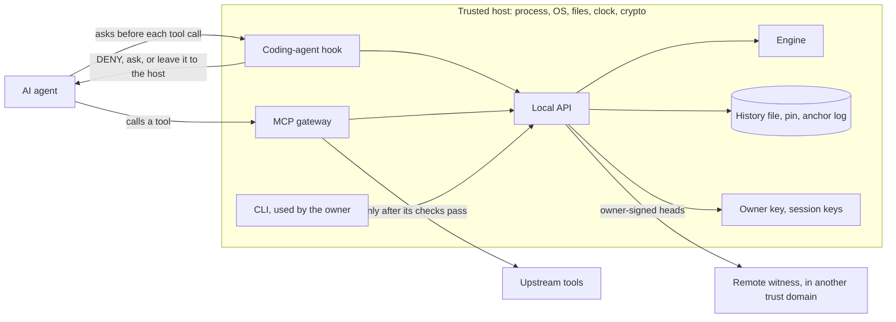
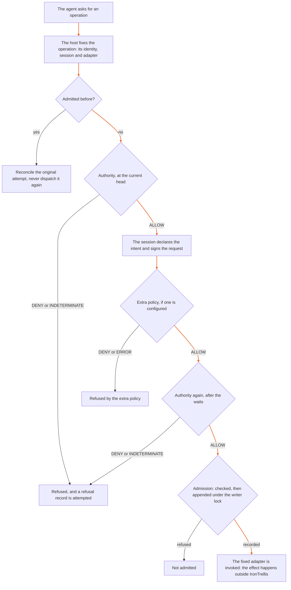

# Architecture

IronTrellis (formerly Continuity) records authority, admissions, duties and succession in a signed history. Replay rebuilds the state from that history. Authorization evaluates a request against a captured head (one exact prefix of the history) at a stated evaluation time. **A decision does not execute anything:** a host program enforces it, or doesn't.

This page shows the pieces, follows one operation through them, and marks where each piece's trust ends.

## The pieces

| Piece | Where it lives | What it does | Where its trust ends |
|---|---|---|---|
| Engine | `packages/core/src`; root export `@ramex-labs/irontrellis` | Canonical encoding, hashes, schemas, signatures, replay, authority, budgets, admissions, receipts and queries | It works on data. Files, clocks and signing callbacks belong to the host. It has no external runtime dependencies. |
| Store and signing | `@ramex-labs/irontrellis/store` | Connects replay to a JSONL history through a writer lock, compare-and-set appends and a pinned head. Pins, attestations, anchor logs and witness checks supply evidence against rollback. | Opening a handle rebuilds the state; later operations can use the cached state and read only what was appended since. |
| Local API | `@ramex-labs/irontrellis/local` | Owner, runtime, execution, observation and other handles | History paths, signers and clocks are privileged configuration. Never expose these handles to an agent. |
| Hosts | `packages/cli`, `packages/hooks`, `packages/mcp-gateway`, `packages/mcp-evidence` | The CLI, the coding-agent hook, the MCP gateway and the evidence server, which call the local API and the store | Each sees only the calls routed through it. The gateway runs upstream tools with its own OS privileges, so routing through it is part of the deployment's trust boundary. |
| Remote witness | `packages/witness` | A separately operated service that keeps a Merkle log of owner-signed heads | It holds its own checkpoint key, never the owner's key or the complete history. It is worth only as much as the independence of its trust domain. |
| Public-chain anchoring (optional) | `packages/anchor-outbox`; the gateway's [anchoring barrier](../packages/mcp-gateway/docs/LIVE-ANCHORING.md) | Publishes anchor statements of owner-attested heads to a public chain. The gateway can hold an admitted call until a qualifying anchor report arrives. | 1.0.0-rc.2 doesn't verify chain anchors itself: its anchor check produces no report, and no code in this release checks an anchor against an independently run validating node. The barrier takes the mode an outside producer's report declares on that producer's word. The separate tools used for the demonstration anchoring records report `TRUSTED_NODE` only ([known issues 54 and 71](records/KNOWN-ISSUES-r2.5.md)). |

The engine, the store and the local API ship in one package, `@ramex-labs/irontrellis`.

## One operation, start to finish

Suppose an agent asks the MCP gateway to collect evidence for `incident:42`, as an exactly-once job. The gateway runs the job through an execution handle (`openLocalExecution`), and the operation takes this path:

The highlighted path is the one that leads to an effect. The diagram is simplified: the [API guide](API.md) gives the exact order, including the dispatch hooks that can hold an admitted call before it starts and dispatch it once later. The gateway's per-call tools check current authority on every call, and record an admission only with `recordCalls: true` (see the [gateway README](../packages/mcp-gateway/README.md)).

**The coding-agent hook takes a shorter path.** Before each tool call, the agent's host app asks the hook. The hook applies its protective rules first: they refuse any call that touches the history, its keys or the hook's configuration, or that runs one of IronTrellis's writing commands. Then it checks the session and the grants. DENY refuses the call. By default, ALLOW leaves the call to the host app's own permission check. INDETERMINATE, or a tool the policy doesn't map, asks the user, or is refused where the host can't ask. An allowed call writes nothing to the history. See the [hooks README](../packages/hooks/README.md).

### What the engine checks

The engine decides in a fixed order: the request and head, then the domain, policy and actor, then (for consequential work) the session, then the permission path, and in format 2 the budgets, which can only turn an ALLOW into a DENY. The [format-2 specification](spec/SPEC-IRONTRELLIS-CORE-v2-EFFECTIVE-r5.2.md), §8.1, sets that order.

## How a write reaches the file

1. The input is captured as plain data and validated.
2. The event is signed: by the owner key for a control event, by a session key for a session event.
3. Under the writer lock, the store checks that the head is still the one the event was built on. If another write got there first, the write is refused (the local API reports `HISTORY_CONFLICT`).
4. The replay rules are applied to the event.
5. The line is appended, and then the pinned head (`<history>.head`) is rewritten.

An I/O failure can leave a write's fate unknown. The store then reports `WRITE_UNCONFIRMED` with `mayHaveCommitted: true`. Re-read and verify before retrying: a failed write may still have left its bytes behind.

## Who signs what

| Writer | Signs with | Owner attestation of the new head | Sent to remote witnesses |
|---|---|---|---|
| Owner writes: the CLI, the owner API, and the hook when a session starts | The owner key | Yes (an asynchronous signer may add it later) | Yes, queued for any bound witness |
| Session writes: execution and runtime handles, and the refusals, effects and counterparty receipts the hook and the gateway record | A session key | No: the pin carries the last owner attestation forward | No |

So records written with a session key stay unattested and unwitnessed until the next owner write or checkpoint. Events after the last attested head aren't protected by that attestation.

## Dependencies and test oracles

- The core has no external runtime dependencies. The MCP SDK packages (`@modelcontextprotocol/client` and `@modelcontextprotocol/server`) are pinned to exactly **2.2.0**.
- The Python package verifies and evaluates legacy and format-1 histories. Format 2 isn't implemented there: it refuses a format-2 file.
- The frozen reference engines (`packages/reference-0.2` and `packages/reference-0.3`) are test oracles. They are private packages, not production dependencies.
- Migration from a legacy history keeps a separate interpretation of the source for the signatures it preserves. It doesn't establish that the source was true.

## What this design establishes, and what it doesn't

**Established:** the separation shows where decisions, persistence, signing and remote evidence enter the system. The [API guide](API.md), the [history format](HISTORY-FORMAT.md) and [Conformance](CONFORMANCE.md) give the detail.

**Not covered by the architecture alone:**

| Limit | What it means |
|---|---|
| A hostile host | The engine trusts the process, OS, files, clock and crypto it runs on. A host that skips the checks isn't stopped by them. |
| Unmediated tool calls | A call that doesn't pass through the hook or the gateway is never checked. |
| External effects | A decision, an admission or a report doesn't prove what happened outside. |
| Implementation correctness | Separating the pieces doesn't make each one correct. |
| Unrecorded protective refusals | The hook's protective rules decide before the history is opened, so 1.0.0-rc.2 doesn't record those refusals. |
| One owner key beside the history | The hook admits a session with the owner key at every session start, so it needs the single owner key (its key file, or a reference to the signer that holds it) beside the history. It can't yet be used with multi-signature or offline owner keys. |
| Unattested session writes | See [Who signs what](#who-signs-what). |
| Chain anchoring | Not verified by 1.0.0-rc.2 itself: see [the pieces](#the-pieces). |

[Security](SECURITY.md) gives the full threat model. Measurements belong in [Benchmarks](BENCHMARKS.md).

*Last reviewed: 24 October 2026. This page is revisited at each release.*
