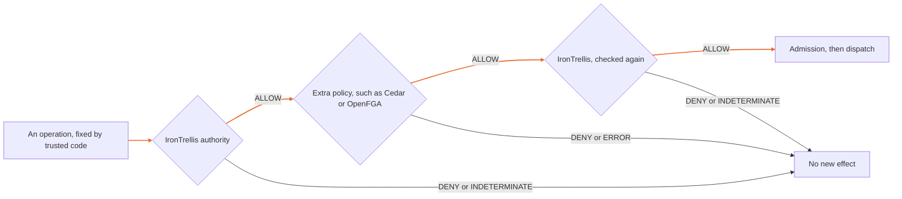

# Combining IronTrellis with policy and workflow systems

IronTrellis (formerly Continuity) records signed authority, sessions, succession and duties. From that history it answers why an actor may act, and what remains after the actor is replaced. It works alongside policy and workflow systems rather than replacing them.

## Who does what

| System | Documented focus |
|---|---|
| IronTrellis | A signed, replayable history of authority, sessions, succession and duties: why an actor may act, and what survives a replacement |
| [Cedar](https://docs.cedarpolicy.com/) | Authorization policies over principals, actions, resources, entities and context |
| [OpenFGA](https://openfga.dev/docs/fga) | Fine-grained authorization using models and relationships |
| [OPA](https://www.openpolicyagent.org/docs) | Policy evaluation over structured input and data |
| [Temporal](https://docs.temporal.io/) | Durable execution of application workflows |

These are complementary roles, not claims that another system can't be extended. The linked primary documentation was checked on 13 October 2026. This page establishes no ranking of throughput or security.

## Two policies, one operation

To add an access policy, require **both** that policy and IronTrellis's own authority to allow the exact operation, at the point where the operation is enforced. Neither one grants the other's missing permission.

IronTrellis checks again after the extra policy answers, so a slow or old answer can't revive an actor whose session has since expired or been retired.

- **An earlier answer is advisory.** An ALLOW from a past query is not a credential for a later dispatch.
- **Trusted code chooses the inputs.** It fixes the identity, the mapping, the policy configuration, the handler and the business key. A model's arguments must not choose them.
- **The extra policy's evidence records the decision context.** The exact request, the policy's identity and its answer go to an audit journal the application keeps. That record doesn't prove the policy service honest, and it doesn't make the policy's whole database part of the signed history.

The [policy-composition example](../integrations/policy-composition/README.md) shows this with Cedar and with OpenFGA.

## Workflows and retries

A workflow engine may retry a step. The retry must keep the original business operation, and reconcile any uncertainty before another dispatch. In IronTrellis, an operation that was already admitted is only reconciled, never dispatched again.

## What this page establishes

**Established:** the supplied integration examples and finite tests exercise the defined composition paths.

**Not established:** compatibility with arbitrary frameworks, exactly-once effects across distributed systems, containment of the host, or formal verification of the whole system.

Read [Security](SECURITY.md), [Conformance](CONFORMANCE.md) and the relevant package README before deploying.

*Last reviewed: 24 October 2026. This page is revisited at each release.*
