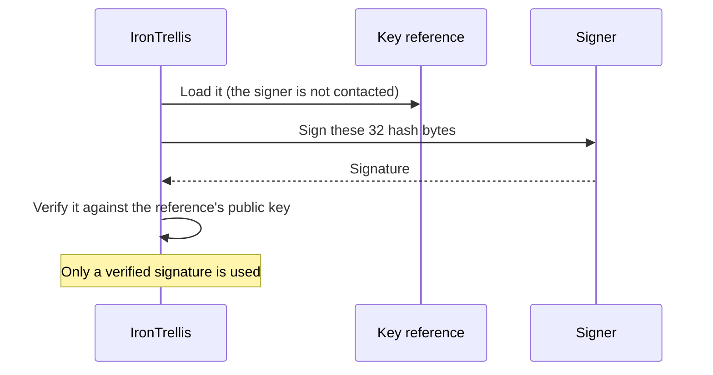
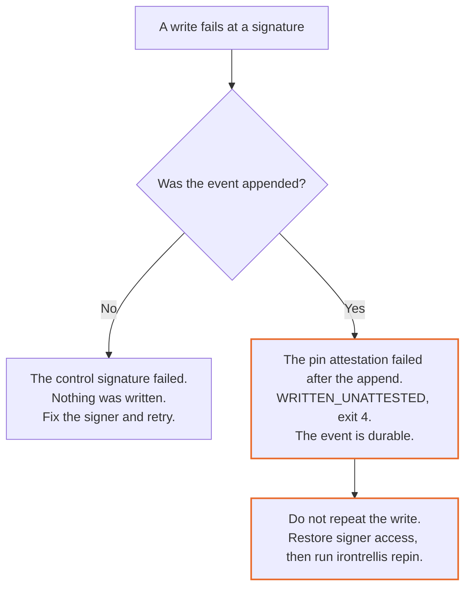

# Owner-key custody

IronTrellis (formerly Continuity) records every change of an AI agent's authority, such as a grant, a revocation or a new session, as an event signed with the history's owner key. Whoever can make that key sign can change what an agent may do, and the history still verifies. IronTrellis verifies signatures and owner-policy requirements; it cannot distinguish the owner's intention from an attacker using the same authorized signer.

So custody comes down to one question: **who can ask the key to sign?** Keep both the key material and the ability to request signatures outside the agent's reach.

## Why it matters: an example

Your coding agent runs as your own OS user, and the owner key is a file in your home directory. The agent's shell can read that file, sign a grant to itself and append it. Replay accepts the grant, because the signature is valid.

Move the key into an ssh-agent, and the agent can no longer copy it. But it can still ask the ssh-agent to sign, unless each use needs your approval or the agent cannot reach the socket. Moving a key into a signer stops theft; only a gate on the signer stops use.

**Established:** 1.0.0-rc.2 supports key files, ssh-agent, Vault Transit, command signers and programmatic signers. A signature returned through a key reference is verified locally before use. A programmatic signer's control signatures are checked before the append, but its pin attestation is written as returned: the next open refuses a bad one, and `verify` reports it (`PIN_ATTESTATION_INVALID`).

**Not covered:** a guarantee that your OS accounts, approval settings, IAM, hardware or signer service are secure. Hooks are tripwires, not an OS boundary.

**A limit today:** the coding-agent hook signs each new session start with the single owner key held beside the history, so it cannot yet be used with multi-signature owner policies or offline owner keys (§9).

The [diagnostic reference](reference/custody-diagnostics.md) lists the exact codes and outcomes.

## 1. Three custody decisions

An agent can execute code with its OS user's permissions, read that user's files and contact reachable sockets and services. Decide three things before the first write:

| Decision | What goes wrong otherwise |
|---|---|
| Who can read the key material | Theft: a readable key can be copied and used anywhere |
| Who can ask the signer to sign | Use: a key moved into a signer still signs for anything that can reach the signer |
| Where the next key lives | Recovery: a next-key commitment loses its recovery advantage when the same attacker can use both keys |

Protect against both theft and use: put the agent under another OS account or on another host, require explicit human approval, or both. Keep the **next key** separate from the current signer.

Format-2 owner, session and counterparty keys must be dedicated to this protocol: a service that signs arbitrary 32-byte hashes for other protocols can become a signing oracle. FROST share and nonce safety belongs to custody, not to the IronTrellis library.

## 2. Choose a holder

| Holder | Boundary to arrange |
|---|---|
| Local key file | Another OS user cannot read it; the same user usually can |
| OpenSSH agent | Protect its socket; confirmation needs a working askpass |
| 1Password agent | Separate vault access and an appropriate approval window |
| gpg-agent with a YubiKey | Protect the socket and configure the touch policy |
| Vault Transit | Separate signing tokens, pinned key versions and TLS trust |
| Command or application signer | Restrict the credentials and execution identity that invoke it |

The next key can be an offline file, a public-key-only commitment, or a reference to an independently protected signer. `NEXT_KEY_SAME_SIGNER` warns when the references identify the same holder. The signer contracts below define the supported interfaces; their security still depends on the holder's boundary.

## 3. Use a reference safely

A key reference is a small file that holds the public key and the instructions for reaching the signer, not the secret. Owner and next-key references have different versions. On POSIX systems the loaders require mode 0600 and the correct owner, and key and reference files are not opened through symbolic links.



Loading a reference does not contact the signer. Every returned signature is checked locally against its public key before use. To check a signer on purpose:

```sh
irontrellis signer test --ref /absolute/path/owner.owner-key-ref.json
irontrellis --history h.jsonl signer test --key current
```

A test deliberately requests a signature. `KEY_UNAVAILABLE` means the signer does not hold the required key; other signer failures are `SIGNER_FAILED`. The [reference schema, commands and reason codes](reference/custody-signers.md#3-key-references) keep the exact distinctions.

## 4. SSH-agent choices

IronTrellis requests an ordinary Ed25519 signature over the 32 hash bytes. It does not use an SSH login signature, and it does not accept FIDO `sk-` keys. The socket configured in the reference takes precedence over `SSH_AUTH_SOCK`; Windows has its named-pipe path. Destination-constrained SSH keys cannot sign these requests.

Plan for several approvals. One write may request a control approval, a pin attestation and witness statements; a rotation adds proofs and seals. The [SSH contract](reference/custody-signers.md#4-the-ssh-agent-signer) covers the supported key types, socket selection, refusal codes, approval behavior and test limitations.

## 5. Keep recovery separate

When you create the history, commit an offline public key with `--next-public-key`, or use `--next-key-ref` for a signer the agent cannot use. Rotate with the next key's signer:

```sh
irontrellis owner rotate-key --next-key-ref <file>
```

Rotation promotes the incoming reference, archives the outgoing one and commits a fresh successor. By default that successor is a newly generated next-key file on this host; `--new-next-public-key` or `--new-next-key-ref` commits to one held elsewhere instead. Staged references follow the same recovery procedure as key files.

Do not remove a retired signer until every required witness has received its rotation; a witness added later may need it too. See [pre-rotation](reference/custody-signers.md#5-pre-rotation-with-keys-held-elsewhere), [owner policies](reference/owner-policy.md) and [witness rotation](WITNESS.md#7-owner-key-rotation).

## 6. Command signers

A command signer is a program that IronTrellis starts to produce a signature, for example a script that asks a cloud KMS to sign.

| Property | How the command signer behaves |
|---|---|
| Start | No shell; it runs from the filesystem root, with absolute executable and file arguments |
| Environment | Restricted; `PATH` is not inherited |
| Timeout | Kills the process group |
| Error text | Standard error is cut to three lines and redacted; an error the program reports itself is passed on as written |
| Result | Verified locally before use |

The request's `purpose` and `historyId` are advisory and must not authorize a signing decision. The [exact request and response contract](reference/custody-signers.md#6-the-command-signer) includes the environment rules and failure handling. The Google Cloud KMS and AWS KMS scripts are examples tested with fake CLIs, not validated against the live services.

## 7. Vault Transit

Transit references pin both a public key and a key version, so a Vault-side rotation does not silently change the IronTrellis owner key. The token is read separately at signing time and is never stored in the reference. Give the current and next keys separate signing access: two keys available through one token are one holder.

The [Vault reference](reference/custody-signers.md#7-hashicorp-vault-transit) keeps the HTTP requests, PureEdDSA parameters, token precedence, TLS rules, least-privilege policies and version-loss recovery. The test suite exercises this signer against a real Vault 1.20 dev server; those tests skip, and say why, where neither Docker with the Vault image nor a configured Vault address is available.

## 8. Separate OS users

Let the agent read the history and pin, while the owner keys, references, sockets and tokens stay under another user. Do not run the agent as root. Container UID separation and unmounted signer credentials matter just as they do on a host.

Run `doctor` twice, because neither run alone proves separation:

| Run | As | To see |
|---|---|---|
| `irontrellis doctor h.jsonl` | The owner | Which signers hold the keys |
| `irontrellis doctor h.jsonl --as-agent` | The agent's actual account, in its environment | What the agent can reach |

On POSIX, keep key and reference files at mode 0600, and expose only the history and pin through a read-only group. Recheck access after any file is replaced. On Windows, ACLs replace the POSIX mode checks: set explicit ACLs, and do not infer protection from POSIX modes.

## 9. Hooks and gateways

**The coding-agent hook needs the owner key beside the history, today.** When it admits a new session, the hook writes control events: it creates the agent if needed, admits the new session and, when it must, fences an earlier one. It signs them with the single owner key held at `<history>.owner-key.json`, which may be the key itself or a reference to the signer that holds it. It has no way to collect co-signatures, and `irontrellis-hook init` refuses an existing history whose owner key is not there.

So in 1.0.0-rc.2 the hook cannot be used with:

- **a multi-signature owner policy:** under an owner approval policy that needs two or more signatures, its session starts are refused;
- **offline owner keys:** without a usable key beside the history, it cannot admit a session.

Either way no session is admitted, and every tool call is denied (`SESSION_NOT_FOUND`). If the key is held in a signer, the hook asks that signer to sign at each new session start, so plan for its approvals then (§4).

Tool decisions read the history without requesting owner signatures. The protective rules catch named key and reference paths, signer commands, sockets and token paths, including some aliases. They do not stop arbitrary programs from using a reachable signer: never rely on a hook to hide a token. Reference and version literals, key paths and known signer paths are protected, but computed strings, and programs that open sockets without naming them, remain outside that detection.

The MCP gateway does not share this limit: once the owner has admitted its sessions, it records with their keys (its own session's, and its connector session's when configured) and needs no owner key to serve calls.

## 10. Recover according to what was written

A signer failure means different things before and after the event is appended:



Lost-key recovery depends on the epoch's commitment and policy. Do not assume that every next key can bypass current-owner authorization. The [failure contract](reference/custody-diagnostics.md#signer-failures-and-recorded-writes) distinguishes missing keys, version loss and recorded writes, and the [owner-policy reference](reference/owner-policy.md) supplies the format-2 recovery conditions. Preserve the history as an archive when no permitted recovery remains.

## 11. Audit with `doctor`

```sh
irontrellis doctor h.jsonl
irontrellis doctor h.jsonl --as-agent
```

The second command must run as the agent's user, in its environment. `doctor` is read-only: it makes no signature, no history write and no cache update.

| `doctor` may | `doctor` never |
|---|---|
| List SSH identities | Executes a command signer |
| Read Vault key metadata | Requests a signature |
| Contact a bound witness | Writes to the history or a cache |

`--offline` contacts nothing. An unreadable reference prevents an all-clear claim about its signer. The [finding table](reference/custody-diagnostics.md#11-irontrellis-doctor) keeps every code and exit status.

## 12. Move an existing key carefully

Moving a key into a signer leaves its identity unchanged, and it does not undo a prior copy. If theft was possible, rotate instead. `irontrellis signer to-ssh` exports a current key for an SSH holder; protect that export immediately. A reference then selects the same public key. Prefer rotating onto a newly generated signer key when the old file's secrecy is uncertain.

## 13. Add a backend

A backend validates references, describes and identifies the holder, and returns a raw signature or a mapped failure; the wrapper performs the local verification. See the [backend interface](reference/custody-signers.md#13-adding-a-signer-backend). Registering a backend does not establish its custody security.

*Last reviewed: 24 October 2026. This page is revisited at each release.*
