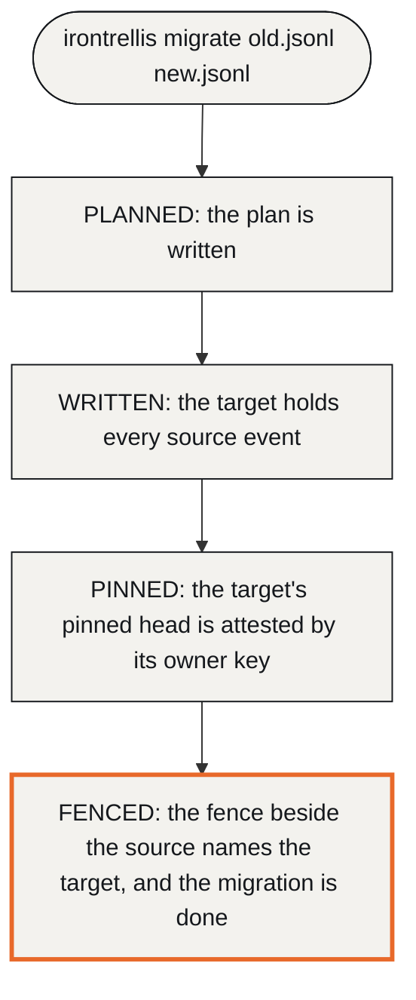

# Migrating from Continuity

IronTrellis (formerly Continuity) keeps a signed, replayable history of who may act for whom. This page is for anyone moving Continuity code, or history files written in the Continuity era, to IronTrellis 1.0.0-rc.2.

Two things move, and they move separately:

- **Your code** moves by renaming packages and changing a few calls (sections 1 and 2).
- **Your history files** stay as they are until you convert them. A new package name or domain version does not migrate a signed history: each file keeps its own profile and compatibility rules. 1.0.0-rc.2 opens older files read only, and converts one to format 2 only when you ask, as an explicit, signed step (section 3).

Keep the source archive, and verify every supported transition with the implementation you choose.

## Format 2, the target

1.0.0-rc.2 writes history format 2, and publishing 1.0.0-rc.2 releases format 2. Histories written by 1.0.0-rc.2 keep their verdicts: later versions read them exactly as 1.0.0-rc.2 does, or refuse them, and rule fixes after 1.0.0-rc.2 come as a new format. That includes a history you migrate with 1.0.0-rc.2: the target is a format-2 history it writes.

Format 2 as released means challenge profile g3, the default. (A challenge profile fixes exactly what a session signs.) The other profile, `frozen-r2.3`, only verifies the frozen conformance vectors.

## An example first

Say your team ran Continuity and has a history at `team.jsonl`. The move takes four commands:

```sh
irontrellis migrate --status --history team.jsonl
irontrellis migrate team.jsonl team-v2.jsonl --accept-unpinned-source
irontrellis migrate --status team-v2.jsonl.migration-plan.json
irontrellis --history team-v2.jsonl verify
```

1. **Ask what the file is.** For a legacy or format-1 history, the first command answers `NEEDS_MIGRATION` (a file this release reads but doesn't write) and prints the command to run next.
2. **Migrate it.** Continuity never pinned its files, so a Continuity source needs `--accept-unpinned-source`. Before you pass it, compare the file with a copy you trust ("The source pin", below, says why). The command writes `team-v2.jsonl`, signed under a new owner key in `team-v2.jsonl.owner-key.json` (its options can name a key a signer holds instead). By default it also commits the new history to a next owner key, written to `team-v2.jsonl.owner-next-key.json`, which you then move off this host. It prints the new history id.
3. **Check where it stands.** The third command reports the phase the plan reached. After a complete run that is `FENCED`, and the next step it names is to point hooks, gateways and the CLI at the target. If a run was interrupted, running the same `migrate` command again resumes from where it stopped.
4. **Verify the target.** Then point hooks, gateways and scripts at `team-v2.jsonl`, and set the new history id as `historyId` in the hook and gateway configurations.

`team.jsonl` itself is never modified. It stays as the archive, with a fence file, `team.jsonl.migrated`, beside it, and every write to it is refused.

## 1. Moving your code

| Continuity | IronTrellis 1.0.0-rc.2 |
|---|---|
| `@ramex-labs/continuity`: the local owner, runtime and execution APIs | `@ramex-labs/irontrellis/local` and the documented core entry points |
| The Continuity engine and store | The core's root entry point and `/store`, under the supported history profile |
| `@ramex-labs/continuity-mcp-gateway` and `@ramex-labs/continuity-mcp` (the evidence server) | `@ramex-labs/irontrellis-mcp-gateway` and `@ramex-labs/irontrellis-mcp` |
| `@ramex-labs/continuity-remote`: the cooperative remote contract and tools | `@ramex-labs/irontrellis-remote` and `@ramex-labs/irontrellis-remote-tools` |
| Agent execution integration | `@ramex-labs/irontrellis-managed-agents`, `@ramex-labs/irontrellis-agent-shims` and the three integrations in `integrations/` |
| `continuity-*` commands | `irontrellis-*` commands |
| MCP Registry entries `io.github.zerohourzulu/continuity-gateway` and `…/continuity-evidence` | `io.github.zerohourzulu/irontrellis-gateway` and `…/irontrellis-evidence` |
| `ContinuityError` and `ContinuityErrorCode` | `IronTrellisError` and `IronTrellisErrorCode`; the old names remain as deprecated aliases until the release after 1.0 |

The gateway's `/http`, `/cooperative`, `/tasks` and `/access-http` entry points are part of this release. The MCP client and server libraries are pinned to **2.2.0**.

If you build, fork or repackage these packages, keep their workspace dependencies, `publishConfig`, the `default` export entries and the full `1.0.0-rc.2` version spelling. Keep the repository's NOTICE and the required third-party notices too. An older suggestion to discard dependency notices doesn't apply to this package set.

## 2. Changing callers

Change callers deliberately; not every habit from Continuity carries over.

| Topic | What to do |
|---|---|
| Writes | Every write that appends to a history is asynchronous: `await` owner, runtime, execution and attempt operations. Don't infer that a format-2 API is synchronous from the old migration guide's blanket list of queries; follow the installed declarations and [API](API.md). |
| Evaluation time | An owner handle evaluates at the trusted clock supplied to it. A reader of a captured history has its own explicit rules (`observeHistory` evaluates at the captured head's time). Where freshness matters, pin the head you mean (`expectHead`). |
| ALLOW | An ALLOW is advisory. The dispatch path must perform its own admission and current-authority checks. |
| Configuration | Keep signers, history paths, clocks, tenant, workflow and session bindings, policy mappings and effect handlers in trusted configuration. |
| Uncertain outcomes | An unknown outcome, or `mayHaveCommitted`, means inspecting the original operation. Never use a new business key to turn an uncertain attempt into a retry. |
| Old storage paths | Remote segmented-history migration and the managed-agent signed-ledger import are not automatically supported by their format-2 replacements. The [remote](../packages/remote/README.md) and [managed-agents](../packages/managed-agents/README.md) READMEs describe the exact exceptions. |

### Deliberate departures from Continuity Core 0.2.2

Each of these changes an answer in a specific case; everything else is checked against the frozen reference by the differential tests and the legacy vectors.

* `RESPONSIBLE` answers instead of throwing on unsorted grants.
* In format 2, declared limits (`maxEvents`, `maxStateRecords`) and the capacity reserve never refuse a control event (revocation, termination, unappointment, epoch advance); the hard limits (1,048,576 state records, 1 GiB) refuse every event, control events included.
* On an owner handle, `observe()` defaults to the handle's `now` clock, where the reference used the head's time; the decision methods already used that clock, and now also accept `at`.
* The 128-event cap on administrative producers is gone; the 1 MiB input bound remains.
* Denials in format 1 and format 2 cite only the evidence relevant to the request, except `INVALID_DELEGATION`; legacy histories keep the reference's whole-history evidence.
* Outside legacy histories, receipt creation, record admission and verification from a state have no history-length bound; portable receipt verification keeps the reference's 4,096-event bound unless every history it is given is format 1.

## 3. Converting a history

### What each kind of file can do

| The file | Questions and `verify` | Writes |
|---|---|---|
| Continuity (legacy, `continuity-event/0.2`) | Work | Refused: `FORMAT_READ_ONLY`, `detail.reason` `LEGACY` |
| Format 1 (`irontrellis-event/1`) | Work | Refused: `FORMAT_READ_ONLY`, reason `FORMAT_1` |
| A migrated source (with a `.migrated` fence beside it) | Work | Refused: `FORMAT_READ_ONLY`, reason `MIGRATED` |
| Format 2 | Work | Allowed |

### The commands

```sh
irontrellis migrate old.jsonl new.jsonl [--plan <file>] [--accept-unpinned-source] [--no-next-key]
irontrellis migrate --status [<plan>]
```

A migration moves through four phases, recorded in its plan file:



A re-run with the same plan resumes. `--status` reports the phase, whether the outputs verify, and the next step. The library call is `migrateHistory` (see [API](API.md) §3). The legacy-to-format-1 `migrateHistory` contract in [the migration and store reference](reference/api-migration-store.md) is historical; don't follow it.

### Sources that are refused

Among the sources `migrate` refuses with `MIGRATION_UNSUPPORTED`:

| Source | `detail.reason` |
|---|---|
| A format-1 history that was itself migrated from legacy | `SOURCE_ALREADY_MIGRATED` |
| A format-1 history that rotated its owner keys | `SOURCE_KEY_ROTATED` |
| A format-1 history that bound witnesses | `SOURCE_WITNESS_BOUND` |
| A source already fenced to another target | `SOURCE_FENCED` |
| A format-2 history | `SOURCE_FORMAT_2` |

The first three stay readable and verifiable, read only ([known issue 15](records/KNOWN-ISSUES-r2.5.md) covers the rotation and witness cases).

### The source pin

The source's pinned head must match the file, unless you deliberately accept an unpinned legacy source with `--accept-unpinned-source`. That choice carries a risk: unsigned legacy control events could have been changed before the migration, and signing the converted history does not retroactively authenticate them. Compare the source against independently trusted copies before you accept it.

An existing target, or conflicting custody state, calls for the documented refusal and recovery procedure, not an overwrite.

### Keep the archive

A migrated history and its source can answer different, profile-specific questions: for intents signed in a legacy domain, the WHY and RESPONSIBLE answers may need the archive. Preserve the domain, canonical form, signature scheme and historical BigInt markers exactly where the profile requires them. [HISTORY-FORMAT](HISTORY-FORMAT.md) describes the current migration-prefix rules, and the [operator key procedures](reference/operator-keys.md) cover lost keys and custody limits.

### Is a file eligible?

Not every Continuity preview history or owner-policy configuration is eligible. Run `irontrellis migrate --status --history <file>` to see which of four kinds a file is:

| Answer | Meaning |
|---|---|
| `NATIVE_FORMAT_2` | A history created in format 2: nothing to migrate |
| `MIGRATION_TARGET` | A format-2 history migrated from an older one |
| `FENCED_SOURCE` | A migrated source, kept read only; the answer names its target |
| `NEEDS_MIGRATION` | A legacy or format-1 history that still needs migrating |

Unsupported continuation and duty record profiles must fail explicitly. Successful legacy differential cases are not universal compatibility evidence.

## 4. What's established, and what isn't

**Established:** the retained legacy compatibility evidence, explicit profile-scoped migration APIs, and the integrated packages' own tests. Owner policies and the attestation policy for PHL, Proof of Human Lineage, ship in 1.0.0-rc.2. The frozen Python package stays legacy and format-1 only; the separate format-2 checker is advisory.

**Not established by this guide:**

- a new migration run;
- universal byte or decision equivalence across formats;
- preserved external service effects;
- chain deployment parity;
- a safe recovery from every lost credential.

Chain anchoring, for its part, isn't verified by 1.0.0-rc.2 itself: its anchor check produces no report, and the separate tools used for the demonstration anchoring records report `TRUSTED_NODE` only ([known issues 54 and 71](records/KNOWN-ISSUES-r2.5.md)).

Keep the backup, custody and witness procedures from [OPERATOR](OPERATOR.md) and [SECURITY](SECURITY.md) alongside the conversion plan. To see where any file stands, start with `irontrellis migrate --status --history <file>`.

*Last reviewed: 24 October 2026. This page is revisited at each release.*
