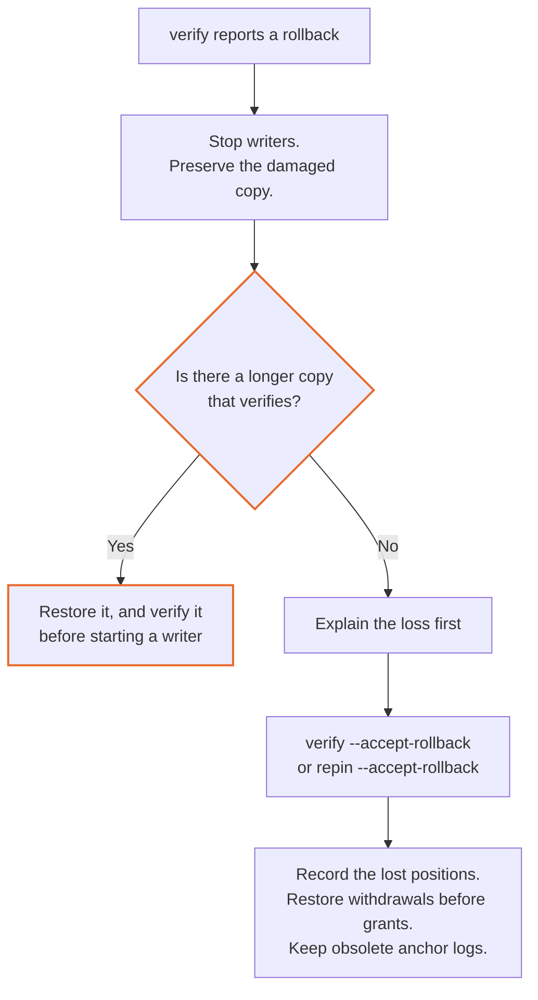

# Operating IronTrellis for a team

This is the history owner's runbook. An IronTrellis (formerly Continuity) history is the signed record of what your agents may do. As its owner you choose custody and retention, verify evidence, watch capacity and sessions, and recover without hiding an unknown outcome.

Keep one limit in view throughout. The recorded history establishes facts within its declared format and captured scope. It does not establish that every real-world action was captured, and a local signature alone does not detect the restoration of an older, previously attested copy.

Use [SECURITY](SECURITY.md) for the threat model, [CUSTODY](CUSTODY.md) for signer setup, [WITNESS](WITNESS.md) for witness administration and [API](API.md) for application handles. The complete commands, file tables and error-specific procedures are kept in the references linked below. This guide contains no performance measurements; for measured costs, use [BENCHMARKS](BENCHMARKS.md).

## 1. Choosing the format and the keys

### The format

Use format 2 for current writes; [HISTORY-FORMAT §1](HISTORY-FORMAT.md#releasing-format-2) says what releasing it promises.

| Format | In 1.0.0-rc.2 | Notes |
|---|---|---|
| Legacy | Read only | Its control events are unsigned |
| Format 1 (historical) | Read only | Added signed control events, pins, anchors and event budgets |
| Format 2 | Read and written | Supplies the current state-record, snapshot and owner-policy rules |

Current writers refuse legacy and format-1 histories, and fenced migration sources, with `FORMAT_READ_ONLY`. The format is recorded in the genesis; upgrading a package is not permission to rewrite that genesis.

### Owner approval policies

Owner approval policies, including `ATTESTED`, ship in 1.0.0-rc.2. They provide thresholds, per-type thresholds, power reduction by effect (`PR_eff`), credential separation, committed-key recovery, lapse, restoration and the T1/T2 time rules. Read the [owner-policy reference](reference/owner-policy.md) before designing a ceremony or a recovery procedure. A one-key local writer does not acquire the authority of a multi-key quorum merely because it is the owner handle.

### The keys

Decide where the current and next keys live before the first write. A local key file is appropriate for an explicitly chosen single-user setup; protect its directory and keep it out of version control. Shared deployments can use signer references or a KMS- or HSM-backed `Signer`. The signer must also be out of the agent's reach: moving key bytes off the host does not help if the agent can freely use the signer.

**If you will run the coding-agent hook:** it signs each new session start with the single owner key at `<history>.owner-key.json`, so today it cannot be used with a multi-signature owner policy or with offline owner keys ([CUSTODY](CUSTODY.md) §9).

A next-key commitment protects rotation only while its key is kept separately. `irontrellis init` creates a format-2 history and commits to a next key like this:

| `irontrellis init` option | The committed next key |
|---|---|
| None (the default) | Generated and written to `<history>.owner-next-key.json` |
| `--next-public-key <key>` | A public key whose private half is held elsewhere |
| `--next-key-ref <file>` | The key held by the signer that the reference names |
| `--no-next-key` | None: the history has no commitment |

Keep any generated next key offline, with two protected copies. Do not silently adopt a pre-existing key file with `--reuse-existing-key`.

### Witness, budgets and identifiers

Select a witness in another trust domain, and bind it at creation when possible. To cover copies from before a binding, configure the out-of-band minimum policy where the agent cannot change it. Choose event budgets for histories with a known lifecycle, and distinguish them from format-2 state-record limits. Use permanent, meaningful ids without secrets. Every option and format detail is in the [start and backup reference](reference/operator-start-backups.md).

## 2. Backups

Back up from a quiescent state, with writers stopped. Keep old verified copies: a shorter, internally valid chain can still have lost revocations.

| Material | Backup rule |
|---|---|
| History, `.head`, applicable `.anchors` and `.witness.json` | Keep the matching set together; the witness state can contain registration tokens |
| Owner key or signer reference | Protect it separately; a history snapshot is not a key backup |
| Committed next key | Keep offline copies, outside the agent host and its ordinary backups |
| Retired owner keys | Keep them protected and offline; a witness missing a rotation, including one added later, may still need an old-key statement |
| Session keys and gateway storage | Preserve them separately when a restore must resume those sessions or answer retained job outcomes |
| Pending rotation files | Do not back them up or restore them independently of the recorded rotation state |

A gateway snapshot excludes owner and session keys, so by itself it cannot restore the ability to write control events. The [complete backup inventory](reference/operator-start-backups.md) explains side files, consistent snapshots, incomplete lines and separate key custody. Treat snapshots as sensitive until their contents have been checked before distribution.

Verify every restore before starting a writer. With witnesses, the restored copy must contain the witnessed head; the witness cannot supply the missing events. A backup that fails verification is not a usable recovery copy.

## 3. Verification and anchoring cadence

For a chosen history, the CLI's global `--history` option makes the target explicit:

```sh
irontrellis --history ./history.jsonl verify --json
irontrellis --history ./history.jsonl status
irontrellis --history ./history.jsonl witness status
```

Decide on `ok` (for `verify` and `witness status`, the exit status says the same; `status` always exits 0), then inspect the failures and notes.

### Check the identity, not only the chain

An auditor, or anyone checking a history they did not write, should always pass the history id and the first owner keys that the history's owner published, taken from a source outside the file:

```sh
irontrellis --history ./history.jsonl verify --expect-history-id 0x… --expect-owner-key 0x…
```

| Without the published values | With them |
|---|---|
| Verification reads the history id and owner keys from the file itself. A substitute history (the same events re-signed under keys of its author's own) verifies cleanly, and the report says that the identity was not confirmed. | A different history is refused with `HISTORY_ID_MISMATCH` or `OWNER_KEYS_MISMATCH` before anything else is checked. |

As the owner, publish what `irontrellis init` (or `irontrellis-hook init`) prints at the end under "Publish these": the history id and the first owner keys, with the command a reader runs. `verify` shows the same values. Publish them somewhere readers can check independently of the file.

Verify a copy that nothing else writes to. With the published values, `verify` also reads the file again after the verification: if it is now another history, or no longer has the verified head on its chain, `verify` refuses with `HISTORY_CHANGED`. Events appended to the same history in between are not refused.

### Cadence

Run verification after a restore, and on a schedule that alerts on failure. A busy gateway may need hourly checks; a slower ledger may use daily checks. These are operating choices, not performance guarantees.

The hook's refusals and the gateway's records are signed by session keys only, so they have no owner attestation or witness statement until the next owner write; sooner, `irontrellis repin` attests the current head and `irontrellis witness sync` brings the witnesses up to it ([SECURITY](SECURITY.md) §3). Read `verify`'s notes for a carried earlier attestation or an unwitnessed tail.

### Anchors and other verifiers

Supply independent anchor-log copies with `--anchors-file` where appropriate: an anchor kept only beside the history can be restored with it. A remote witness is consulted by witness-aware verification; an ordinary reader is not necessarily a live network check.

The frozen Python verifier is an additional implementation check for legacy and format 1; it does not support format 2. It checks the chain and signatures but does not read the local `.head` or `.anchors`, so a truncated valid prefix can pass it. Keep the local pin, anchor and witness verification as well.

`anchor` attests a head and records an anchor receipt. The experimental Rekor path has not been exercised against a live service, and it cannot enumerate the log for the local verifier. `repin` advances an owner attestation when a valid pin carries an earlier prefix; it refuses evidence of rollback rather than blessing a possibly shortened history. `--accept-rollback` records the acceptance of a loss, and is reserved for an understood incident.

Flush asynchronous signer and witness work before a short-lived process exits: a signature or network error after an append can leave the event durable. See [verification, pins and cadence](reference/operator-start-backups.md) and [API error handling](API.md#11-errors).

## 4. Owner keys: what is and is not supported

A rotation changes the owner-key set for subsequent positions. It does not invalidate earlier control events, or protect a copy cut back to before the rotation. Retired key ids and credentials cannot simply be reused. Policy-enabled histories must also satisfy their current quorum, counting, floor, time and commitment rules.

The local writer cannot produce every recovery ceremony that replay accepts. A recovery rotation is one: replay accepts it, but recovering a lost quorum needs an external producer of that event, which this release neither ships nor documents ([known issue 24](records/KNOWN-ISSUES-r2.5.md)).

Legacy and format-1 histories are read only in the current writer, whatever key custody is restored. Migration creates format 2 from either, with a plan, a source fence and resume: `irontrellis migrate <source> <target>` ([MIGRATION](MIGRATION.md)). An already legacy-migrated format-1 source is refused with `MIGRATION_UNSUPPORTED` (`detail.reason: "SOURCE_ALREADY_MIGRATED"`). The legacy-to-format-1 command in older references is historical. For format-2 lost-key recovery, use the actual policy and commitment rules and a suitable ceremony tool, rather than extrapolating the old single-key limitation.

### 4.1 Pre-rotation: committing, storing and using the next key

These commands write to a format-2 history and must satisfy its owner policy.

1. Inspect `irontrellis owner status`. Record the committed next-key digest with the offline copy.
2. If the current epoch has no commitment, `irontrellis owner commit-next-key` can add one. It refuses an epoch that already has a commitment.
3. Keep the next key offline, or commit to a public key whose private half is held elsewhere. Keep two protected copies where applicable.
4. Rotate with the committed key and a reason, `irontrellis owner rotate-key [--next-key <file>] --reason "<why>"`. For example:

   ```sh
   irontrellis owner rotate-key --next-key /media/offline/history.jsonl.owner-next-key.json --reason "scheduled rotation"
   ```

5. Inspect the result. The revealed key is now a current owner key; label or dispose of its old offline copy accordingly. Move the freshly committed next key offline.
6. Verify the witness delivery, and keep the retired key under the custody rules.

A missing committed next key is not replaced by inventing another key or editing its commitment. A crash may leave staged files or a prepared two-phase record; the next owner operation settles them according to the recorded history and the witness evidence. Do not delete unread pending files merely to clear an error. The [full key procedures](reference/operator-keys.md) and the [API crash table](reference/api-owner.md) cover the branches.

### 4.2 Keeping the owner key in a signer

Built-in references support SSH agents, command signers and Vault Transit. Configure the selected key and backend, then check it:

```sh
irontrellis --history <history> signer test --key current
irontrellis doctor <history>
```

The signer test makes a signature; `doctor` is a read-only audit. Run the audit as the agent's actual OS user as well, with `irontrellis doctor <history> --as-agent`.

Keep signer sockets, tokens and usable credentials out of the agent's environment, or enforce an independent approval boundary. A hook's string-matching protection is a tripwire, not OS isolation: on a default same-user layout, a run-shell grant can expose owner authority.

If a signer refuses before the control signature, nothing is appended. If the pin attestation fails after the write, the event is recorded: restore the signer and repin, rather than issuing the operation again. Backend commands, key-version pinning and recovery cases are in the [key and signer procedures](reference/operator-keys.md).

## 5. Monitoring

Watch:

- verification failures;
- pin, anchor and witness status, including witness queues and `UNWITNESSED_TAIL`;
- capacity and file size;
- session expiry and open duties;
- writer-lock age and conflict rates;
- recorded equivocations and incomplete rotations, which should raise an alert.

A handover with open duties for a terminated agent requires an operational response; the report itself assigns no new authority.

Event-budget `CONTROL_ONLY` is different from an invalid history: it refuses new work. In format 2 it still admits every control event (new grants and session admissions included) and the lifecycle records of jobs already declared; in format 1, only the documented withdrawal and lifecycle operations. Its genesis budget is not changed in place. File limits and replay costs can require a successor before a numerical cap is reached. Consult the [full monitoring table](reference/operator-monitoring-incidents.md) for the fields, and the [benchmark report](BENCHMARKS.md) for measured costs.

**Plan a successor before a limit forces one.** `irontrellis doctor` advises a successor history at about 500,000 events or 500 MiB, and fails a history within 10% of its hard file limit, where writes stop with `HISTORY_FILE_LIMIT`. To move on, create a new history with `irontrellis init`, re-create what is still live, and keep the old one as a read-only archive.

### 5.1 Format-2 cost and caches

The snapshot and its journal are caches. Corruption can require a full replay and a rebuild; oversized snapshots are discarded under the documented limits.

A genesis `maxStateRecords` cannot be raised within the same history. Non-control events are refused when their resulting record count would exceed it. Controls that remove records can restore room, but the absolute cap refuses every event: do not rely on record removal as the recovery plan.

Hooks and gateways can spool refusals that could not be recorded in time. Preserve the distinction between the canonical history, the refusal spool and disposable local rendering logs. Exact bounds and paths are in [format-2 monitoring](reference/operator-monitoring-incidents.md).

### 5.2 Enforcing from an older file

`enforceFromReadOnlyHistory`, a field you set by hand in the hook's or the gateway's configuration, lets them keep enforcing from a never-migrated legacy or format-1 history, read only. Decisions read the file, and every open warns. Anything that must be recorded fails closed:

| Opted in | What happens |
|---|---|
| The hook | It admits no session, and therefore denies every tool call. The denial is reported as `FORMAT_READ_ONLY` with the remedy "run `irontrellis migrate` to write", not only as `SESSION_NOT_FOUND`. |
| The gateway | It serves only calls that need no record. A call that must be recorded is refused with `FORMAT_READ_ONLY` and the same remedy, before anything is dispatched: in exactly-once mode every job, in per-call mode a call it records. A per-call DENY is still answered DENY, and no refusal is recorded. |

Run `irontrellis migrate` to write.

### 5.3 Session time horizon

A history created with `init --session-time-horizon <ms>` (or `migrate --session-time-horizon <ms>`) bounds every session-signed and administrative event to at most H past the latest owner event that advanced time (`ownerTime`). A session whose clock has passed `ownerTime + H` stops recording until an owner writes a control event that advances time.

When that happens, the writer does not sign. The API refuses with `TRANSITION_REJECTED` and `detail.reason: "SESSION_TIME_HORIZON"`, recording reports that reason, and a spooled refusal stays spooled (`spooledRefusalCount` counts the spool).

Choosing H, and living with it:

- Keep H below the shortest `FIXED_WINDOW` `lengthMs`, and below the `notBefore` lead of the grants that matter.
- An unattended deployment needs a scheduled owner process that writes a `STATE_CHECKPOINT` at intervals below H minus the reader's clock skew. `checkpointPolicy` counts events and does not suffice, and this keeps an owner key online.
- A checkpoint is refused with `CLOCK_INVALID` while the head is ahead of the owner's clock.
- After `migrate` with the field set, sessions that survive the prefix cannot write until the first time-advancing owner event; `migrate` prints this.

## 6. Incident playbook

Preserve evidence, and find out whether a write may already be durable before retrying. The [complete incident reference](reference/operator-monitoring-incidents.md) contains every verification code and the recovery commands.

| Incident | First response |
|---|---|
| Pin missing, malformed, invalid or ahead of the file; anchor shows a later head | Stop writers; compare matched backups and independent anchor and witness evidence |
| Witness ahead, or on another fork | Find a copy containing its latest head; a local `--accept-rollback` does not override it |
| Witness split view or invalid response | Investigate its key, endpoint, consistency evidence and storage; do not classify invalid evidence as ordinary unreachability |
| Invalid history or control signature | Preserve the damaged copy and restore a verified one; any valid-prefix salvage is an explicit loss procedure |
| Compromised owner key | Rotate under the applicable policy and commitment, deliver the rotation, review suspect changes and revoke them |
| Compromised session key | Advance the agent's epoch, admit a fresh session and review the affected grants |
| Stale writer lock | Confirm the writer is dead before removing the lock by hand; never remove a possibly live writer's lock |
| Capacity refusal | Follow the relevant event, state or file limit; arrange a successor when required |
| `WRITE_UNCONFIRMED` or unknown job outcome | Verify and reconcile the existing identity; do not invent a new business key to force a retry |

### When a local copy may have been rolled back



Accepting a rollback does not waive an unreadable anchor log.

### When a remote witness holds what no copy has

For a remote-witness loss with no surviving complete copy, the documented owner-signed `witness remove … --accept-loss --reason …` is a separate, explicit branch decision; other witnesses still apply. It is not ordinary rollback acceptance, and it does not restore the missing events.

### Torn lines and proof-size answers

A torn final line has no automatic repair command. Stop writers and preserve the damaged bytes before following the reference's last-newline procedure, then verify. If the pin does not match, investigate broader loss.

An `OUTPUT_LIMIT_EXCEEDED` answer is not an ALLOW: refine the question, or use the documented prefix or migration route.

## 7. The gateway operator command

`irontrellis-mcp-ops` provides `inspect`, `revoke`, `snapshot`, snapshot `verify` and `recover-dead-host`. A consistent snapshot and separate key backups serve different purposes. Take backups with writers stopped, and preserve the gateway storage that records attempts and replies.

After a crash, reconcile the original job identity. Previously run work can return `RECONCILIATION_ONLY` or `OUTCOME_UNKNOWN`; it must not be sent again under a new business key. The [gateway reference](reference/operator-integrations-platforms.md) keeps the command flags, the snapshot inventory and the lease behavior. The MCP SDK packages (`@modelcontextprotocol/client` and `@modelcontextprotocol/server`) are pinned at exactly **2.2.0** for this release.

## 8. The hook's state and handover files

The hook normally stores project state under `~/.irontrellis/projects/<hash>/`, outside the project: the history, its side files, the owner key beside it, session keys and handover records. They need their own backup policy. The project's configuration points to the history, and hashed session ids form the file names.

What the hook writes to the history:

| Hook event | Recorded in the history |
|---|---|
| Session start | For a new session, owner-signed events: the agent, role and appointment if missing, the session admission, and an epoch advance when it fences an earlier session. A resumed session writes nothing |
| Allowed tool call | Nothing |
| Tool call refused by the grants, or by an agent without a current session | A refusal (format 2), signed by the agent's session or by the hook's own connector session |
| Tool call refused by a protective rule | Nothing |
| Stop or session end | Nothing: the handover record is written to a file under `<history>.handovers/` |

A handover record lists duties, grants, sessions, tenures and the SURVIVES answer. It grants nothing. After a killed session, inspect `irontrellis-hook session list`, and release stale session keys with `irontrellis-hook session release`, so that the next session can be admitted and fence the prior epoch. Keep expired keys private until they are removed under the retention policy.

The [hook layout and session procedures](reference/operator-integrations-platforms.md) keep the exact file names and commands. Separate OS users, or independently controlled signer access, are required when the agent must not be able to grant itself authority.

## 9. Upgrades

Upgrade readers before writers. Verify a copy with the new version before using it on the live history, and require the conformance vectors for the format in use. A newer package reads the formats it supports; it does not silently convert a genesis.(delete; keep the paragraph's other sentences)

Keep the earlier programs and evidence needed to explain the history. Python and TypeScript verification, and witness and client upgrades, have their own documented compatibility boundaries.

## 10. Remote witnesses

Get the verifier key out of band. Bind the witness at creation, or add it to an existing history and use an independently protected minimum policy to cover older copies. Require HTTPS outside the documented loopback and insecure exceptions; signed-answer freshness and transport confidentiality are separate concerns.

Routine commands are `irontrellis witness status`, `irontrellis witness sync` and witness-aware `verify`. Watch required-answer counts, queued statements, recorded equivocations, `ROTATION_PENDING` and `ROTATION INCOMPLETE`.

For a rotation, inspect the reported outcome. These are distinct states:

- a definite abort;
- an unknown delivery outcome;
- a durable rotation with incomplete delivery;
- an emergency, local-first rotation.

Do not clear pending records by hand, or destroy retired keys while they are still needed for witness delivery. Offline key-event bundles can deliver a recorded rotation to an unreachable witness; they contain signed data, not private keys.

To replace a witness:

1. Add the new witness.
2. Wait until it holds the current head.
3. Unbind the old one.

Copies from before the unbinding still name the old witness. The full commands, side files, alarms, emergency supersede and offline imports are in the [witness operating procedures](reference/operator-integrations-platforms.md) and [WITNESS](WITNESS.md).

## 11. Windows hosts

The documented Windows job is a CI target; Windows counts as CI-tested only after that job's first green run, and no production use is claimed. Restrict directories with ACLs before key creation, because POSIX mode checks do not apply there. Use drive-qualified or UNC paths for the minimum witness policy, and a real executable for a gateway upstream.

Antivirus or indexing locks can exhaust replacement retries. Preserve and inspect a failed pin write; do not assume it undid the append. Avoid editing history or witness logs: their newline and byte-order-mark rules differ. The [Windows operating reference](reference/operator-integrations-platforms.md) and [PLATFORMS](PLATFORMS.md) give the exact ACL, process, retry and encoding behavior.

*Last reviewed: 24 October 2026. This page is revisited at each release.*
