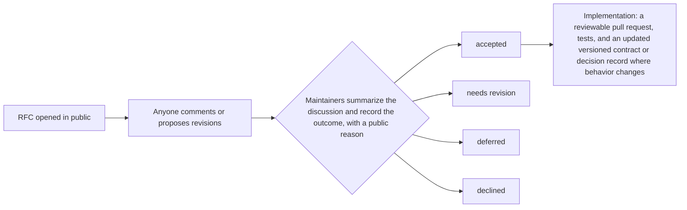

# Propose a change

IronTrellis (formerly Continuity) welcomes questions, issues, forks and pull requests. This page says which changes need an RFC (a short, public proposal), what to put in one, and how a decision on it is made.

## Which path to take

| You want to | Do this |
|---|---|
| Fix documentation, add tests, or make a focused fix | Open a pull request. |
| Change protocol behavior, a public interface, a security boundary, the history format or compatibility | Open a GitHub issue or a draft pull request titled `RFC: <short proposal>`. Code can come with the proposal; the discussion may change its shape. |
| Report a vulnerability, or share exploit details | Use the repository's private **Security** tab ("Report a vulnerability"), as the [security policy](../SECURITY.md) explains. A public RFC can follow once disclosure is safe. |

[Contributing](../CONTRIBUTING.md) covers building, testing and commit messages.

## What to write

Keep it short. A sketch or a minimal example is enough to start, and questions and incomplete ideas are welcome. Cover these points:

```markdown
## Problem
What goes wrong today, with one concrete use case.

## Proposal
The behavior you want.

## Alternatives
What else you considered.

## Compatibility
Effects on existing histories and interfaces, and any migration.

## Security and privacy
The security and privacy implications.

## Testing
How someone could check the result.
```

## Changes to how a history is judged

Format 2 is released with the first public publication of 1.0.0-rc.2. From then on, a later version reads a format-2 history exactly as 1.0.0-rc.2 does, or refuses it, so a published history keeps its verdicts. A proposal that would change how a format-2 history is decided, such as what is hashed or signed, a record's schema, or the decision procedure, therefore comes as a new format, not as an edit to format 2.

## How a decision is made



There is no fixed voting threshold, and silence doesn't mean consent. An accepted RFC sets the direction for the upstream project. It doesn't merge code or make an evaluation build production-ready: the implementation is reviewed on its own.

## Forks

The published source, reference contracts, tests, security boundaries and license describe the current upstream edition, and this process lets them change in public. Forks may make different choices under the applicable licenses; an upstream decision doesn't govern them.

**What this page establishes:** the contribution and decision process. It doesn't establish that any particular proposal has been accepted, implemented, tested or released.

*Last reviewed: 24 October 2026. This page is revisited at each release.*
