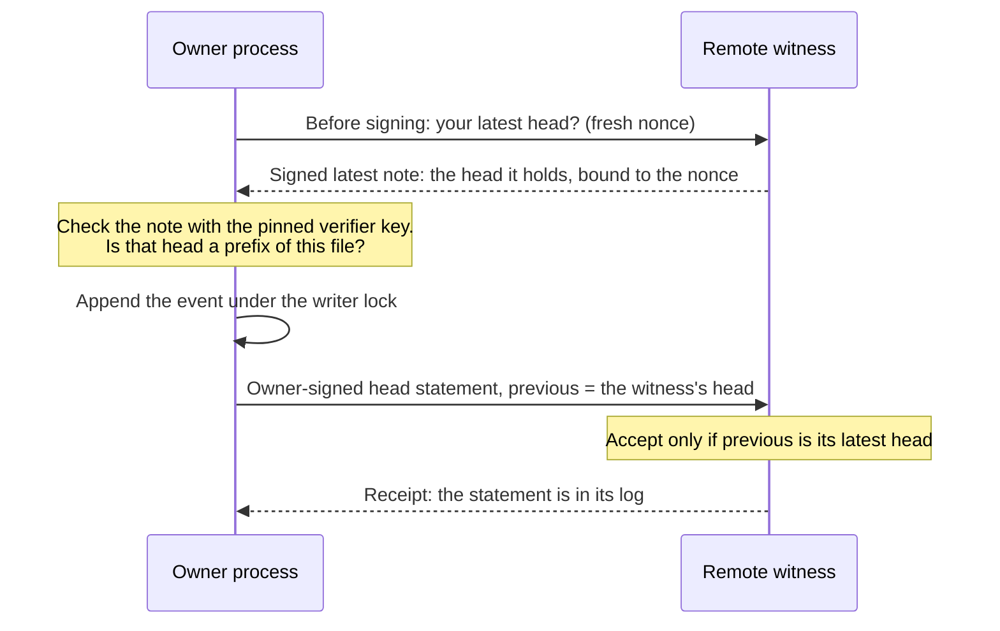
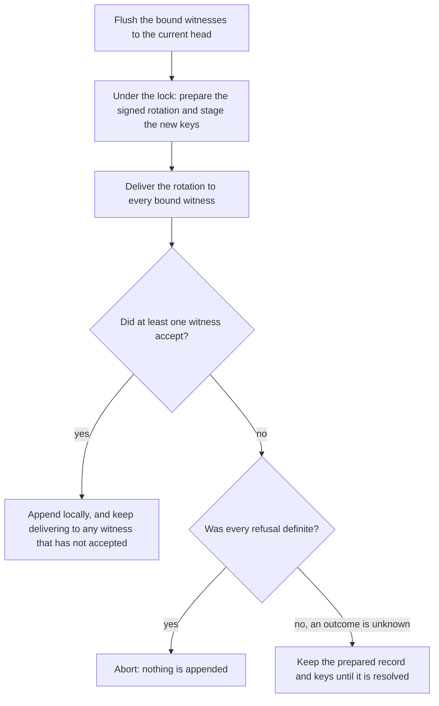

# The remote witness

An IronTrellis (formerly Continuity) history is a hash-chained, signed file. Hashes and signatures catch edits, but not a rollback: anyone who can write the file can put back an older, genuine copy. A remote witness is a small service, run somewhere else, that remembers the latest owner-signed head of each history it serves. An honest owner process consults it before signing an extension, and a network-aware verifier compares the local file with the witness's latest head.

## 1. Move rollback evidence elsewhere

Suppose an agent's grant to pay invoices is revoked on Monday. On Tuesday, someone who controls the agent's host copies back Friday's backup: every line genuine, every signature valid, and a pin the owner really attested on Friday. Replay accepts it, and the revocation is gone. Nothing inside the file shows the loss, because nothing in it is false; it is only old.

The pin and the local anchor log protect only evidence the attacker cannot replace. A witness keeps the remembered latest head in another trust domain. If the history above was bound to one, the witness still holds Monday's head. The next owner write, a `verify`, or a reader whose policy requires an open check asks the witness, finds that it holds a head past the end of the file (`WITNESS_AHEAD`), and stops.

Run the witness where the agent's host cannot rewrite its log or use its checkpoint key. The server is `@ramex-labs/irontrellis-witness`; the Core client serves the CLI, hooks and gateway.

## 2. Why chaining works

The witness accepts an owner-signed statement only when its `previous` matches the latest head it holds. Honest owner code signs that statement only after obtaining the witness's head in this process and checking that it is a prefix of the history being extended.



The prefix check, the stated head and the signature all use one replayed state under the writer lock. If that state no longer contains the head this handle previously appended or checked, `FILE_CHANGED_UNDER_WRITER` is a sticky rollback alarm: a file swap must not be laundered into a new signed branch.

A receipt proves inclusion, not freshness. So history responses bind a fresh client nonce in a witness-signed latest note, and the client checks the configured verifier key, history, origin, nonce and returned head. A replayed genuine old answer fails that check. See the [latest-note format](reference/witness-protocol.md#98-latest-notes-freshness).

## 3. Limits that affect deployment

**Established:** the 1.0.0-rc.2 witness and client rules, operational recovery and protocol checks. **Not established:** that recorded events are true, safe owner custody, recovery of unwitnessed events, or one globally consistent view from a malicious witness. The limits below make those trust assumptions explicit. Read the older format-1 procedures and the documented format-2 policy extensions with the [owner-policy reference](reference/owner-policy.md). This page is not an audit of the engine.

- **Stolen keys:** a witness does not stop someone using an authorized owner key. Rotation, protected next keys and delivery of the rotation matter.
- **Unwitnessed tail:** events after the latest witnessed head may exist only locally. Back up the history; witnessing is not replication.
- **Writes without the owner key:** what the coding-agent hook and the gateway write with a runtime session's key, such as recorded refusals, stays unattested and unwitnessed until the next owner write. `irontrellis witness sync` submits the head sooner, and `irontrellis repin` attests it.
- **Outages:** owner-keyed writers can queue statements until `maxUnwitnessedEvents`; ordinary readers continue unless their policy requires an open check. Invalid signed responses and refused registration are not ordinary network outages.
- **Caches:** `requireOnOpen` readers may use a sufficiently recent verified or owner-sealed answer within `cacheMs`. Writers do not use that shortcut.
- **Split views:** remembered checkpoints and consistency proofs detect contradictions a client sees, not a hidden view it never receives. Use independent operators when that concentration of trust is unacceptable.
- **Older unbound copies:** adding a binding later cannot make a pre-binding copy name it. Bind at creation, or supply an out-of-band minimum.

Less common cases:

- An aborted prepared rotation can still be replayed to a witness at its old head; recovery refuses without the staged keys and raises an alarm.
- Receipt-less bindings do not get a sealed-cache shortcut.
- A side-file rollback can weaken remembered split-view evidence, and a party that controls both hosts defeats their separation.
- Python history verification (legacy and format 1 only) does not contact witnesses; it reports that limitation. Use the network-aware `irontrellis verify` for freshness.

## 4. Run and maintain the service

```sh
npm install -g @ramex-labs/irontrellis-witness@next
irontrellis-witness init --data ./witness-data --name witness.example.com
irontrellis-witness token create --data ./witness-data
irontrellis-witness serve --data ./witness-data
```

- **Pin the printed verifier key** in clients. They pin the signing key independently of TLS; TLS still protects tokens and traffic.
- **Protect the registration token.** It is displayed once.
- **Serve behind TLS,** normally with the service on loopback, and configure proxy trust so that rate limits use the intended client address.

The [service reference](reference/witness-service.md) has the config fields, log formats, CLI reload behavior, health and metrics fields, and limits. Systemd and Docker deployment templates are under `packages/witness/deploy/`; they are not protocol requirements. An amd64 smoke test of the witness image is on record (26 September 2026); it does not establish an arm64 runtime test, or a completed publish and signing run.

**Backups.** Back up the entire data directory. Copy `checkpoints.jsonl` before `log.jsonl`, then run `irontrellis-witness check-log --data <copy>` on the copy. Restoring an older witness backup is itself a rollback: clients may hold later checkpoints. Never edit malformed log entries to make startup pass. Keep the checkpoint key out of images and repositories. A storage failure stops writes until it is repaired and the service restarted. The log is the source of truth; the in-memory tree is rebuilt from it at every start.

## 5. Connect a history and choose policy

Prefer binding at creation:

```sh
irontrellis init --history h.jsonl --witness https://witness.example.com \
  --verifier-key 'witness.example.com+<hash>+<key>' --token <token>
irontrellis --history h.jsonl witness status
```

The full form is `irontrellis init --witness <url> --verifier-key <key> [--token <token>] [--mode sync|async]`, plus `--no-require-on-open` and `--allow-insecure-http`. For an existing history:

```sh
irontrellis witness add https://witness.example.com --verifier-key 'witness.example.com+1a2b3c4d+AX…' --token itw_…
```

`witness add` checks the witness, the registration, the prefix and the required historical signing keys before binding it. `--allow-offline` permits a binding without a registration receipt; it does not turn an unsigned "not registered" response into evidence. Add it again while reachable to record the receipt.

A binding pins the URL, verifier key and transport choice, plus a signed policy minimum. The writable side file cannot remove or redirect bound witnesses. It stores tokens, checkpoints, caches and queued work, and can add findings. A malformed side file fails rather than disappearing silently. The policy options given to `witness add` (`--quorum`, `--require-on-open`, `--max-unwitnessed`) are also signed into the binding as its policy minimum; running `witness add` again with other values writes a new binding that changes it. See the [connection and policy reference](reference/witness-policy.md).

### Policy decisions

| Setting | What it decides |
|---|---|
| `quorum` | How many witnesses must hold a head for it to count as witnessed. Rollback checks need `n − quorum + 1` answers, independently for the bound set, the out-of-band minimum and the whole policy. Any verified rollback or split-view finding is fatal regardless of quorum, and a side-file-only witness cannot answer in place of a bound one. |
| `requireOnOpen` | Adds a gate for readers. Owner-keyed writers already check before their first write in a process. |
| `maxUnwitnessedEvents` | Limits queued exposure. |
| `cacheMs` | The reader freshness window. |
| `mode`: `sync` or `async` | `sync` attempts submission before returning, after the local append; `async` uses a background worker. |

Effective requirements combine the signed minimum, the external minimum and other policy sources as specified; host files cannot weaken the signed minimum.

Don't infer that a failed witness round unwrites an event. In sync mode an unreachable witness does not fail the write: its statement stays queued. Rollback or split-view evidence does throw, after the local append. Check the reported head, queue and verification result before deciding whether to retry.

For histories bound later, set `IRONTRELLIS_WITNESS_POLICY` to an absolute path of a policy file the agent cannot edit. Every open of the history applies that minimum, with two exceptions: an explicit inspection, and the coding-agent hook's refusal recorder, which writes a refused call's record with the witnesses switched off (the hook's own open, just before, applies the minimum and checks the witnesses when the policy requires it). An unusable policy file fails closed. The exact fields, defaults and exceptions are in the [policy reference](reference/witness-policy.md#54-an-out-of-band-minimum-policy-irontrellis_witness_policy).

## 6. Respond to findings

Start with `witness status` and `verify --json`, and preserve their evidence. The [finding table and recovery runbook](reference/witness-operations.md#6-operations-and-incident-response) keep every code and distinction.

| Finding | First response |
|---|---|
| Ahead, fork or file changed under writer | Stop writers; find a copy containing the witness head |
| Unreachable / maximum unwitnessed tail | Restore connectivity and `witness sync` |
| Invalid answer or denied signed registration | Investigate key, URL, proxy and witness storage; do not treat it as an outage |
| Split view | Preserve checkpoints and investigate the witness; the alarm is sticky |
| Pending or incomplete rotation | Follow rotation recovery; keep staged and retired keys |

Restore a valid history together with its pin, anchors and side file, then verify remotely. If no surviving copy contains the witness's head, the missing events are lost, and a local `--accept-rollback` does not override that. An explicit owner-signed `witness remove … --accept-loss --reason …` requires verified network evidence of the loss, and records the abandoned heads. Other witnesses still apply; several showing the same loss may need removing together. The removed witness cannot simply accept the new branch later: add a new witness, or use a successor history.

An equivocation entry is evidence of conflicting owner-signed statements. It warns without freezing the history: prefix checks still decide the file. Concurrently written copies or a restore may explain it; otherwise, investigate key compromise. Supersede warnings likewise keep evidence of heads overridden by a later protected rotation. Neither warning proves which external events really happened.

## 7. Owner-key rotation

A witness learns of a rotation only when it receives it; until then, a retired key may still count there. Next-key commitments constrain who can rotate, and custody keeps the committed successor beyond an attacker's reach.

With bound witnesses, the normal two-phase flow first flushes them to the current head, then prepares fixed signed data and staged keys under the lock, then delivers the rotation:



So "two-phase" does not mean every witness always acknowledges before the local append.

Emergency rotation records locally first and delivers afterward. A valid pre-rotated rotation may supersede conflicting heads after a verified last-good head, subject to the complete checks in the [rotation reference](reference/witness-operations.md#7-owner-key-rotation-with-a-witness). This is not arbitrary deletion: superseded entries remain evidence. Without the required commitment, proof, known last-good head or signing key, the client fails closed.

Keep retired key files offline until every required witness has received the rotation; witnesses added later may need them too. Key-event bundles provide out-of-band delivery. The token or server lock gates that channel; signatures still decide acceptance. [CUSTODY](CUSTODY.md) covers signer loss and policy-dependent recovery.

## 8. Rotate the witness key separately

There is no in-place checkpoint-key rotation. Instead:

1. Create a new witness, with a new directory, key and origin.
2. Bind it to each history.
3. Verify that it holds the current heads.
4. Unbind the old witness.

Keep the old evidence available for older copies. After a compromise, don't trust a dual-run period with the old key. An older copy that names only the retired witness fails verification while that witness is unavailable, but plain readers without `requireOnOpen` are not stopped, and owner writes keep their unwitnessed-event allowance.

## 9. Implement the protocol from the reference

The [protocol reference](reference/witness-protocol.md) has the exact statements, ordered acceptance rules, key-event and supersede checks, log entries, Merkle hashing, signed notes, receipts, HTTP routes, error codes, latest notes and bundles. It keeps optional-field presence, ordered checks and idempotency distinctions.

Format-2 owner-policy extensions qualify head signers, and verify rotation counting and the T2 time rule from the available epochs and heads. They do not supply missing full-history state checks; see the [owner-policy reference](reference/owner-policy.md). A witness does not replace the Core replay engine.

## 10. Verify evidence independently

You can check a receipt offline, with an independently trusted verifier key, using TypeScript `verifyWitnessReceipt` or Python `verify-receipt` (receipts of format-1 histories only). Never trust a key merely because the receipt names it.

A valid receipt establishes inclusion at an index in a signed checkpoint. It establishes neither freshness, nor a single view shown to every client. Compare its head with your history, and use fresh latest notes for rollback decisions. The [independent verification examples](reference/witness-protocol.md#10-verifying-receipts-independently) give the exact API and CLI forms.

*Last reviewed: 24 October 2026. This page is revisited at each release.*
