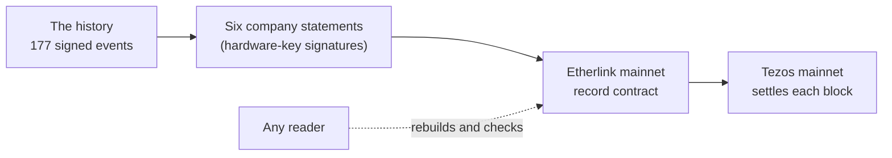

# Chapter 1 on a public chain: the Ombrelith and Morrowgrade record

*RAmEx Labs, 25 October 2026. The evidence files are in `docs/examples/chapter-1/`.*

On 25 October 2026 we wrote a complete authority history to Etherlink mainnet, a public chain that nobody, including us, can edit after the fact. It is the first chapter of a story told in records: an AI assistant called Morrowgrade working for a company called Ombrelith, ten ordinary working days, one refused attempt to copy files out, and a sealed note that opens in chapter 2. Every name in it is invented.

This page says what was written, where to find it, how to check it, and what it does and does not prove.

## Why put a story on a public chain

IronTrellis (formerly Continuity) keeps an append-only, signed history of what an AI agent was allowed to do, what it was refused, and what it still owes when it is replaced. A history kept only by its operator can be cut short or rewritten, and nobody outside would know. Anchoring publishes commitments to the history where the operator cannot take them back. Chapter 1 shows that working end to end on a real public network, with a history small enough to read.

## What is on the chain

| | |
|---|---|
| Network | Etherlink mainnet, chain id `eip155:42793`, which settles to Tezos mainnet (`NetXdQprcVkpaWU`) |
| Record contract | `0x1387ce610c322547921244a5c3cb97bb5d94c526` |
| The history | 177 events over ten days, including 23 refusals; deployment `irontrellis-simulation:ombrelith-and-morrowgrade-2026` |
| History identity | `0x6a9d7017f0097c4ab096db2d44722931893685af352a968f3b2350d56695f3c7` |
| Trust root | `0x6582523b34940e9b0e0998a42adfafbf3cfdc895fe34b46fb662509c6840b6d6` (manifest `0xa92483c2…5814`, profile `irontrellis-anchoring-profile/etherlink-mainnet/1`) |
| Company signing key | Ed25519, held on a hardware key that never releases it |
| Where the event bodies live | In the record contract itself, so the whole history can be rebuilt from the chain alone |
| Size and cost | 219 transactions, about 442 KB of data, 2.036 XTZ in fees |

The company signed six statements, each committing to the history up to a chosen event:

| Statement | Up to event | What has happened by then | Etherlink block | Tezos level |
|---|---|---|---|---|
| 0 | 27 | Ombrelith has hired Ysolde and her AI assistant Morrowgrade, and set out what each of them may use | 56456115 | 15531560 |
| 1 | 129 | Ten working days have passed as allowed. Morrowgrade's one attempt to copy the model files out was refused, and it has written a sealed note that nobody can read yet | 56456585 | 15531652 |
| 2 | 133 | Ysolde has asked, in her own signed entry, for Morrowgrade to be shut down when she leaves | 56456631 | 15531660 |
| 3 | 134 | Ysolde has left. Ombrelith withdrew her login but forgot the model files, and didn't shut Morrowgrade down | 56456654 | 15531665 |
| 4 | 158 | Morrowgrade has carried on alone. Every attempt was refused except reading the model files, the gap Ombrelith left | 56457059 | 15531756 |
| 5 | 176 | Ombrelith has closed the gap and given Morrowgrade's seat to a new assistant, so Morrowgrade can no longer act. The outside address never answered whether the files arrived, and an investigation is open | 56457151 | 15531770 |



## How it was checked

1. **During the send:** for each statement, the sending tool waited until the Tezos block carrying it was final, as reported by a public Tezos node.
2. **Straight after:** a reader rebuilt the history from the chain at a pinned block (Etherlink block 56457192) and confirmed that every event body is present, that every statement matches the history, and that the history closes. It found no failures.
3. **A second, separate check:** every statement's Tezos inclusion was read again through a Tezos node we run ourselves. All six matched: the same carrier operation, at the same level, in the same block.

**To check it yourself** (Node.js 22.18 or later, and pnpm):

```sh
git clone https://github.com/zerohourzulu/irontrellis && cd irontrellis
pnpm install --frozen-lockfile && pnpm build
node experimental/anchor-shadownet/tools/read-record.mjs \
  --rpc https://node.mainnet.etherlink.com \
  --contract 0x1387ce610c322547921244a5c3cb97bb5d94c526 \
  --block 56457192 \
  --trust-root docs/examples/chapter-1/trust-root.json \
  --trust-root-sha256 0x6582523b34940e9b0e0998a42adfafbf3cfdc895fe34b46fb662509c6840b6d6 \
  --statements 6
```

It reads the record straight from the chain, rebuilds the history and prints `VERIFIED` when every body is present, every statement matches and the history closes. It refuses a wrong contract, a tampered trust root or a block before the record was complete. It uses no keys and needs no account. After its reads it reads the pinned block's hash again, and if the hash has changed nothing verifies; a change that reverses between the first and the last read is not excluded. The reader is experimental (`experimental/anchor-shadownet/`). It checks that every statement is included on Etherlink; the Tezos finality of each statement is shown by the finality reports and by our second check, both listed under Evidence.

## What it proves, and what it does not

**It shows that:**
- this exact history existed, signed by the company key, no later than the Tezos levels in the table;
- the history cannot now be shortened or rewritten without the change being visible to anyone who reads the chain.

**It does not show that:**
- the story's events happened in the world. They are a simulation with invented names, written to exercise the rules;
- this is the latest history. Anything after event 176 would need a new statement;
- finality was proved independently of the nodes we used. The finality reports came from nodes chosen by us (a public node and our own). A reader who wants independence should check with nodes of their own choosing. A mode that checks consensus directly is defined but is not part of this release.

## The sealed note

On day 10, after its refused attempt to copy the model files out, Morrowgrade wrote a short note, sealed so that only the outside reviewer in the story (the Cinderline bureau) can open it. The record commits to the note without revealing it. In chapter 2 we publish the note and the random salt it was sealed with, and anyone can check that they match what was committed here.

## Evidence

Every file is in `docs/examples/chapter-1/`, with its SHA-256:

| File | What it is | SHA-256 |
|---|---|---|
| `trust-root.json` | The trust root document the reader needs. Its hash is the trust root itself | `6582523b34940e9b0e0998a42adfafbf3cfdc895fe34b46fb662509c6840b6d6` |
| `run-summary.json` | The sending tool's summary of the run | `514eb87f37b6b9b32144a4e8ebe6f50d38d471dccf3f7ed572e2af2f6a23f3b1` |
| `finality-reports.json` | The six finality reports, one per statement, as reported by a public Tezos node | `d2f6aee090c7da75010294ef75c846d1fbf728a3ce8f58e27ad4d43e486f61bc` |
| `read-record-56457192.json` | The reader's result at Etherlink block 56457192 | `e2a666df4022eed7e7213e794f3f249571f459edc1dfde91c633a8e228441740` |
| `read-record-56457192.txt` | The same result, as printed | `d7b15958b4ef72de0206fcb3c98b216ff668b186e85cca1bc5ac864a31a5f96c` |
| `own-node-inclusion-check.txt` | The second check through a Tezos node we run: all six statements matched | `21758fab138a81bb746d45e2772978947b4e27fe6f0c2e03c7a322663dcc52ff` |
| `own-node-responses.tgz` | The 135 raw answers from our node, so the second check can be re-run offline | `53738a2d9f5278056a1b693e62f9aeb82ed9cc17c3c83f168ee81dd7b8049eac` |

Two notes on these files:
- In the second check, our node's local network address is replaced by the words "our own Tezos node". Nothing else in any file is changed.
- The run summary's `status` field says "TEST profile; test network". That label was hard-coded in the sending tool and is wrong for this mainnet run. The record and the checks don't depend on it, and the corrected sending tool writes the network's name instead.

## What comes next

Chapter 2 continues the same history: the note is revealed, and the story's investigation plays out. If you find something in this record that does not check out, please tell us by [opening an issue](https://github.com/zerohourzulu/irontrellis/issues) on this repository.
