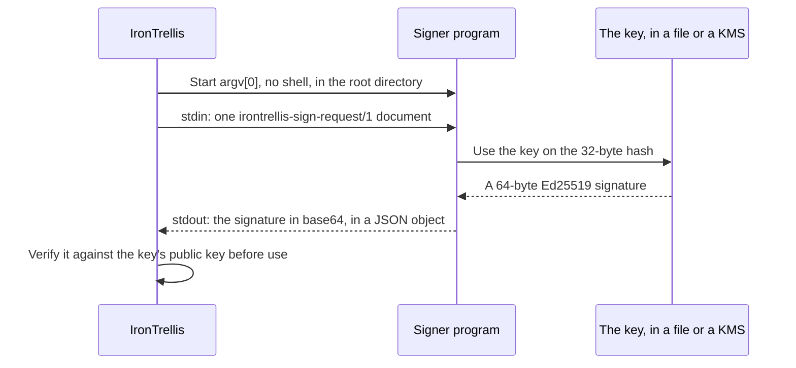

# Command signers (examples)

IronTrellis (formerly Continuity) keeps a checkable record of who may act for whom, and which duties survive when an AI agent is replaced. The owner's key signs every change to who may act, so where that key lives matters: an agent that can read it can sign as the owner.

A command signer moves the key out of IronTrellis's process. IronTrellis starts a separate program to sign, and that program reaches a key IronTrellis cannot read: in another user's file, or in a cloud KMS. The three programs here are examples for IronTrellis's `command` signer ([docs/CUSTODY.md §6](../../docs/CUSTODY.md#6-command-signers)).

## How IronTrellis calls a signer



| Step | What IronTrellis does |
|---|---|
| Start | Runs the program named in a key reference's `signer.argv`, with no shell and a minimal environment, in the file-system root (`/`), with `PATH=/usr/bin:/bin` (or the reference's `path`) |
| Ask | Writes one `irontrellis-sign-request/1` JSON document to the program's stdin |
| Answer | Reads `{"signature":"<base64>"}` from its stdout |
| Check | Verifies every signature against the key's public key before using it |

## The three examples

| Script | Signs with | Tested |
|---|---|---|
| `file-signer.mjs` | an Ed25519 key in a file IronTrellis cannot read (another user's file, reached through sudo or a setuid wrapper, a mounted secret) | yes: `packages/core/test/custody-examples.test.mjs` runs it as a history's owner key |
| `gcp-kms-sign.mjs` | a Google Cloud KMS key of algorithm `EC_SIGN_ED25519` (PureEdDSA over the raw data), through `gcloud kms asymmetric-sign` | **no live test**: an example. The suite runs it against a fake `gcloud` that checks the arguments |
| `aws-kms-sign.mjs` | an AWS KMS key of key spec `ECC_NIST_EDWARDS25519`, signing algorithm `ED25519_SHA_512`, `MessageType` `RAW`, through `aws kms sign` | **no live test**: an example. The suite runs it against a fake `aws` that checks the arguments |

## Set one up

Each script prints the key's public key (`0x` + 64 hex) with `--public-key`, for `irontrellis signer ref --public-key`. With the AWS example:

```sh
node /opt/irontrellis/aws-kms-sign.mjs --key-id arn:aws:kms:eu-west-1:111122223333:key/… --aws /usr/local/bin/aws --public-key
irontrellis signer ref --out owner-1.owner-key-ref.json --signer command --public-key 0x… \
  --signer-command '["/usr/bin/node","/opt/irontrellis/aws-kms-sign.mjs","--key-id","arn:aws:kms:eu-west-1:111122223333:key/…","--aws","/usr/local/bin/aws"]' \
  --pass-env AWS_PROFILE,AWS_REGION --signer-timeout-ms 60000
irontrellis signer test --ref owner-1.owner-key-ref.json
irontrellis init --history history.jsonl --owner-key-ref owner-1.owner-key-ref.json
```

In order, these print the key's public key; write a key reference that names the signer and holds no secret; ask the signer for one signature over a random challenge and verify it, writing nothing; and create a history whose owner key the signer holds.

## Keep the signer private

- **Absolute paths only.** `argv[0]` and every argument that names a file must be absolute, and the cloud examples need their CLI by absolute path (`--gcloud /usr/bin/gcloud`, `--aws /usr/local/bin/aws`). Nothing is looked up in the caller's directory or `PATH`, where the agent could plant a program.
- **One key per identity.** A command signer is only as private as the credentials the program uses. Grant its identity the right to sign with that one key only, and keep that identity out of the agent's reach.
- **The program file too.** Keep it out of the agent's reach. When the history's owner or next key is held by a signer, the coding-agent hook refuses tool calls that name the signer's program file, but that is a tripwire, not a boundary: the boundary is a separate OS user, or a KMS.
- **Read it first.** Review a script before you use it, and copy it somewhere the agent cannot write.

*Last reviewed: 24 October 2026. This page is revisited at each release.*
