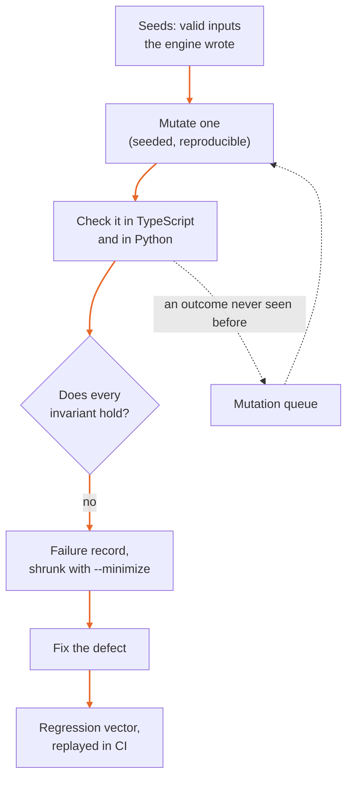

# IronTrellis fuzzer and TypeScript/Python differential harness

IronTrellis (formerly Continuity) keeps a checkable record of who may act for whom, and which duties survive when an AI agent is replaced. Anyone holding a history can replay it and should get the answers its writer got. So every reader has to agree on what a history says, and none may crash, whatever the input.

This folder tests that. It is a dependency-free, seeded, structure-aware fuzzer for every surface that reads input IronTrellis did not write itself. It starts from valid inputs the real engine produced, damages them in systematic ways, and checks each result against fixed rules, its invariants. It runs the Python verifier on the same inputs as the TypeScript engine, so a disagreement between the two counts as a failure.

## One finding, start to finish

In pre-release fuzzing on 26 September 2026, the `canonical` target gave both engines the JSON number `-0`. The TypeScript engine reads it as negative zero, which the canonical form refuses. Python's `json.loads` read it as the integer `0`. So when a `0` in a store file was respelled `-0`, the record hash still matched in Python, and the Python reader accepted a file the TypeScript reader rejects.

The Python reader now parses `-0` as `-0.0`, which every protocol check rejects, as TypeScript does. The finding became two regression vectors, `canonical/negative-zero-literal` and `store/negative-zero-in-store-line`, and CI replays both.



## Run it

Build the packages first (`pnpm -r build`): the harness drives the built `dist/` of each package. The Python side imports the package from `python/src` and needs python3 3.11 or later. When no Python can import it, the differential checks are skipped, with a notice.

```sh
node fuzz/run.mjs --smoke                                   # CI smoke: regression vectors + a few seeded iterations per target (~20 s)
node fuzz/run.mjs --regressions                             # replay fuzz/regressions/** only
node fuzz/run.mjs --target replay --seed 7 --minutes 30 --corpus ../fuzz-corpus --resume --minimize
node fuzz/run.mjs --target all --iterations 500 --seed 3    # every target, 500 iterations each
```

| Option | What it does |
|---|---|
| `--target <name\|all\|a,b>` | One target, all of them, or a comma-separated list |
| `--seed <n>` | The campaign seed (default 1) |
| `--iterations <n>`, `--minutes <m>` | The budget per target; the run stops at whichever ends first. Give at least one (`--smoke` and `--regressions` need neither). |
| `--start <iteration>` | Start at this iteration |
| `--corpus <dir>` | Keep the mutation queue, progress and failure records in `<dir>` |
| `--resume` | Continue at the iteration the corpus recorded for this seed |
| `--minimize` | Shrink the first input of every new failure key |
| `--no-python` | Skip the Python differential |
| `--json` | Print the report as one JSON document instead of progress lines |
| `--smoke` | The CI smoke run: the regression vectors, then a fixed number of iterations per target, seed 1 |
| `--regressions` | Replay the regression vectors only |
| `--help` | List the targets and the regression folder |

To choose the Python interpreter, set `IRONTRELLIS_FUZZ_PYTHON` (default `python3`; `python` on Windows).

| Exit status | Meaning |
|---|---|
| 0 | No invariant failed |
| 1 | Failures, listed with their failure keys |
| 2 | A usage or setup error |

The same smoke run is part of the package test suites, so `pnpm -r test` and CI run it:

| Test file | Targets |
|---|---|
| `packages/core/test/fuzz-smoke.test.mjs` | `canonical`, `events`, `replay`, `store`, `sidefile`, `transparency` |
| `packages/witness/test/fuzz-smoke.test.mjs` | `witness-http` |
| `packages/cli/test/fuzz-smoke.test.mjs` | `cli-args` |

`python/tests/test_fuzz_regressions.py` replays the regression vectors against the Python implementation alone, for the CI job that has no Node.

## What it checks

### Targets

| Target | Input | What is exercised | Invariants beyond "no untyped crash" |
|---|---|---|---|
| `canonical` | JSON text | `jsonParseWithBigints`, `canonicalEncode`, `captureValue`; Python `json_loads_with_bigints`, `canonical_encode` | capture ≡ encode; canonical text is a fixpoint; TS/Python agree on acceptance and bytes |
| `events` | `{event, format, position}` | `validateEvent` / `validate_event` (envelope, capture, genesis probe, closed per-type schemas) | TS/Python agree on acceptance, code and captured event; wire round trip re-validates identically |
| `replay` | wire event array | `replay` in-process, the TypeScript conformance adapter process (`conformance/adapters/node.mjs`), the Python engine and the Python conformance adapter (`conformance/adapters/python.py`'s `handle`); on a sample of accepted histories SURVIVES and authorize through both adapters | TS/Python agree on status, code, position and head; the adapters agree exactly; no seed owner signature over altered content; accepted histories re-replay identically |
| `store` | history directory (JSONL, `.head`, `.anchors`, `.witness.json`) | `openHistoryStore` strict and `inspect`, `state()`, `verify()`, `verifyHistory`; Python `replay_history_bytes` and `python -m irontrellis verify` | typed errors only; a strict open that succeeds carries no seed signature over altered content and contains the head its pin's owner attestation names; readers agree on layer (record/replay), code and position |
| `sidefile` | the witness side file of a witness-bound history, current or an older (restored) copy | `readWitnessState`, strict open, `witnessStatus`, `verify`, `checkWitnesses`, `verifyWithWitnesses` against a live witness | side-file parse∘serialize identity; the side file only makes things stricter (no mutation lets a rollback the pristine file exposes pass) |
| `transparency` | notes, checkpoints, latest notes, receipts, entries, statements, verifier keys, base64, Merkle proofs, key-event bundles | the witness wire-format parsers and verifiers in both cores (bundles: TypeScript only) | TS/Python agree on every outcome; parse∘format identity (checkpoints, latest notes, verifier keys, base64) |
| `witness-http` | HTTP requests (fetch, or raw bytes on a socket) | a live witness server (`packages/witness`) | no 500 and no dropped connection; documented `{error:{code,message}}`; every receipt verifies; one root per checkpoint size; no request that appends to the log carries a seed signature over altered content; healthy; a restart re-opens the log (same size, `checkLog` clean) |
| `cli-args` | argument vectors | `irontrellis` `main()` in a child process, against a history made with `irontrellis init` | `main` never rejects; no unclassified `FAILED` error; `--json` output is one JSON document; no output behind `io`; no exit, no hang |

### Invariants

1. **No untyped crash.** Every rejection is a result (`REJECTED`, `{ok:false}`) or one of the engine's own error classes (for example `EngineError`, `IronTrellisError`, `CanonicalError` and `NoteError`; `SyntaxError` only where an API documents it). The Python side never raises anything but its documented rejections (`StoreError`, `CanonicalError`, `NoteError`, `ValueError`), and its CLI never prints a traceback. No promise rejection goes unhandled, and HTTP never answers 500.
2. **No acceptance of content altered under an existing signature.** Every owner signature in the seeds is indexed with the control challenge it signs (domain, event id, type, time, previous head, effect hash). In any history a target accepts (replay, strict store open, witness append), each seed signature must still sign exactly that challenge; a seed head attestation must still attest its head, and that head must be a prefix of the accepted file. Re-signed events carry new signatures and are not affected.
3. **parse∘serialize identity** for canonical JSON, validated events, accepted histories, side files, checkpoints, latest notes, verifier keys and base64.
4. **TypeScript and Python agree** on accept or reject and on the failure code (and the position, head and parsed fields) for every replayed, stored, validated, encoded or verified input, directly and through the conformance adapters. Format-2 input is the exception (see [Limits](#limits)).

A check that runs longer than 60 seconds is a failure too (`HANG`), and so is a defect in the harness itself (`HARNESS_ERROR`): an unattended campaign reports it and goes on.

## What it has found

Fixed defects are kept as regression vectors in `fuzz/regressions/`, each with its root cause, its fix and how it was found. The few that the vectors can't reach directly are unit tests in `packages/core/test/fuzz-findings.test.mjs`. Some examples:

| Found | Target | What went wrong | What changed |
|---|---|---|---|
| 26 September 2026 | `canonical` | Valid JSON nested 20,000 levels deep made the TypeScript parser overflow its call stack (`RangeError`), and made `python -m irontrellis verify` print a traceback | TypeScript decodes bigint markers with an explicit stack; Python turns the recursion error into a typed `CanonicalError` |
| 26 September 2026 | `replay` | An Ed25519 session admission inside a migrated legacy prefix crashed replay in both engines, and with it every reader of such a history | Both engines reject it with `EVENT_DATA_INVALID` |
| 26 September 2026 | `store` | A pin file whose attestation is JSON `null` made `verify()` throw a `TypeError` | The strict open refuses it (`ROLLBACK_DETECTED`, reason `PIN_ATTESTATION_INVALID`), and `verify()` reports it |
| 26 September 2026 | `transparency` | With an expected nonce of `null`, the Python verifier skipped the nonce check and accepted a witness answer not bound to the caller's nonce, which could be a replayed one | Both verifiers fail closed with `EXPECTATION_INVALID` |
| October 2026 | `cli-args` | `irontrellis --json status false` printed the human-readable status, with exit 0 | It is a usage error, answered as JSON |
| October 2026 | `replay` | The conformance adapters cut a request in two at a U+2028 inside a JSON string, then paired every later answer with the wrong request | The adapters end a line at `\n` only; the frozen legacy adapter keeps its old reader ([known issue 73](../docs/records/KNOWN-ISSUES-r2.5.md)) |

Three differences found in October 2026 are still open. For a malformed legacy genesis, and for an undeclared format-1 field over 256 bytes, the two engines reject with different codes. And the TypeScript format-1 parser accepts a string whose lone surrogates pair up only after parsing, which only JavaScript can produce, while the Python verifier rejects it ([known issues 72, 74 and 75](../docs/records/KNOWN-ISSUES-r2.5.md)).

## Limits

A fuzzer can find failures; it can't show that none are left. This one has these limits:

| Limit | What it means |
|---|---|
| Few seeds are format 2 | Most seeds are legacy and format-1 histories; the owner-API seeds are written in format 1 through a test-only option. Format 2, the format 1.0.0-rc.2 writes, comes from one seed (a legacy history migrated to format 2) and from the `cli-args` history, which `irontrellis init` writes. |
| Re-signing is format 1 only | Mutated control events are re-signed only in format-1 histories, and new ones are generated only from format-1 templates; edited store files are re-chained only in legacy and format-1 files. So mutations of format-2 histories mostly stop at the signature and record checks instead of reaching the rules behind them. |
| The differential skips format 2 | The Python verifier doesn't read format 2 yet, so TypeScript and Python are compared on legacy and format-1 input only ([known issue 50](../docs/records/KNOWN-ISSUES-r2.5.md)). |
| The witness targets start from format 1 | `sidefile` and `witness-http` build their valid inputs from format-1 seed histories only. |
| No coverage guidance | An input is kept for more mutation when its outcome is new; no code-coverage instrumentation steers the search. |
| CI runs a small, fixed budget | The smoke run replays the regression vectors and runs 80 to 1,000 iterations per target, always with seed 1. Longer campaigns are run by hand ([below](#long-campaigns)). |

## How inputs are made

### Seeds

**Seeds** (`lib/seeds.mjs`) are produced by the real engine, deterministically (fixed Ed25519 seeds, counter ids, scripted clocks, a witness with a fixed key): the format-1 conformance histories, the legacy reference fixtures, and history directories written through the owner API: grants, delegations, prohibitions, revocations, roles, appointments, successions, runtime admissions, simulated invocations and receipts, obligations, assignments, genesis next-key commitments, commitment-only, pre-rotated and plain owner key rotations, local anchor-log anchors, and a history bound to a live witness (its `WITNESSES_BOUND` binding, side file, receipts and key-event bundles). Two more history directories hold a legacy history and the same history migrated to format 2.

The seeds are cached under the system temp directory (`irontrellis-fuzz-seeds-1-<uid>`), and rebuilt when `SEED_VERSION` or the code that builds them (`SEED_LAYOUT`, a digest of `lib/seeds.mjs`) changes.

### Mutators

| Kind | Mutations |
|---|---|
| JSON structure (`lib/mutate.mjs`) | replace, delete, insert, duplicate, swap, splice from a dictionary harvested from the seeds, rename, wrap, type changes, bigint markers valid and invalid, limits ±1, lone surrogates, control characters |
| Text | characters, chunks, number respelling (`5` → `5.0`, `5e0`, `-0`, `05`, `1e400`), whitespace including U+00A0 and U+2028, `\u00xx` escapes, duplicate keys |
| Lines | drop, duplicate, swap, reverse, CRLF, BOM, missing final newline |
| Bytes | invalid UTF-8, overlong forms, surrogates, truncation |
| Histories (`lib/history.mjs`) | drop, duplicate, swap, move and truncate events; splice events from other histories; collide ids and timestamps; swap control signatures; edit the genesis, key events (owner keys, commitments, next-key proofs), witness bindings and anchors (anchored heads pointed at other heads of the history); generate new control events from templates |
| Stores (`lib/storefile.mjs`) | re-chain the unkeyed record hashes after an event edit (what anyone who can write the file can do); roll the file back with and without a rewritten pin (with no, a null, the current or another owner attestation); re-encode a history under the other line format; edit pins, anchor logs and side files |

Most of the time, a mutated control event is **re-signed** with the owner key in force, and so are the events after it, whose signatures bind the changed head (a rotation's next-key proofs too). So mutations reach the transition rules behind the signature check instead of stopping at `CONTROL_AUTHORIZATION_INVALID`. This works in format-1 histories (see [Limits](#limits)).

### Feedback

An input whose outcome class (verdict, code and a normalized reason) was never seen joins the mutation queue. There is no instrumentation.

### Transport

Inputs travel to the Python worker and the node adapter, and are stored in the corpus, as JSON that keeps JavaScript's `-0` (`stringifyFaithful` in `lib/python.mjs`; the worker reads it back as `-0.0`). Plain `JSON.stringify` writes `-0` as `0`, which once made the two sides judge different numbers. The campaign driver normalizes every mutated input to that faithful JSON form before checking it, so the in-process TypeScript call sees exactly what the corpus stores and Python receives: no `undefined`, `NaN`, array holes or prototypes.

New targets must use the same helpers:

| Do | Not | Why |
|---|---|---|
| Copy with `structuredClone` (`clone` in `lib/mutate.mjs`) | `JSON.parse(JSON.stringify(…))` | The JSON round trip turns `-0` into `0` |
| Add a key with `put` (`lib/mutate.mjs`) | `obj["__proto__"] = …` | That assignment sets the prototype instead of adding the key |

## Failures and regression vectors

A campaign de-duplicates failures by **failure key** (invariant, where, codes). With `--corpus`, it writes one record per key to `<corpus>/<target>/failures/<hash>.json`: the target, seed, iteration, message, the input and, with `--minimize`, a greedy delta-debugged input. Every input is self-contained JSON, so a record reproduces without the campaign state.

Fixed defects become **regression vectors** in `fuzz/regressions/<target>/<id>.json`: `{id, target, description, rootCause, fix, found, input, expect}`, plus `requires: "python"` when the `expect` comparison needs Python. `expect` is a projection of the target's outcome: the fields it names must match. Replay them with `node fuzz/run.mjs --regressions`; CI replays them in the smoke tests and in `python/tests/test_fuzz_regressions.py`.

To add one after the fix:

```sh
node fuzz/tools/promote.mjs <failure.json> --id <name> --root-cause "…" --fix "…"
```

It also takes `--description`, `--expect '<json>'` and `--requires python`. Without `--expect`, it records the fixed code's outcome as the expectation and refuses while the input still fails; it never overwrites a vector. Vectors that must regenerate deterministically belong in `fuzz/tools/make-regressions.mjs` instead (`--check` verifies the committed files regenerate byte for byte).

## Long campaigns

Campaigns are resumable: a corpus directory keeps the mutation queue and, per seed, the next iteration, so `--resume` continues where a run stopped. A campaign is also reproducible from `--seed` and `--start` alone, apart from the queue. Run one target per process; on a 2-CPU machine, run one campaign at a time. For example:

```sh
CORPUS=/path/to/fuzz-corpus
for t in replay store canonical events transparency sidefile witness-http cli-args; do
  node fuzz/run.mjs --target $t --seed 21 --minutes 45 --corpus $CORPUS --resume --minimize --json > $CORPUS/report-$t.json
done
```

`<corpus>/<target>/state-<seed>.json` shows progress while a run is going.

## Layout

```
fuzz/run.mjs                 the command line
fuzz/lib/campaign.mjs        campaign driver, corpus, regression replay, smoke budgets
fuzz/lib/env.mjs             where things are; the built packages the harness loads
fuzz/lib/prng.mjs            the seeded random generator (one per target, seed and iteration)
fuzz/lib/seeds.mjs           seeds through the owner API, key registry, fixed-key witness
fuzz/lib/mutate.mjs          JSON / text / line / byte mutators, dictionary
fuzz/lib/history.mjs         history mutators, re-signing, control-event generation
fuzz/lib/storefile.mjs       JSONL parse / re-chain, pins
fuzz/lib/invariants.mjs      typed errors, signed-content and attestation invariants
fuzz/lib/minimize.mjs        greedy delta-debugging minimizer
fuzz/lib/python.mjs          persistent JSON-lines workers (Python worker, node conformance adapter)
fuzz/lib/cli-worker.mjs      the CLI child for cli-args
fuzz/lib/smoke.mjs           node:test smoke registration
fuzz/python/worker.py        Python side: conformance adapter ops + store, CLI, canonical, events, transparency
fuzz/targets/*.mjs           the eight targets
fuzz/tools/                  make-regressions.mjs, promote.mjs
fuzz/regressions/            regression vectors (replayed by CI)
```

*Last reviewed: 24 October 2026. This page is revisited at each release.*
