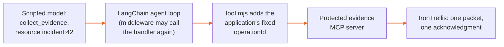

# Use the protected tool from a LangChain agent

IronTrellis (formerly Continuity) keeps a checkable record of who may act for whom, and which duties survive when an AI agent is replaced.

Agent frameworks retry. A LangChain middleware may call a tool's handler zero, one or several times, so if every call started a new operation, one decision could copy the evidence twice. This example connects a real LangChain agent to the [protected evidence tool](../protected-evidence-mcp/README.md) and keeps one operation per workflow step: the application owns the operation ID, not the model or the framework.

It uses the actual **LangChain 1.5.12** agent loop, **@langchain/core 1.2.12** and the official MCP client **2.2.0**. Only the model's responses are scripted, so you can see the complete tool path without a model account, payment or tracing service.



## Try it

From the 1.0.0-rc.2 workspace:

```sh
node integrations/protected-evidence-mcp/setup.mjs /absolute/path/to/a-new-demo-directory
LANGCHAIN_TRACING_V2=false LANGSMITH_TRACING=false node integrations/langchain-evidence/example.mjs /absolute/path/to/a-new-demo-directory/gateway.json
```

Expect **RECORDED** and `packetVerified: true`. Run the second command again with the same case to see **RECONCILIATION_ONLY**. Keep the disposable directory private: it contains the example's fresh signing credential. The tool copies only the setup's synthetic file.

## Use the recipe in your application

`tool.mjs` is the reusable recipe:

| Who | Supplies |
|---|---|
| Your application | The MCP client, a resource alias and a stable workflow `operationId` |
| The model | Only the `resource` field |

The model cannot turn its transport or tool-call ID into a new operation, or replace the host's operation ID. Use a real model with the same `createAgent` tool when you choose to; your own model credentials and costs are outside this example.

Every tool invocation goes through the protected service. The LangChain wrapper cannot itself grant permission or execute the copy. A `wrapToolCall` middleware may call its handler more than once; the test exercises that actual framework path and confirms one canonical acknowledgment and one packet. A refused or unknown result needs interpretation, not a new ID to force another attempt.

The [LangChain middleware documentation](https://docs.langchain.com/oss/javascript/langchain/middleware/custom) explains why handlers can be invoked zero, one or multiple times. IronTrellis's stable operation ID preserves the original attempt across that behavior.

## Run the tests

```sh
LANGCHAIN_TRACING_V2=false LANGSMITH_TRACING=false node --test integrations/langchain-evidence/tests/agent.test.mjs
```

The tests run the real agent loop for permitted work, middleware repetition, retired-runtime refusal and attempted operation-ID substitution. A scripted model is not evidence about a real model's reliability or resistance to prompt injection.

## Limits

The developer owns the application, the tool list and the MCP connection. This wrapper alone does not contain arbitrary untrusted code running with the service's OS privileges. [The separate-user Linux example](../protected-evidence-mcp/linux/README.md) describes the intended file boundary; it has not been run yet.

## What it is built on

This integration is part of 1.0.0-rc.2 but is not published to npm: its package is marked private. It uses the format-2 Core, with one `historyFile`, native Ed25519 runtime credentials and awaited owner writes, and it accepts only the IronTrellis tool and configuration names. Core's frozen protocol literals inside hashed records are unchanged, and some still carry the Continuity name; the new SHA-256 policy identities make no claim to equal earlier digests.

Its tests use the default owner policy, under which owner keys are classed as declared (`DECLARED`). Core also ships the attestation policy for PHL, Proof of Human Lineage (`humanFloor: "ATTESTED"`), but these integration tests don't establish that additional policy coverage.

## Check it in a clean install

The shared packed verifier is `integrations/policy-composition/tests/verify-install.py`. It packs the three integrations and Core, unchanged, installs the four packages into a fresh consumer with install scripts disabled, runs their tests against the real engine and a strict TypeScript check of their declarations, and keeps the histories the tests write, for an independent history checker that is not part of this repository. Give it `--output <dir>`, and pass `--node`, `--pnpm`, `--store-dir`, `--offline` and a disposable, verified `--openfga-binary` as applicable (the OpenFGA tests run only with it); see `--help`. The workspace pins `langsmith` to 0.9.0 (an override in `pnpm-workspace.yaml`) until the upstream declaration issue is resolved.

The test commands above are the package's own checks; this page does not report their results. The deployment boundaries and untested profiles are as stated above.

*Last reviewed: 24 October 2026. This page is revisited at each release.*
