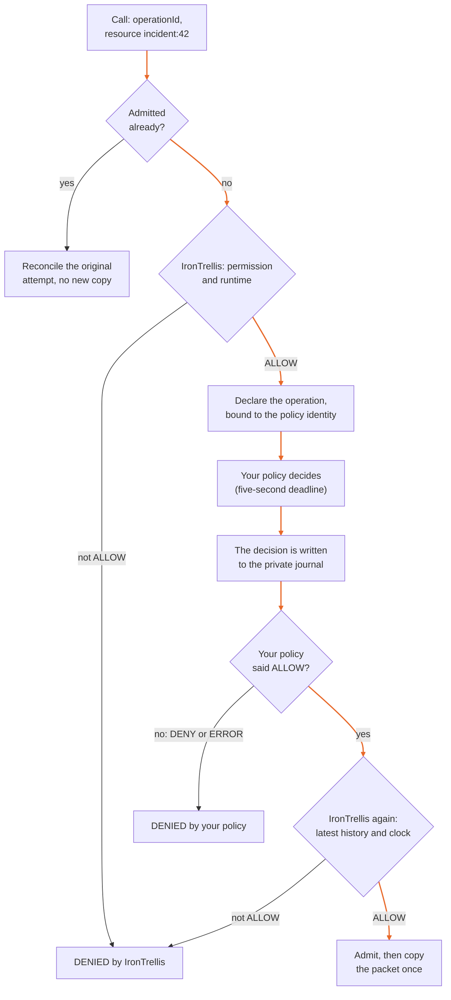

# Use Cedar or OpenFGA with IronTrellis

IronTrellis (formerly Continuity) keeps a checkable record of who may act for whom, and which duties survive when an AI agent is replaced.

Your application may already use Cedar or OpenFGA to decide who can access a document. Keep that policy. This example requires **both** that policy and IronTrellis to allow a collection. IronTrellis still handles the agent's current session, role, operation history and retirement. Neither system grants the other's missing permission.

| | IronTrellis | Your policy (Cedar or OpenFGA) |
|---|---|---|
| What it checks | The agent's grant, current session, role, operation history and retirement | Your own access rules |
| A DENY from it | Stops the collection | Stops the collection |
| An ALLOW from it alone | Not enough | Not enough |

These are optional integrations. The normal local example needs neither service.

## How one call is decided



## Try Cedar first

Use the 1.0.0-rc.2 workspace, or the isolated packed verification below. Dependencies are exact pins, and install scripts stay disabled:

```sh
node integrations/protected-evidence-mcp/setup.mjs /tmp/my-policy-case
node integrations/policy-composition/cedar-gateway.mjs \
  /tmp/my-policy-case/gateway.json \
  integrations/policy-composition/collect.cedar \
  /tmp/my-policy-case/policy-audit.jsonl
```

The last command starts a stdio MCP server: it waits for an MCP client rather than printing a prompt. Configure your client to launch that command with those three application-owned paths. The only tool is `irontrellis_collect_evidence`; its arguments are `operationId` and `resource`. For this fresh synthetic case, use `incident:42`. Keep the same operation ID when retrying, and use a new setup directory if you repeat the setup.

For an automatic demonstration, with no model account:

```sh
node --test integrations/policy-composition/tests/wire-policy.test.mjs
```

That starts real MCP clients and fresh servers, checks both permit and denial, and removes its temporary synthetic cases. The remaining tests use the installed public Core API.

[Cedar 4.13.0](https://github.com/cedar-policy/cedar) runs locally in WebAssembly. Its identity includes the SHA-256 of the exact policy text and the engine version. The adapter maps the Core actor, action and resource directly into Cedar entities. The session, role, tenure, operation and terms come from the trusted broker; the agent supplies no policy context. Any syntax or evaluation error prevents a new effect, including Cedar's [allow-with-skipped-error case](https://docs.cedarpolicy.com/auth/authorization.html).

## Try OpenFGA

The supplied `model.json` grants a `collector` relationship between an agent and a resource. `openfga.mjs` is the trusted application's adapter, and uses the same `additionalPolicy` interface as Cedar. Agent and resource IDs are encoded with base64url before they are mapped to OpenFGA, so the colons in `incident:42` cannot change the tuple syntax. Use the exported `fgaObject(type, id)` when you write relationships.

Use the official **OpenFGA 1.21.0** binary for your platform from [its release](https://github.com/openfga/openfga/releases/tag/v1.21.0). Verify the downloaded archive against the published `checksums.txt`, extract it, then run:

```sh
OPENFGA_BINARY=/absolute/path/to/openfga \
  node integrations/policy-composition/run-openfga-tests.mjs
```

The runner starts its own loopback-only, in-memory service, with the playground and metrics disabled. It creates and deletes fresh test stores, then stops only that process. Do not point these tests at a production service. They test actual relationship removal, model pinning, an unavailable service, Core revocation and retirement during a real response. They do not substitute a mock server.

The adapter pins the endpoint, the store and the immutable model ID, and checks the store and model headers that come back. It requests `HIGHER_CONSISTENCY`, uses no contextual tuples, disables retries and redirects, and bounds the response's size and time. No result means no new effect. This example has no production credential provisioning or service management; an authenticated production deployment needs its own reviewed configuration.

**A pinned model does not pin relationships.** A relationship may change after the check and before the effect. Higher consistency does not make OpenFGA and IronTrellis one atomic transaction. This is a pre-dispatch policy check, with an explicit gap between the two systems. Use it only where that contract is sufficient ([OpenFGA model guidance](https://openfga.dev/docs/getting-started/immutable-models)).

## What is kept, and what is refused

**Operations.** The broker binds the additional policy's identity into the stable operation declaration, so changing that identity cannot reinterpret an old operation ID. Once an operation has been admitted, a retry only reconciles that original attempt; it never dispatches it again, even if a policy service is now unavailable.

**The journal.** Before admission, the broker records the exact policy request, the request hash, the selected policy identity, bounded diagnostic strings and the decision in a private application journal. The supplied journal fsyncs its file and parent directory, and stops at 1 MiB. Use one trusted writer and a private parent directory. A journal that is unavailable or full prevents new effects: arrange archival and a reviewed restart, rather than deleting evidence during operation. It is an application audit file, not an extra canonical Core event or a cryptographic attestation from the external policy engine.

**Time.** Evaluation has a five-second deadline, and OpenFGA requests have a four-second transport timeout. The broker rechecks the Core history and clock after the policy evaluation and the audit recording, so an old answer cannot revive an expired or retired session. A timeout cannot preempt blocking code inside a trusted callback; untrusted evaluators require process isolation.

**Replies.** MCP replies disclose only the policy refusal, not journal paths, policy text, keys or engine diagnostics. Unfinished obligations remain Core records; they are not translated into Cedar rules or OpenFGA relationships.

## What it is built on

This integration is part of 1.0.0-rc.2 but is not published to npm: its package is marked private. It uses the format-2 Core, with one `historyFile`, native Ed25519 runtime credentials and awaited owner writes, and it accepts only the IronTrellis tool and configuration names. Core's frozen protocol literals inside hashed records are unchanged, and some still carry the Continuity name; the new SHA-256 policy identities make no claim to equal earlier digests.

Its tests use the default owner policy, under which owner keys are classed as declared (`DECLARED`). Core also ships the attestation policy for PHL, Proof of Human Lineage (`humanFloor: "ATTESTED"`), but these integration tests don't establish that additional policy coverage.

## Check it in a clean install

The shared packed verifier is `integrations/policy-composition/tests/verify-install.py`. It packs the three integrations and Core, unchanged, installs the four packages into a fresh consumer with install scripts disabled, runs their tests against the real engine and a strict TypeScript check of their declarations, and keeps the histories the tests write, for an independent history checker that is not part of this repository. Give it `--output <dir>`, and pass `--node`, `--pnpm`, `--store-dir`, `--offline` and a disposable, verified `--openfga-binary` as applicable (the OpenFGA tests run only with it); see `--help`. The workspace pins `langsmith` to 0.9.0 (an override in `pnpm-workspace.yaml`) until the upstream declaration issue is resolved.

This example pins axios to 1.20.0 with an override, and its dependency audit was clean when it was pinned, on 13 October 2026. Keep that override and the lockfile.

The test commands above are the package's own checks; this page does not report their results. The deployment boundaries and untested profiles are as stated above.

*Last reviewed: 24 October 2026. This page is revisited at each release.*
