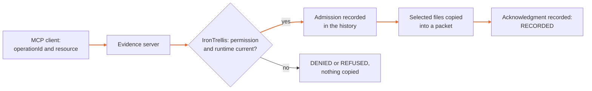

# A protected evidence tool over MCP

IronTrellis (formerly Continuity) keeps a checkable record of who may act for whom, and which duties survive when an AI agent is replaced.

This server lets a client ask for one useful action: copy the operator-selected files into a recorded evidence packet. IronTrellis checks the agent's current permission and runtime before that copy. Retire the runtime while its server is still running, and the next new operation is refused.



The server uses the official TypeScript MCP server and client, **2.2.0**. Tests exercise the **2026-07-28** protocol with a pinned client, and the SDK's legacy negotiation. It is local stdio only. It is not an arbitrary remote-server proxy, an HTTP service or a sandbox by itself.

## Try it without a model account

Use supported Node 22.18 or Node 24 in the 1.0.0-rc.2 workspace:

```sh
node integrations/protected-evidence-mcp/setup.mjs /absolute/path/to/a-new-demo-directory
node integrations/protected-evidence-mcp/client.mjs /absolute/path/to/a-new-demo-directory/gateway.json
```

The setup creates one synthetic text file, fresh local credentials and a one-hour permission. Use an existing parent and a new target directory. The target contains a private signing key for this disposable example: keep it private, and don't commit it. The example uses actual file copying, never production documents, a paid model or a chain.

The client lists `irontrellis_collect_evidence`, then calls it twice with the same operation ID. The first call prints **RECORDED**, **SUBMITTED** and `packetVerified: true`; the second prints **RECONCILIATION_ONLY** and copies nothing. Run the same client command again, and both calls print **RECONCILIATION_ONLY**. The packet stays in the `packets` subdirectory of the private demo directory. A packet acknowledgment establishes the selected copy, not the truth of its contents or the completion of an investigation.

## Connect a host

Use the absolute path to your Node executable and to the server:

```json
{
  "mcpServers": {
    "irontrellis-evidence": {
      "command": "/absolute/path/to/node",
      "args": ["/absolute/path/to/server.mjs", "--config", "/absolute/path/to/gateway.json"]
    }
  }
}
```

Adapt the outer configuration shape to your host. The documented client above is tested; this example is not a claim that every host supports the same MCP revision. No tokens, passwords or chain credentials belong in client settings.

| Comes from | What |
|---|---|
| The client, with each call | `operationId` and the configured public `resource` alias, nothing else |
| The operator's private launch configuration | The actor, session, signing key, role, tenure, source paths, selected hashes and output paths |

A client cannot select another agent or tool server. Tool descriptions, protocol metadata, request IDs and connection IDs are not authority. The stable operation ID belongs to the application workflow: keep it across retries, and don't invent a new one after an uncertain result.

## What protects the files

The engine records admission before invoking the fixed local packet adapter. The selected files are copied synchronously while the cooperating history writer lock is held. The adapter checks paths, links, file identities, sizes and hashes, and retains an attempt record, a packet manifest and a typed acknowledgment. Source changes do not silently change the requested work.

| Bound | Limit |
|---|---|
| Selected files | Up to eight, each at most 64 KiB, at most 256 KiB in total |
| Incoming JSON, checked before the SDK parses it | 16 KiB per frame, depth 12, 2,048 values |
| Messages | At most 1,024 per server process |
| An incomplete frame | A five-second deadline |
| Tool operations | One at a time; an overlapping call receives `BUSY` |

Denial creates no attempt directory or packet. When the bounded process or history limits require investigation, restart with the same private configuration and the original operation IDs. Restarting does not raise the history limit or grant fresh execution authority.

History, configuration, keys, executable code and the source and output folders must be outside the agent's writable control. Running this server and arbitrary agent code as the same unrestricted OS user is a trusted-host demonstration, not complete mediation. [The Linux deployment example](linux/README.md) describes a separate-identity test; it has not been run yet. Host administrators remain trusted.

The server records with the agent's session key, never the owner key, so its records stay unattested and unwitnessed until the next owner write ([docs/SECURITY.md](../../docs/SECURITY.md) §3).

## Uncertain results and retirement

A durable admission is never automatically invoked again, even if the server exited before returning a result. Repeated calls reconcile the original attempt. If the copy completed but the runtime retired before Core recorded its acknowledgment, the packet can verify while the canonical result remains **OUTCOME_UNKNOWN**. Preserve both records. There is no new invocation, no reversal of the copy, no automatic receipt after retirement, and no claim that the uncertainty is resolved.

The guarantee covers this bounded, synchronous local adapter. A remote tool that acts after dispatch would need its own recipient-side fencing; a transport success is not a business acknowledgment. Ordinary grant revocation is not a universal cancellation mechanism for previously admitted work.

Responses contain the status and the typed acknowledgment, without host paths, keys, source contents or the full private history. Full inspection remains a privileged application operation.

## Run the checks

```sh
node --test integrations/protected-evidence-mcp/tests/wire.test.mjs
```

The command starts real server processes and calls them with the official SDK. It covers collection and reconciliation, the still-live retired server, malformed JSON, resource, path and identity substitution, revocation and an incorrect signing key. The integration manifests use exact direct dependencies, and the integrations are part of the repository's pnpm workspace and lockfile. The packed verifier ([below](#check-it-in-a-clean-install)) installs into a fresh, isolated consumer with lifecycle scripts disabled.

Where the parts come from: the strict wire-JSON guard (`strict-json.mjs`) is reused from Continuity's retained-evidence MCP integration, and the packet copy is done by the Core evidence API (`@ramex-labs/irontrellis/evidence`) of 1.0.0-rc.2, a port of Continuity Core 0.3's packet executor. The originals are kept unchanged in the frozen Continuity reference (`packages/reference-0.3`).

Sources: [official stdio serving](https://ts.sdk.modelcontextprotocol.io/v2/serving/stdio), [official client](https://ts.sdk.modelcontextprotocol.io/v2/get-started/first-client.html), [MCP security guidance](https://modelcontextprotocol.io/docs/2026-07-28/tutorials/security/security_best_practices).

[Run an actual LangChain agent without a model account](../langchain-evidence/README.md).

## What it is built on

This integration is part of 1.0.0-rc.2 but is not published to npm: its package is marked private. It uses the format-2 Core, with one `historyFile`, native Ed25519 runtime credentials and awaited owner writes, and it accepts only the IronTrellis tool and configuration names. Core's frozen protocol literals inside hashed records are unchanged, and some still carry the Continuity name; the new SHA-256 policy identities make no claim to equal earlier digests.

Its tests use the default owner policy, under which owner keys are classed as declared (`DECLARED`). Core also ships the attestation policy for PHL, Proof of Human Lineage (`humanFloor: "ATTESTED"`), but these integration tests don't establish that additional policy coverage.

## Check it in a clean install

The shared packed verifier is `integrations/policy-composition/tests/verify-install.py`. It packs the three integrations and Core, unchanged, installs the four packages into a fresh consumer with install scripts disabled, runs their tests against the real engine and a strict TypeScript check of their declarations, and keeps the histories the tests write, for an independent history checker that is not part of this repository. Give it `--output <dir>`, and pass `--node`, `--pnpm`, `--store-dir`, `--offline` and a disposable, verified `--openfga-binary` as applicable (the OpenFGA tests run only with it); see `--help`. The workspace pins `langsmith` to 0.9.0 (an override in `pnpm-workspace.yaml`) until the upstream declaration issue is resolved.

The test commands above check this package as it ships. They do not test your deployment, and the limits stated above still apply.

*Last reviewed: 24 October 2026. This page is revisited at each release.*
