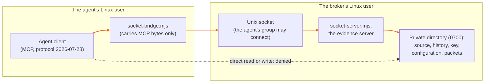

# Give the agent a separate Linux identity

IronTrellis (formerly Continuity) keeps a checkable record of who may act for whom, and which duties survive when an AI agent is replaced.

**Status: an adapted recipe, not yet run.** The macOS stdio tests establish no Linux OS isolation and no separate restore authority. A supervised run on Linux is still required.

A permission check is useful only if the agent cannot bypass it. This disposable example runs the broker and the agent as different Linux users. The agent can connect to the broker's Unix socket, but cannot directly read the source file, the history or the signing key, or write the source, the history or the server code.



| What | How it is protected |
|---|---|
| The broker's private directory | Mode 0700; its key, history and configuration files are mode 0600 |
| The socket | Owned by the broker; the agent's group may connect. Its parent directory does not let the agent replace it. |
| Both processes | Run with `no_new_privs`; the agent has no effective capabilities |
| Executable code and dependencies | Operator-owned, and must not be writable by either identity |

## Run the disposable proof

Use a **development Linux machine**, not a production host. You need root to create and remove temporary service users and to set file ownership. Install Node and the optional MCP integration first. Place this distribution and its installed dependencies in an administrator-owned, world-readable directory, such as a dedicated directory under `/opt`. Do not place it behind a private home-directory permission boundary that prevents the example users from loading the code.

```sh
sudo /absolute/path/to/node integrations/protected-evidence-mcp/linux/prove-isolation.mjs --run-disposable-lab
```

The explicit flag matters. The script creates random temporary broker and agent users, a private synthetic case under `/var/tmp`, and two process groups. When it finishes, whether it passes or fails, it stops only those process groups, removes only that temporary case and deletes only those newly created users. It does not change your firewall, SSH, hypervisor or global network configuration. Do not interrupt the operating system during cleanup; if cleanup cannot finish, inspect the printed failure.

A passing result lists each direct-access denial, one recorded copy, the refusal from the still-live obsolete runtime, and the reconciliation of the original operation. It verifies that the source bytes stayed unchanged and that exactly one canonical consumption was recorded. It uses the official current-protocol MCP client over the local socket.

## What a passing run would establish

- Separate identities enforce the tested file, history, signing-key and executable-code boundary.
- The permitted request reaches the broker and creates the selected packet.
- The old client and broker stay alive when control advances. A new request is refused; retrying the original operation does not copy again.

This is not a full hostile-code sandbox, a network egress policy, a resource quota, a kernel proof or a defense against the host administrator. An agent with extra credentials, inherited resource descriptors or another privileged route would need those routes closed separately. Only the configured local packet tool has the demonstrated actual-effect serialization contract.

`socket-server.mjs` is an explicit local service launcher; `socket-bridge.mjs` runs under the unprivileged agent and carries only MCP bytes. No signing credential is sent across that bridge. There is one active connection per launcher, bound to its configured runtime; use separately configured launchers for separate identities. It is not an HTTP endpoint or a general remote proxy.

The disposable lab above checks this example as it ships. It does not test your deployment, and the limits stated above still apply.

*Last reviewed: 24 October 2026. This page is revisited at each release.*
