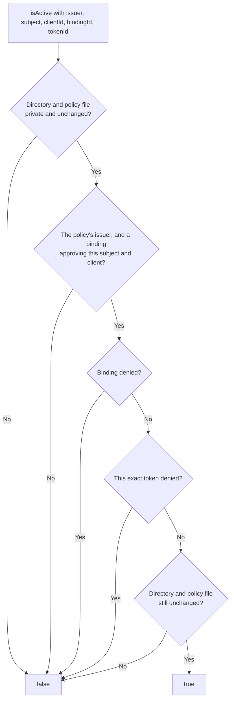

# Keeping revoked callers revoked

An identity provider says who signed in. The operator still decides whether that person's agent may keep using this gateway, and a token that is still cryptographically valid, or a refreshed one, must not undo that decision.

Suppose an analyst's access to an incident gateway ends today. Their login at the identity provider still works, and a refresh can mint a new token that verifies perfectly. So the operator records a denial for the analyst's binding. From then on the policy answers `false` for every token of that binding, including tokens issued after the denial.

`@ramex-labs/irontrellis-mcp-gateway/access-policy` is a small host-owned store for exactly that: approved issuer/subject/client/binding assignments recorded once, then durable denial records. A binding is one approved assignment, under an id you choose: a subject (the signed-in user at the issuer) using a registered client. The store has no grant, un-revoke, migration, restore or network command.

## Use it

```js
import { initializeAccessPolicy, openAccessPolicy } from "@ramex-labs/irontrellis-mcp-gateway/access-policy";

// One-time setup; the parent directory must already be private (0700).
const policy = initializeAccessPolicy({
  directory: "/private/operator-state/access",
  issuer: "https://identity.example.com/",
  bindings: [{ bindingId: "analyst", subject: "approved-user-id", clientId: "registered-client" }],
});
policy.isActive({ issuer, subject, clientId, bindingId: "analyst", tokenId }); // true only for an approved, undenied identity
policy.revokeBinding("analyst");                  // every token for that assignment, now and after renewal
policy.revokeToken({ issuer, subject, clientId, bindingId, tokenId }); // one exact token

const reopened = openAccessPolicy({ directory: "/private/operator-state/access" }); // a restart opens existing state; never initialize over it
```

| Call | What it does |
| --- | --- |
| `initializeAccessPolicy({ directory, issuer, bindings })` | Creates a new policy directory under an existing canonical, owner-only (0700) parent, and refuses a directory that already exists. The issuer is an `https` URL in canonical form (`new URL(issuer).href` must equal it), without credentials, query or fragment; `http://127.0.0.1` is accepted for isolated tests. Bindings: 1 to 16, each with a unique `bindingId` |
| `openAccessPolicy({ directory })` | Opens existing state, as a restart must |
| `isActive(identity)` | `true` only for an approved, undenied identity; any failure answers `false` |
| `revokeBinding(bindingId)` | Denies every token for that assignment, now and after renewal |
| `revokeToken(identity)` | Denies one exact issuer/subject/client/binding/token tuple |

## What `isActive` checks



`isActive` is synchronous and rereads the private files on every check; missing, corrupt, changed, replaced or symlinked state, or state that is not owner-only, answers `false`. Records are created exclusively, fsynced and named by hash.

| Limit | Value |
| --- | --- |
| Bindings | At most 16 |
| Denial files | At most 1,024; exhaustion refuses another mutation (`POLICY_CAPACITY_EXHAUSTED`) and never prunes |
| Administrative calls | Serialise them |

## Where it fits

The gateway's authenticated HTTP entrances consume this store: pass `policy.isActive` as the `isActive` option of the `/http` entrances (`serveGatewayHttp`, `serveGatewayRouter`, `serveGatewayBackend`) or of `createAccessVerifier` from `/access-http`, which calls it with the verified token's issuer, subject, client, binding and token id (see the [README](../README.md#public-imports)). Public HTTPS deployment is not part of this release. With any other login, call `isActive` from your own host that terminates the caller's login.

Keep the directory under the trusted host's control, outside the record directory (snapshots do not include it) and outside the agent's reach. It is not tamper-proof storage, and a policy answering `true` does not itself authorize any tool: the history's runtime and grant checks still apply.

*Last reviewed: 24 October 2026. This page is revisited at each release.*
