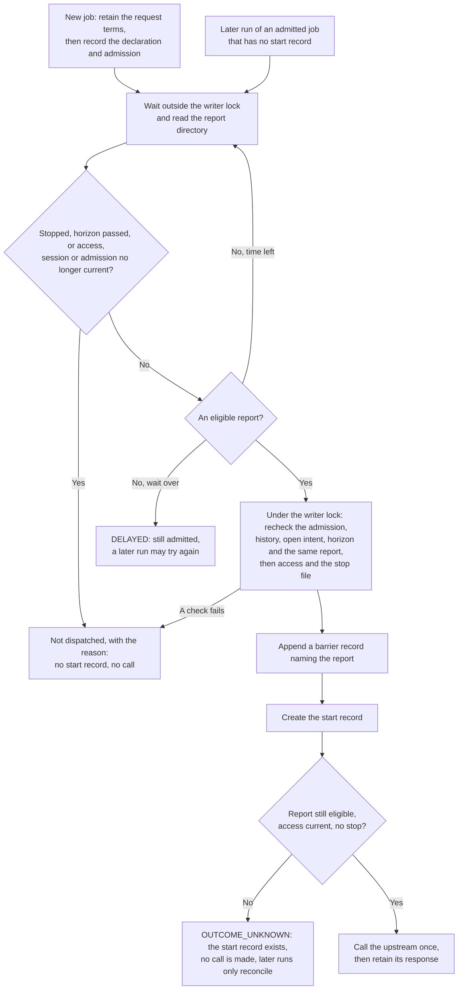

# Live-anchoring integration

A history kept by IronTrellis (formerly Continuity) can be anchored on a public chain: a commitment to one of its heads is published there. Once that publication is final, anyone who reads the chain can detect a rollback or fork of the anchored part of the history.

The gateway has an optional, privileged API integration that uses such evidence to hold work back: it delays an admitted operation until a retained anchor report is eligible. Picture a job that pays an invoice. Its admission is recorded at position 41 of the history, and the host's rule is that no payment request leaves until a report shows that a head at or past position 41 is final on the chain. The gateway keeps the admitted job waiting, reads a protected directory of reports, and calls the payment service once, only when an eligible report is there. If none arrives in time, the job stays admitted and undispatched, and a later run of the same job may try again.

Core authorization and replay remain unchanged. A wait, an unavailable report or a stop does not turn an admitted operation into a Core refusal.

## What 1.0.0-rc.2 does and does not do

The example above is what the barrier is designed for. Before relying on anything else on this page, read what this release actually does.

| Question | In 1.0.0-rc.2 |
| --- | --- |
| Is the barrier built? | Yes, as a host API: `createGateway({ …, anchoring })`. There is no CLI option and no `gateway.json` field for it. |
| Does the release produce anchor reports? | No. It includes no qualified finality-report producer. Both `verifyAnchor` functions of the [anchor outbox](../../anchor-outbox/README.md) (the outbox's own and its observed connector's) return `report: null`, so eligible reports can only come from an external producer. |
| Does `irontrellis verify` check chain anchors? | No. It takes no chain-anchor reports; the anchors it checks are local anchor logs and the anchor receipts recorded in the history. |
| Can a production-class barrier open? | Only if an external producer writes eligible reports into the report directory. The gateway then takes a report's `CONSENSUS_VERIFIED` mode on its producer's word: no code in this release queries an independently administered L1 node, or checks on the chain the reported L1 block's inclusion, its finality or the inbox message bytes. |
| Is consensus-verified anchoring claimed? | No. This release makes no consensus-verified or production-anchoring claim and sets no live-anchoring default. |
| Are there demonstration records? | Yes, made with separate anchoring tools. They report `TRUSTED_NODE` mode only, never consensus-verified, and open no barrier. |
| Is there a test profile? | Yes: Etherlink Shadownet, behind an explicit opt-in. Nothing dispatched under it supports a production or live-anchoring claim. |

The structural codecs, retained-RPC diagnostics and synthetic fixtures in this release do not qualify a production deployment. An installation needs a separately installer-selected and qualified `verifyAnchor` producer, its evidence and protected report custody.

Keep synthetic fixtures out of the trusted report directory. A synthetic report claiming `CONSENSUS_VERIFIED`, together with a supplied instance observation claiming that mode, can satisfy the implemented eligibility checks. The gateway trusts this privileged host boundary; plausible bytes or mode strings do not independently establish evidence qualification.

## How a job passes the barrier



If a report became ineligible between the wait and the locked check, and no start record exists yet, the run waits again while its time lasts. Every step is described below.

## Host API configuration

Pass `anchoring` to the privileged `createGateway(options)` API. It is supported for exactly-once jobs, and for per-call mode only when `recordCalls: true` supplies durable operation storage; unrecorded per-call mode refuses an anchoring configuration (`INVALID_INPUT`). The per-call API allocates a new operation for each call; it is not a job-resume interface.

There is no CLI or configuration-file setup: `gateway.json` has no `anchoring` field (it refuses unknown fields), and there is no `--allow-test-anchoring` or `--test-barrier-mode` flag in this release. Every option below is host API only.

The implemented shape is:

```ts
type LiveAnchoringOptions = Readonly<{
  trustRootBytes: string | Uint8Array;
  reportDirectory: string;
  stopFile: string;
  readInstanceImmutables(request: Readonly<{
    destination: string;
    chainId: string;
  }>): Promise<Readonly<{
    destination: string;
    namespaceId: ContentHash;
    publisher: string;
    chainId: string;
    mode: "CONSENSUS_VERIFIED" | "TRUSTED_NODE" | "UNVERIFIED";
  }>>;
  waitMs?: number;
  pollMs?: number;
  resumeHorizon?: Readonly<{ kind: "HEAD_POSITIONS"; limit: number }>;
  resumeUndispatched?: boolean;
  allowTestProfile?: boolean;
  testBarrierMode?: "CONSENSUS_VERIFIED" | "TRUSTED_NODE";
}>;
```

| Option | Default and bounds | What it is |
| --- | --- | --- |
| `trustRootBytes` | required | The profile trust root (below) |
| `reportDirectory` | required; an existing canonical, owner-only directory | Where the installer's producer writes reports; bound to one trust root |
| `stopFile` | required; its parent an existing canonical, owner-only directory | Any entry at this path stops new dispatch |
| `readInstanceImmutables` | required | The installer's one read of the deployed instance, at load |
| `waitMs` | 1,000 ms; an integer from 0 through 3,600,000 | How long one run waits for an eligible report |
| `pollMs` | 100 ms; an integer from 1 through 60,000 | How often the report directory is read during a wait |
| `resumeHorizon` | none | `{ kind: "HEAD_POSITIONS", limit }` |
| `resumeUndispatched` | `true` | Whether a later run may dispatch an admission that has no start record |
| `allowTestProfile` | off | The opt-in a TEST-class profile needs |
| `testBarrierMode` | `"CONSENSUS_VERIFIED"` | The mode a TEST profile's barrier is measured in |

The installer owns these options and callbacks. Do not expose the gateway handle, report directory, stop-file control or configuration as agent inputs. Existing local session/signing and approved-upstream configuration is still required; anchoring does not replace it.

**The instance observation.** `readInstanceImmutables` performs the installer's one read of the deployed namespace instance. Its returned destination, namespace, publisher and chain must match the trust root, and its mode must be one of the three listed. The gateway retains the observation and its reported mode in its storage directory. It does not authenticate a caller-supplied observation by checking its shape. A report is eligible only while this observation's mode equals the barrier's mode (`CONSENSUS_VERIFIED`, or `TRUSTED_NODE` under a TEST profile's trusted-node barrier), so a diagnostic `UNVERIFIED` observation does not become qualified on load.

**Directories.** `reportDirectory` and the stop file's parent must already be canonical, owner-only directories, without symlink traversal. Keep them outside agent write access. Report files are owner-only regular files with one hard link, read without following symlinks and checked for changes during reading. These are host custody requirements, not consensus proofs.

**Timers.** A bounded wait expiring leaves the operation undispatched; a later job `run` may try again. Neither timer establishes finality. Setting `resumeUndispatched` to false disables this integration's narrow resumption of an existing undispatched admission.

**Resume horizon.** The only supported `resumeHorizon` kind is `HEAD_POSITIONS`. Its nonnegative safe-integer `limit` bounds `current.head.position - admissionHead.position` on a resumed operation. An omitted horizon imposes no additional horizon. There is no host-time horizon option in this implementation. The configured value is surfaced in status; a limit failure is `RESUME_HORIZON`, with no new dispatch.

## The trust root and profile classes

`trustRootBytes` is the profile trust root, an `irontrellis-profile-trust-root/1` envelope: the profile manifest, its hash, the namespace id and the destination. Load recomputes the payload hash and namespace, checks the destination's shape and binds the payload to the current format-2 genesis identities. The manifest's `(chain.id, id)` pair must then be a row of the closed class table, which Core exports as `ANCHORING_PROFILE_CLASSES` and both the outbox and the gateway read (`verify` does not read it in this release):

| class | chain | profile id |
| --- | --- | --- |
| PRODUCTION | `eip155:42793` (Etherlink mainnet) | `irontrellis-anchoring-profile/etherlink-mainnet/1` |
| TEST | `eip155:127823` (Etherlink Shadownet) | `irontrellis-anchoring-profile/etherlink-shadownet-test/1` |

Any other pair, including the production id on Shadownet, is `TRUST_ROOT_INVALID` before the instance read. No flag changes a class. The class then decides what the barrier may do:

| | PRODUCTION | TEST |
| --- | --- | --- |
| Needs an opt-in to open | No | Yes, `allowTestProfile: true`; without it, `TRUST_ROOT_INVALID` with the reason `TEST_PROFILE_NOT_ALLOWED` in its detail |
| Barrier mode | `CONSENSUS_VERIFIED` only; `testBarrierMode: "TRUSTED_NODE"` is `TRUST_ROOT_INVALID` with the reason `TRUSTED_NODE_BARRIER_NOT_ALLOWED` in its detail | `CONSENSUS_VERIFIED` (the default, the production rule) or `TRUSTED_NODE` |
| Separate node operators required | Yes | Under `CONSENSUS_VERIFIED`, yes; under `TRUSTED_NODE`, no |
| On every open | — | A line on stderr naming the profile and barrier mode |
| `classLabel` in status | `null` | "test network; no production finality claim", or under the trusted-node barrier "test network; trusted-node barrier; no production finality claim" |

`TRUSTED_NODE` is for a Shadownet deployment with no independently administered validating L1 node. The class is checked before the mode, so the weaker barrier cannot reach a production profile.

Under a consensus-verified barrier the manifest's EVM and L1 operator labels must differ; if an own-rollup node is present, its operator must also differ from the L1 operator. These string comparisons do not prove separate administration. A TEST profile's trusted-node barrier does not ask for them, since it exists exactly where no independent L1 node does.

## Report custody

The report directory belongs to **one exact trust root**. Before the first digest-named report exists, load creates its `trust-root.json` with an exclusive durable create. A directory containing reports but lacking that binding is refused. An existing different root is refused, and the binding is checked again when reports are read. Do not repurpose or overwrite that directory for another manifest: a profile migration uses a new namespace instance and a new trust root.

Only the installer-selected qualified producer may publish live reports there. It must derive the fields from the selected profile, actual statement, transaction and prefix checks and the required node evidence; an agent-provided report, codec success or injected `qualified: true` is not an input path. Complete diagnostics and synthetic codec examples belong elsewhere. There is no built-in producer in this release that closes these evidence obligations.

Each report file is named `<reportDigest without 0x>.json` and contains the exact canonical `irontrellis-anchor-verify-report/1` bytes. The gateway re-hashes the bytes, checks the filename and requires the closed report schema. It reads at most 4,096 digest-named files, with a 131,072-byte limit per report. A malformed recognized file fails the read; it is not silently skipped.

## Which reports are eligible

A report releases a dispatch only when every row holds:

| Check | What must hold |
| --- | --- |
| Identity | Same profile id, chain and history as the trust root |
| Position | Its statement head is at or beyond the admission head and matches the current local history at that position |
| Label | `L1_FINAL` or `CEMENTED` |
| Mode | The barrier's mode, and only that: `CONSENSUS_VERIFIED`, or `TRUSTED_NODE` under a TEST profile's trusted-node barrier. A report claiming `CONSENSUS_VERIFIED` is not eligible under the trusted-node barrier |
| Nodes | The EVM, L1 and own-rollup node chain ids and operators match the manifest's pins |
| Administration | No report for this history and profile shows a node administration that differs from the pins; falling back to an older report does not bypass this |
| Own claims | No listed contradiction in its own fields (below) |
| Statement | Not contradicted: no report of the same statement declares a contradiction or names a different L1 block, operation or block time |
| Freshness | If the manifest sets `maxL1HeadLag`, its L1 head is within that lag of the highest retained matching L1 head |

A report's own claims contradict each other when it declares a continuity contradiction; when, as an `L1_FINAL` report in `CONSENSUS_VERIFIED` mode, it lacks an `OPEN` refutation residual or a null cementation level, declares an L1 head fewer than two levels past its block, or names the same EVM and L1 operator; or when, as a `CEMENTED` report, it lacks a `CLOSED` residual or a cementation level.

**Contradictions.** An explicit contradiction, or different L1 block or operation hashes reported for the same statement, blocks that statement; so does a different block time reported for the same L1 block hash. Referenced previous reports must be present. A report disappearing after this gateway instance observed it is a storage incident. The producer must retain append-only evidence and continuity across restarts: the gateway's in-memory disappearance check is not a durable anti-deletion ledger.

**Upgrades and freshness.** Different protocol/software values are not silently pinned forever by the payload: tracking and qualifying upgrades remains the producer's obligation. For `maxL1HeadLag`, selection compares a candidate's L1 head level with the highest retained matching L1 head observation for that profile, chain and operator. It does not fetch a fresh node head or infer freshness from elapsed wall time. The producer remains responsible for fresh, authentic observations.

**Order.** Among eligible reports, the gateway picks the highest statement-head position, then the latest observation time, then the lowest digest.

## What the finality labels mean

At `L1_FINAL`, inclusion and order in the L1 inbox are final under the specification's qualified-evidence conditions; L2 execution remains refutable. The report carries an `OPEN` residual and a null cementation level plus the required sentence; the gateway checks the residual and the level in `CONSENSUS_VERIFIED` mode, not the sentence's wording. `CEMENTED` requires observed covering cementation, not a timer; the gateway accepts it only with a `CLOSED` residual and a cementation level, which are the producer's claims.

`TRUSTED_NODE`, `UNVERIFIED` diagnostics, mirror results and own-rollup re-execution do not substitute for the production barrier. The report also carries `finality.l1BlockTime`: the L1 block's header time in milliseconds under `CONSENSUS_VERIFIED`, `null` in every other mode. It is chain evidence, never a clock reading.

## Persisted request and dispatch sequence

Anchoring adds private application records, not Core events. Before a new admission, the gateway retains the captured request terms under a name derived from the operation id and terms commitment. A resume loads the record selected by the admitted declaration's commitment, verifies its identity, terms, role, tenure and upstream joins, and uses those retained argument values. It does not render a new business request. This is a commitment to the application values; it is not a claim that every later transport serialization is byte-identical.

The barrier wait runs outside the history writer lock. After it returns, the dispatch path rechecks the same admission and submission identity, extending local history, open intent, current control, session, role and stop state, and the optional horizon. Inside invocation's locked section it re-reads the exact selected report and checks eligibility again. The order is then:

1. Check current access and stop state.
2. Append an exclusive, fsynced barrier record identifying the report relied on.
3. Create and fsync the exclusive operation start record, `<operation-stem>.attempt.json`.
4. Recheck the selected report and current access and stop state.
5. Call the approved upstream once. If a response is retained, write the existing response record bound to the attempt digest.

The operation response `<operation-stem>.report.json` is different from the finality report in `reportDirectory`. A retained response records what the upstream reported; it does not prove an external effect.

**Barrier records.** The first barrier file is `<operation-stem>.barrier.json` with `barrierSeq: 0` and `previousBarrierDigest: null`. Subsequent files are `.barrier-1.json`, `.barrier-2.json`, and so on. Every record binds the operation and admission, the statement head and digest, the profile, chain, report label, mode and digest, and `resumed`. A resumed append uses `resumed: true` and hashes the preceding barrier record. The complete chain must be contiguous and re-hash, and every record must name the open trust root's profile and chain and the open barrier's mode; otherwise the chain gives `ADMISSION_MISMATCH`. Old barrier records are never overwritten or treated as proof of dispatch. A record's mode is `CONSENSUS_VERIFIED`, or `TRUSTED_NODE` only when its own chain and profile are the TEST pair.

## Crashes, stops and status

Absence of the operation's start record is the resumption condition, even when one or more barrier records exist. A later `run` of the same job may dispatch once only after all resume checks pass and it appends a new barrier record. An old report may be reused only after current re-evaluation. Once an attempt exists, the path is reconcile-only and does not append another barrier or invoke the upstream again. Only `ENOENT` under intact private storage proves absence; a malformed file or link does not.

The stop latch is existence-based: any entry at `stopFile`, including malformed or linked content, stops a new dispatch. It is checked during polling and around the attempt fsync. A stop while waiting makes zero calls and leaves no start record; the run reports `STOPPED` or an undispatched result with reason `STOPPED`, depending on the stopping boundary.

A stop after attempt fsync can still prevent the call, but the durable start already exists. The result is conservatively `OUTCOME_UNKNOWN` unless a valid response is retained; subsequent runs only reconcile. The stop latch does not cancel a call already sent, roll back an external effect or make resending safe. Do not delete attempt or barrier files to force a retry.

For exactly-once jobs, `status()` inspects retained state without contacting the upstream:

| Retained state | `status()` reports |
| --- | --- |
| No admission | `NOT_STARTED`, or `NOT_ADMITTED` once declared |
| An admission, no start record, a wait open in this process | `DELAYED` |
| An admission, no start record, no wait open | `NOT_DISPATCHED`, with its remembered reason |
| A start record and a retained response that verifies | `RESPONSE_RETAINED` |
| A start record, no such response | `OUTCOME_UNKNOWN` |

It never reports `OUTCOME_UNKNOWN` merely because barrier records exist. A repeat run may return `RECONCILIATION_ONLY`. With an admission, status also carries:

- `barrierChain`: the operation's whole barrier chain, one entry per record in order with its digest, report digest, label and mode. A chain that does not validate is listed as `barrierChain: null` with `barrierChainStatus: "ADMISSION_MISMATCH"`. The gateway has no separate evidence-bundle export, so this listing is where the barrier chain appears.
- `reliedOnBarrierDigest`: the record dispatch relied on, the last record once an attempt exists (none is appended after it), and `null` before.

Under anchoring every status also carries `profileClass` (`PRODUCTION` or `TEST`), `barrierMode` and `classLabel`. Nothing dispatched under a TEST profile supports a production or live-anchoring claim. `dispatchPerformed: false` on status means that inspection did not dispatch; it does not prove no earlier call happened. Reasons remembered only in memory may return to `NOT_STARTED` after restart until the next check; the durable admission, start and response records determine the dispatch boundary.

## Scope of the guarantee

The exclusive-create/fsync discipline assumes the designated host, its private local store and the stated filesystem durability model. It does not make a distributed database lock, prove upstream business effects, qualify nodes, authenticate report authors merely from JSON, or provide a production finality service. The unmodified current diagnostic outputs do not supply an eligible report. Tests that inject synthetic consensus claims exercise the trusted-host boundary; they do not demonstrate consensus evidence. Live connector qualification, and the node evidence it needs, remain separate requirements. Anchoring commits a particular prefix of a history; it does not establish that its records are true.

No CLI setup, deployed contract, active node enrollment or live default is implied by this API documentation.

## References

- Implementation: [`gateway.ts`](../src/gateway.ts), [`anchor-barrier.ts`](../src/anchor-barrier.ts), [`dispatch-files.ts`](../src/dispatch-files.ts) and [`anchor-profile`](../src/anchor-profile/index.ts).
- Normative rules: the [anchoring profiles specification](../../../docs/spec/SPEC-IRONTRELLIS-ANCHORING-PROFILES-r2.md), §8 (finality labels and the barrier), §10 (profile classes), §14 (the report), §16 (resume and the barrier chain) and §19 (the trust root).
- The limits above are [known issues](../../../docs/records/KNOWN-ISSUES-r2.5.md) 53, 54, 56 and 71.

*Last reviewed: 24 October 2026. This page is revisited at each release.*
