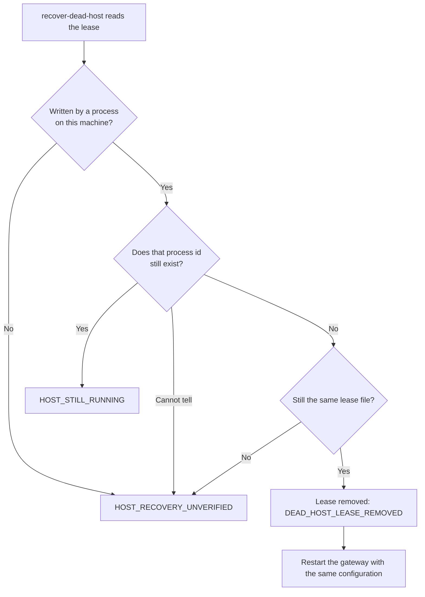

# Operating a gateway case

A case is one history file plus one private record directory (`storage`). The history is the signed record of what the agent may do; the record directory holds the bytes behind each job: the attempt written before an upstream call, the reply kept after it, and the host lease. This page covers the operator command `irontrellis-mcp-ops` and the limits a running gateway keeps. Each command is built so that you can look at a case, revoke, copy it and recover it without sending any job twice.

| Command | What it does | While a gateway runs |
| --- | --- | --- |
| `inspect` | Counts and capacity of a case | Can run alongside |
| `revoke` | Revokes one recorded authority as the owner | Can run alongside; the gateway sees it on its next call |
| `snapshot` | Writes an offline private copy into a new directory | Stop the gateway and every history writer first |
| `verify` | Checks a snapshot | Reads only the snapshot |
| `recover-dead-host` | Removes the lease a crashed host left behind | Only once that process has stopped |

`--config <gateway.json>` stands in for `--history <file>` and `--storage <dir>`. Every result is JSON on stdout; a refusal is one JSON line on stderr, `{"status":"REFUSED","reason":<CODE>,"detail":<why>}`, with exit code 2.

## One host per case

Run one gateway host per case: the host claims `storage/gateway-host.lock.json` before serving, and a second host using the same directory refuses to start (`HOST_ALREADY_OWNED`). Embedded users of `createGateway` in exactly-once mode wrap their host with `acquireHostLease(storage)` and release it after all work stops. The lease is a process-ownership guard, not core authority and not a distributed lock.

Owner administration (`irontrellis` commands, `irontrellis-mcp-ops revoke`) may run alongside a live host: the store serializes writers through the history's own writer lock, and the gateway reads the history afresh on every call.

## Inspect a case

```sh
irontrellis-mcp-ops inspect --config /private/case/gateway.json
```

Reports counts only:

| Fields | What they report |
| --- | --- |
| `eventCount`, `maxEvents`, `mode`, `declaredJobs`, `canDeclareJob`, `capacity` | Events and capacity: mode `OPEN` or `CONTROL_ONLY` (a format-2 history at a reserve threshold reports `RESERVED`, and at an absolute limit `FULL`), declared jobs, reserved lifecycle slots |
| `observedHeadHash`, `chain`, `pinnedHeadStatus`, `rollback` | The observed head hash, the chain and pinned-head status; `rollback: true` when the file is behind its pin |
| `recordFiles`, `recordBytes`, `leasePresent` | Record files and bytes in `storage`, and whether a lease is present |
| `duties` | The case's attempt duties, counted by their current view |
| `warnings` | `CAPACITY_CONTROL_ONLY`, `ROLLBACK_DETECTED`, `REMOTE_WITNESS_NOT_CHECKED` |

No identities, tool arguments, replies, keys or paths appear in the output. It is a point-in-time diagnostic, never an authorization decision.

## Remote witnesses

`inspect`, `snapshot` and `verify` are offline tools: they never ask the history's remote witnesses ([docs/WITNESS.md](../../../docs/WITNESS.md) in the repository), so they never establish that the history is the latest copy the owner vouched for. Evidence the store already holds still refuses `inspect` and `snapshot`: a rollback remembered in `<history>.witness.json` (a witness head the file lacks) or a recorded split view makes them fail with `ROLLBACK_DETECTED` / `WITNESS_SPLIT_VIEW`. `verify` reads the copied history without the witness side file, so it does not check that evidence.

When the witness policy sets `requireOnOpen` (readers must confirm with the witnesses first), they do not wait for that check; instead they read the history without its witness session and say so:

| Command | What it reports |
| --- | --- |
| `inspect` | The warning `REMOTE_WITNESS_NOT_CHECKED`: the counts describe the file on disk, which the witnesses have not confirmed in this run |
| `snapshot` | `remoteWitnessCheck`: `"NOT_REQUIRED"` (no `requireOnOpen` policy: the history was read through its normal witness guards) or `"SKIPPED"` (a `requireOnOpen` policy whose witness check was not waited for); and always `currentnessEstablished: false` |
| `verify` (of a snapshot) | Always `currentnessEstablished: false`: it checks the copy's integrity (checksums, chain, copied pin), never that it is current |

To establish currentness, run `irontrellis verify` on the live history (it asks the witnesses) or `irontrellis witness status`.

## Capacity

A format-2 history has no event limit unless its genesis carries `capacity.maxEvents` (`irontrellis init --max-events`, or `maxEvents` in `createLocalAttemptOwner`); otherwise only the format's absolute ceilings apply, 1,048,576 state records and a 1 GiB file, which `RESERVED` and `FULL` report. Each declared job reserves one slot per lifecycle record type (12 with the declaration), so `canDeclareJob` turns false before the file is physically full.

In `CONTROL_ONLY` mode, new jobs and recorded per-call operations are refused with `CAPACITY_CONTROL_ONLY`. These continue:

- reconciliation of admitted jobs, `irontrellis_status` and `irontrellis_why`;
- per-call forwards without `recordCalls`;
- every control write (revocation, termination, unappointment, epoch advance).

Legacy and format-1 histories are read only in this release; the gateway serves one only when `gateway.json` opts in by hand (`enforceFromReadOnlyHistory`). There is no pruning or automatic migration; `irontrellis migrate` creates a format-2 successor.

## Revoke

```sh
irontrellis-mcp-ops revoke --config /private/case/gateway.json --authority write
```

Writes one `AUTHORITY_REVOKED` control event signed with the owner key next to the history (`<history>.owner-key.json`; without it the revocation fails with `KEY_UNAVAILABLE`, never silently). Repeating it answers `ALREADY_REVOKED` and writes nothing; an unknown id answers `UNKNOWN_AUTHORITY`.

A running gateway sees the revocation on its next call in both modes: a job (or per-call tool) that has not run yet answers `DENIED`. An exactly-once job that already ran is not re-authorized: repeating it answers `RECONCILIATION_ONLY` with the reply retained from the original run, because reconciliation reports what already happened and sends nothing. Revocation cannot recall a request already sent to an upstream; see [RECOVERY.md](RECOVERY.md).

**What the owner key covers.** `revoke` is an owner write: the owner key signs the event and attests the new head, and when witnesses are bound, the command tries to submit that head to them before it exits (an unreachable witness is not an error; evidence of a rollback or a split view is). Under a `requireOnOpen` policy it first confirms the history with the witnesses, and refuses (`WITNESS_UNAVAILABLE`) when too few of them answer. What the gateway itself records (job declarations and admissions, outcomes, refusals, effects and receipts) is signed with runtime session keys instead. Those records stay unattested and unwitnessed until the next owner write; between owner writes, `irontrellis repin` attests the current head and `irontrellis witness sync` brings the witnesses up to it.

## Recover a stopped host

Normal shutdown (stdin end, SIGTERM) releases the lease. A hard crash leaves it in place. Confirm the former process has stopped, then:

```sh
irontrellis-mcp-ops recover-dead-host --config /private/case/gateway.json
```



Only a lease from this machine whose recorded process id provably no longer exists is removed. A live process, a different hostname, a replaced file or a symbolic link is refused. It never kills a process or changes the history. Restart the gateway with the same configuration: admitted jobs resume as reconciliation, and uncertain outcomes are not sent again.

## Offline snapshot

Stop the gateway and every history writer, then:

```sh
irontrellis-mcp-ops snapshot --config /private/case/gateway.json --directory /private/snapshot-01
irontrellis-mcp-ops verify --directory /private/snapshot-01
```

`snapshot` takes the host lease while it copies, so it refuses while a gateway holds it (`HOST_ALREADY_OWNED`). The snapshot directory must be new and outside the case's storage directory (`SNAPSHOT_TARGET_INVALID`). Its parent must be owner-only (0700); otherwise the refusal says so (`STORAGE_UNAVAILABLE`, with the directory and its mode in `detail`). The snapshot holds exactly:

| file | copied from |
|---|---|
| `history.jsonl` | the history file |
| `history.jsonl.head` | `<history>.head`, the pinned head, when it exists |
| `history.jsonl.anchors` | `<history>.anchors`, the local anchor log, when it exists |
| `history.jsonl.witness.json` | `<history>.witness.json`, the remote witness side file (policy, remembered checkpoints, queue), when it exists, **with every registration `token` removed from its policy**: secrets never go into a snapshot. A case restored from it registers with a witness again only once the operator gives the token again (`irontrellis witness add … --token`) |
| `gateway.json` | the configuration file, when the snapshot was taken with `--config` |
| `records/*` | every record file in `storage` (not the host lease) |
| `snapshot.json` | the checksum manifest (head, every file's size and SHA-256) |

**Key files and witness tokens are never copied**: not the owner key (`<history>.owner-key.json`), not the retired owner key files, not the session key named by `keyFile` or the gateway's own key named by `connector.keyFile`, and not the registration tokens in the witness side file. Back them up separately, to a place at least as private (see the repository's [`docs/OPERATOR.md` §2](../../../docs/OPERATOR.md#2-backups)); without the owner key a restored case cannot revoke. The copied `gateway.json` still names the original absolute paths. The gateway refuses to start when `keyFile`, `connector.keyFile` or `historyFile` lies inside `storage`, so a snapshot never holds a key.

A history, pin, anchor log or witness side file that changes during the copy is refused (`HISTORY_CHANGED_DURING_SNAPSHOT`).

`verify` checks every checksum, refuses unlisted files, replays the history against its copied pin (`pinnedHeadStatus`) and reports whether the anchor log, the witness side file and the configuration are present. It does not establish that the snapshot is current (`currentnessEstablished: false`, see [Remote witnesses](#remote-witnesses) above). There is deliberately no restore command: replacing a live case with an older copy loses revocations and consumed admissions, and the live pinned head then reports `ROLLBACK_DETECTED` on open.

## Limits and logs

| What | Limit |
| --- | --- |
| Exactly-once jobs | One active call per gateway, at most 8 upstreams and 32 jobs |
| Per-call tools | At most 64 tools and 8 upstreams; concurrent calls allowed unless `recordCalls` |
| Records | Each record file at most 128 KiB; a recorded call (`recordCalls`) adds two, and nothing prunes them. `snapshot` refuses a case whose manifest would pass 128 KiB, from about 326 to 328 recorded calls (the check prices every manifest row at its longest size, not its actual one; fewer with anchoring), before writing anything (`SNAPSHOT_TOO_LARGE`); `inspect` and `snapshot` refuse a `storage` directory of more than 4,096 files (`RECORD_CAPACITY`) |
| Upstream replies | Retained up to 16 KiB |
| Upstream output | stdout bounded to 64 KiB per frame, 128 KiB buffered, and at most 1,024 frames in any 60 seconds from one upstream process; stderr is discarded. A connection that closes or fails is dropped, and the next call to that server starts it again and checks the approved tool definition first |
| Client input on stdio | 16 KiB per frame and at most 1,024 messages in any 60 seconds; an oversized or invalid frame, a message past that rate, or an unfinished frame older than five seconds ends the process (`INPUT_REFUSED` or `FRAME_TIMEOUT`) |
| Histories read by `inspect` and `snapshot` | Up to the core store's own limit (1 GiB for formats 2 and 1, 64 MiB legacy), the size the gateway can write; a larger file is refused with `PRIVATE_FILE_TOO_LARGE` and a `detail` naming its size and the limit |

Apart from one warning line at each start when `gateway.json` opts in to an older history (`enforceFromReadOnlyHistory`; the line names the history file), the gateway prints only bounded codes to its own stderr (`GATEWAY_CONFIGURATION_UNAVAILABLE`, `GATEWAY_TRANSPORT_ERROR`, `INPUT_REFUSED`, `FRAME_TIMEOUT`). A startup refusal is one JSON line, `{"status":"REFUSED","reason":"GATEWAY_CONFIGURATION_UNAVAILABLE","code":…,"detail":…}`, whose `detail` names what is wrong (the file or setting, invalid JSON, a file mode, a relative upstream command, an unknown flag) without echoing configuration values or keys; `irontrellis-mcp-ops` refusals carry the same `detail`.

## Trust boundary

The host, its clock, its filesystem and the configured executables are trusted; file modes are not a sandbox. Deploying around hostile agents needs separate OS identities and no direct route from the agent to the keys, the history or the upstream services.

*Last reviewed: 24 October 2026. This page is revisited at each release.*
