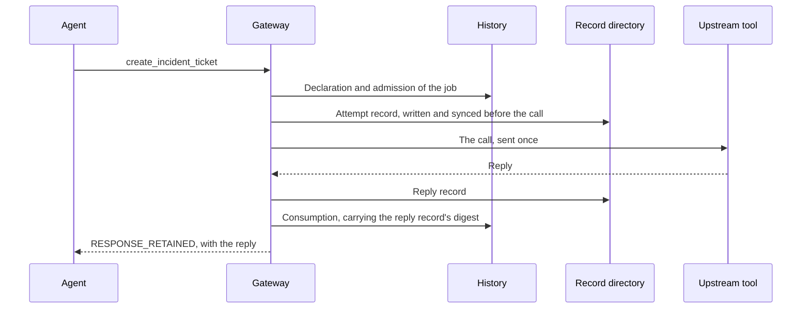
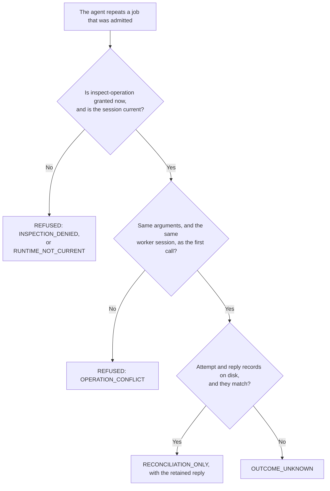

# Finding out what happened without doing it twice

An agent asks for a ticket and loses its connection. Was the ticket created? Sending the job again might create a second one. Exactly-once mode is built for this question: the gateway answers it from what it kept, and it never sends the same job a second time.

## What the gateway keeps

For every admitted job the gateway retains, in `storage`, an attempt record (written before the upstream is called) and, once the reply arrives, a reply record whose digest is also recorded in the history as the acknowledgment of the admission. The history holds the declaration, the admission and the consumption; the record directory holds the bytes. With the job's admission in the history, a matching attempt and reply record give back the retained reply (`RESPONSE_RETAINED` from `irontrellis_status`, `RECONCILIATION_ONLY` on a repeat), and `canonicalResponseRecorded` says whether the history also holds the consumption. An attempt record without a matching reply record answers `OUTCOME_UNKNOWN`.

A crash can interrupt this sequence anywhere. Whatever survives on disk decides what a repeat answers.

## Reading a repeat

None of these answers sends anything to the upstream. (Under the host API's anchoring barrier, a later run of an admitted job that has no attempt record may still dispatch it once; see [LIVE-ANCHORING](LIVE-ANCHORING.md).) In detail:

| Situation | Repeat of the same job answers | What to do |
|---|---|---|
| Reply retained | `RECONCILIATION_ONLY` with `upstreamResult` | Read `upstreamResult.isError`. The reply is the upstream's word, not proof of the business outcome. |
| Upstream crashed, timed out, replied with unsupported content, or the reply record could not be written | `OUTCOME_UNKNOWN` (`canonicalDisposition: OUTCOME_UNKNOWN`) | Investigate at the upstream. The gateway will not send the job again under any retry, restart or renamed alias. Do not create a new business key to "retry": that is a second operation. |
| Gateway process killed after the upstream acted | `OUTCOME_UNKNOWN` after `recover-dead-host` and restart | Same. The attempt record shows that dispatch started, so the gateway never sends the job again; it does not show that the upstream received it. |
| Reply arrived after the worker was retired | `RESPONSE_RETAINED` for the call in flight, `canonicalDisposition: OUTCOME_UNKNOWN`; the acknowledgment is not recorded | The reply is host-held evidence, not a recorded outcome. A separately authorized replacement can inspect it with `irontrellis_status`. |
| Arguments changed, or the job repeated under a new worker session | `REFUSED`, `OPERATION_CONFLICT` | A job is bound to its first declaration, which names the session that made it. A successor inspects it with `irontrellis_status`. |
| Grant revoked after admission | `RECONCILIATION_ONLY` still answers if `inspect-operation` is granted; `INSPECTION_DENIED` otherwise | Inspection is a separate permission from execution and can be granted to a successor without the original action. |

## Asking without repeating

The `irontrellis_status { job }` tool inspects the job's retained state without contacting the upstream. It needs current inspection permission (`INSPECTION_DENIED` otherwise).

| Answer | What the gateway holds |
| --- | --- |
| `NOT_STARTED` | No declaration of the job |
| `NOT_ADMITTED` | A declaration, but no admission |
| `NOT_DISPATCHED` | An admission, but no attempt record: nothing was sent |
| `RESPONSE_RETAINED` | An attempt record and a reply record that verifies; `responseDigest` and `reportedError` describe the reply, and `canonicalResponseRecorded` says whether the history recorded it as the outcome |
| `OUTCOME_UNKNOWN` | An attempt record without a reply record that verifies |

Under the host API's anchoring barrier, an admitted job with no attempt record can also answer `DELAYED`; see [LIVE-ANCHORING](LIVE-ANCHORING.md).

## Per-call mode

Per-call mode forwards on every call and retains nothing unless `recordCalls: true`, in which case each call is its own admitted intent (`mcp-call:…`) with attempt and reply records, but there is no reconciliation: a repeat is a new call. A lost reply in per-call mode is the model's problem to handle, as with any ordinary MCP tool; choose exactly-once mode for effects that must not be repeated.

## Cooperating services

For upstreams that implement the cooperative remote contract, the separate `/cooperative` subpath (`createCooperativeGateway`) adds three verbs over a pinned destination: `recover` asks the service for its signed report about the original attempt, `cancel` sends one separately admitted cancellation (it needs its own `cancel-operation` permission and does not undo an effect), and `observe` records a verified report of an applied operation in the history. `/tasks` serves that work through the MCP Tasks extension over the `/http` entrances (see the [README](../README.md#public-imports)). The `irontrellis-mcp-gateway` command serves neither: the record-based recovery above is what it provides. Revocation cannot undo an already sent request, and a retained late reply is not an independently attested outcome.

*Last reviewed: 24 October 2026. This page is revisited at each release.*
